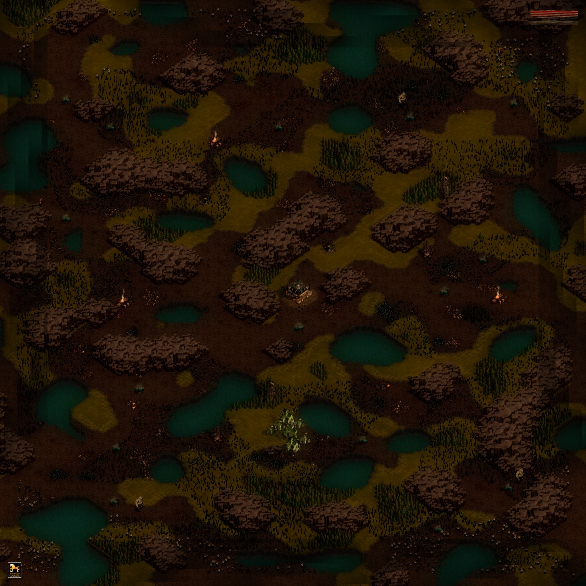
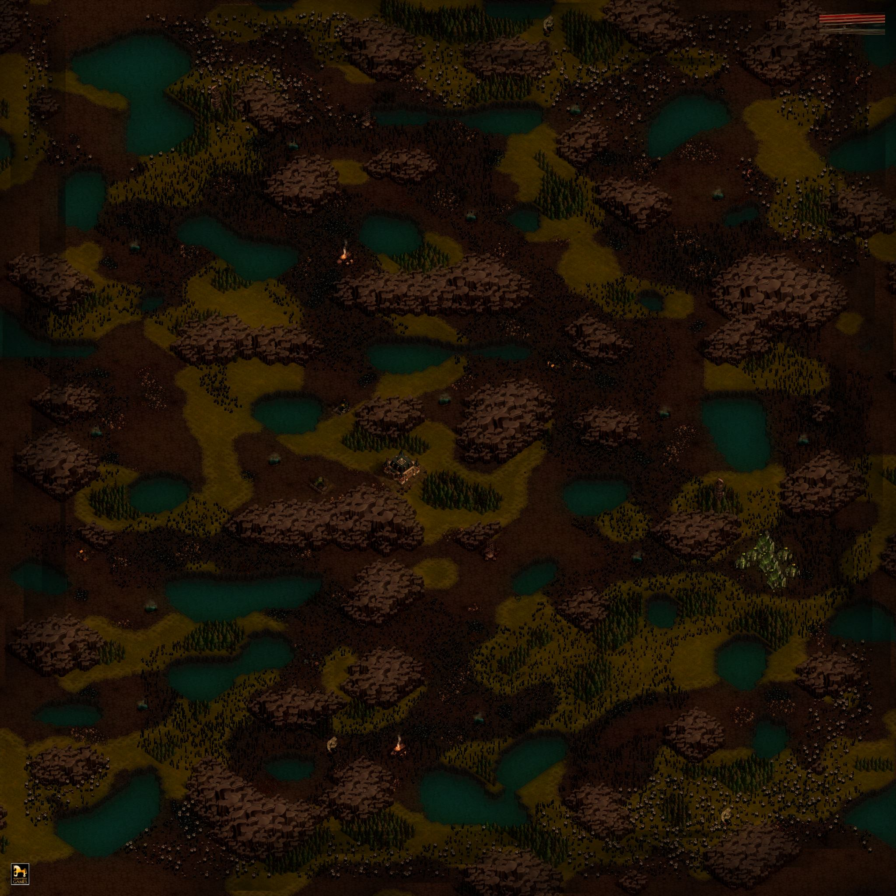
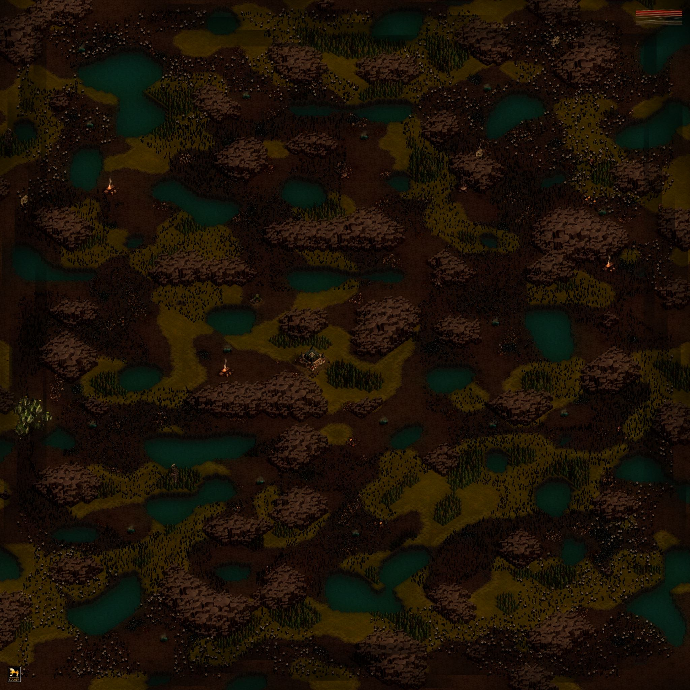
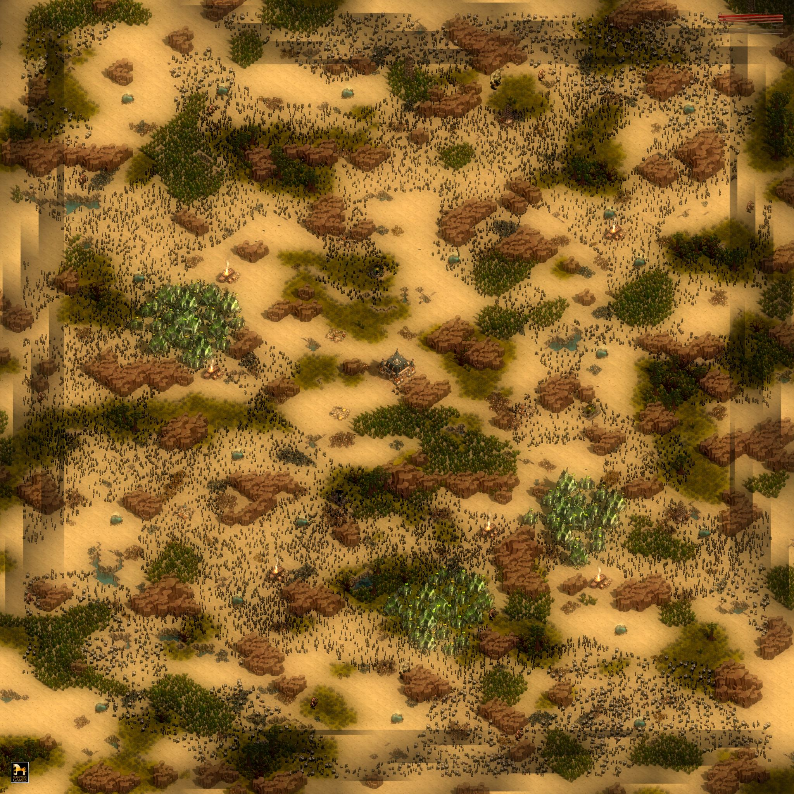
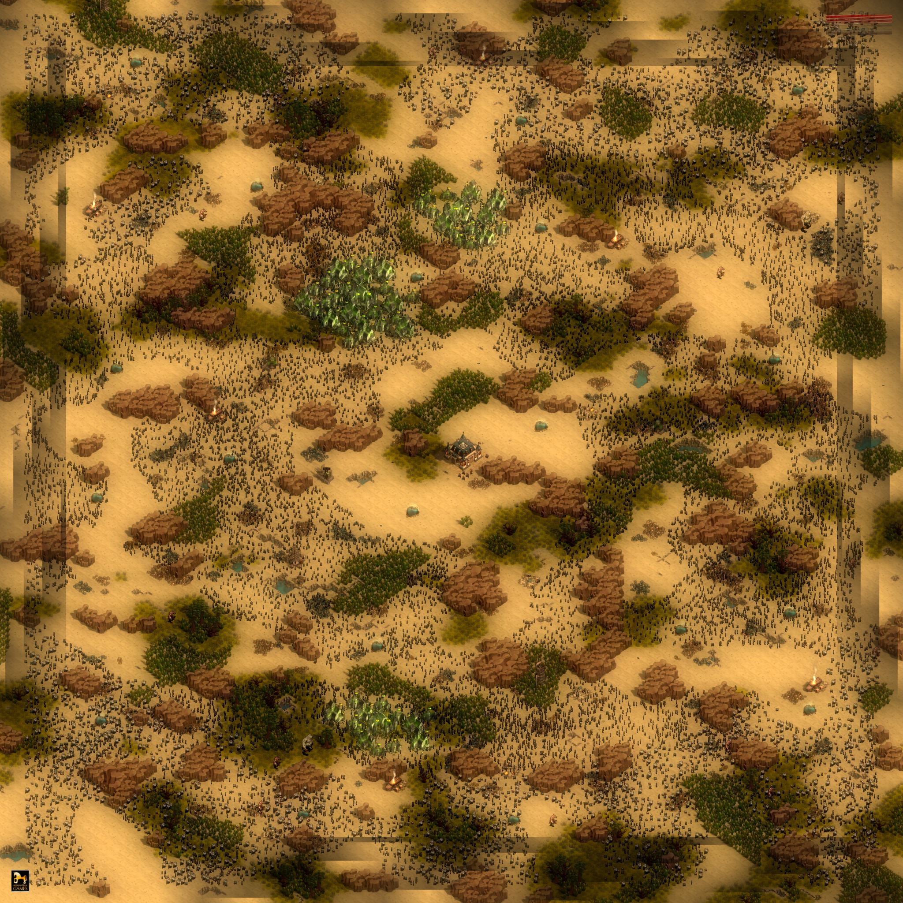
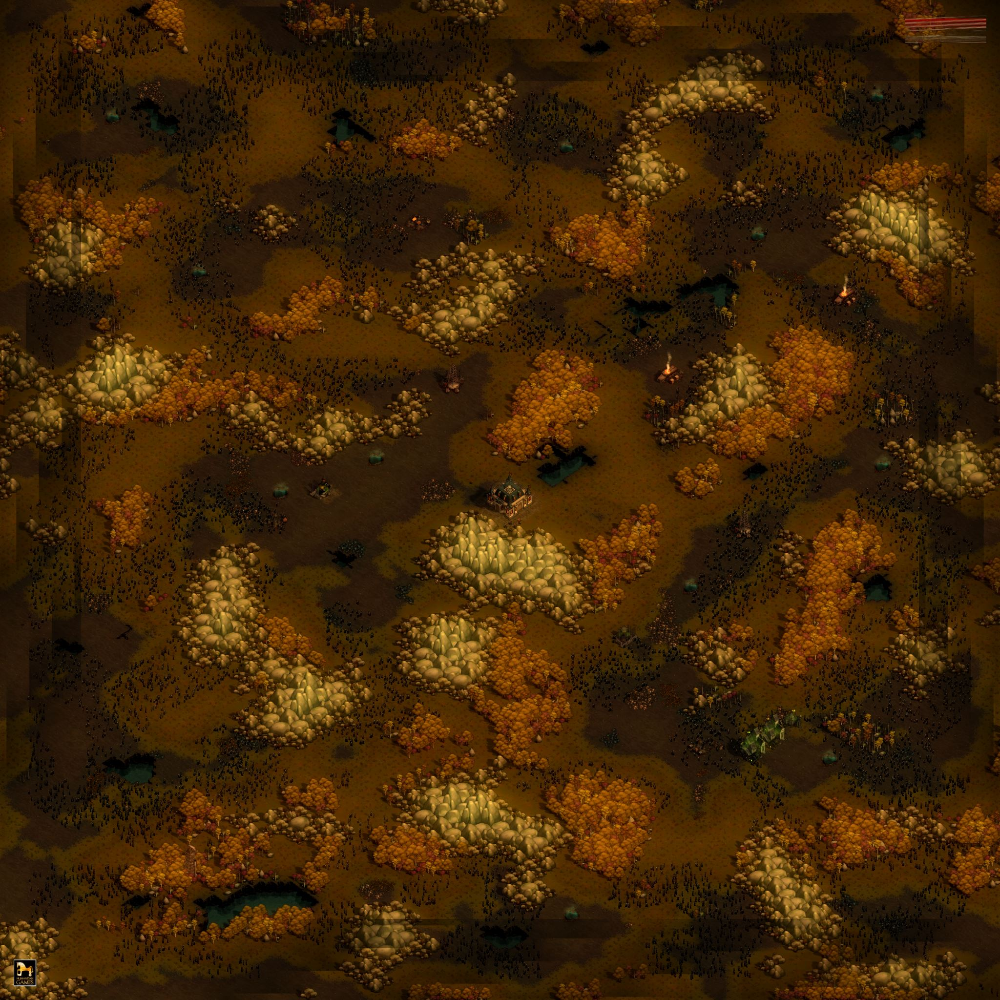
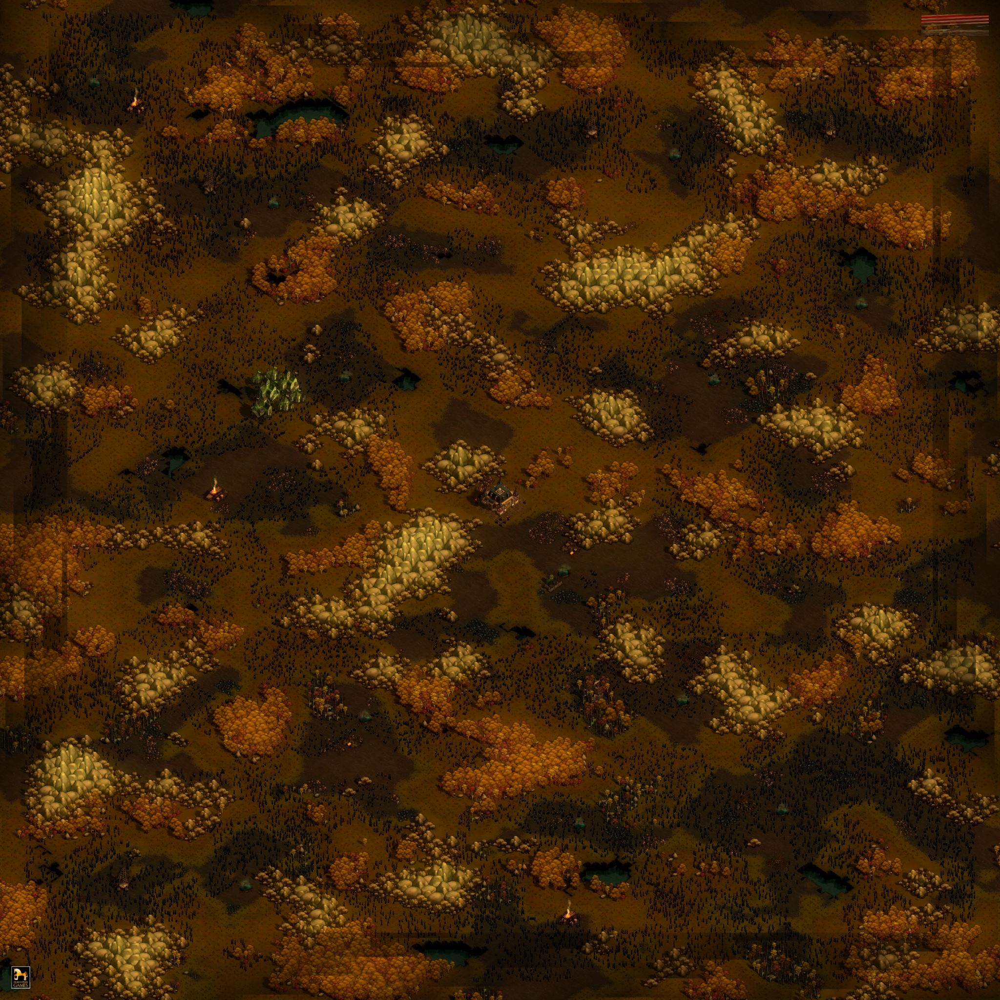
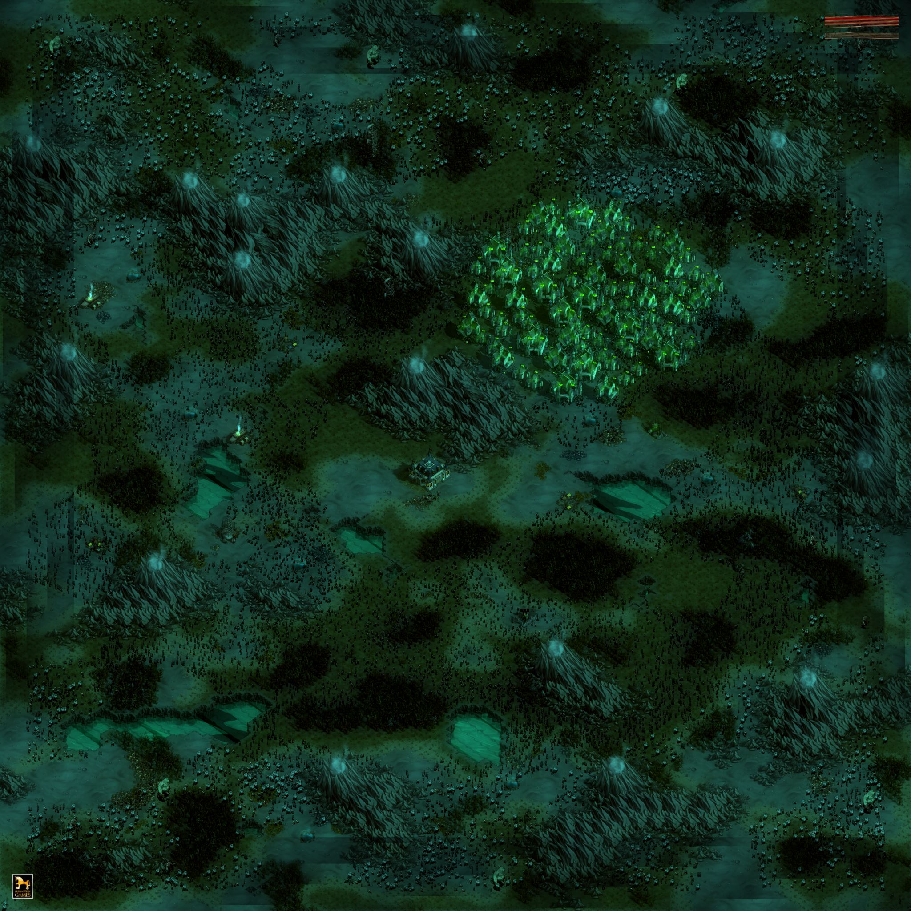

# TABCoopMod — 《亿万僵尸》(They Are Billions) 2~3 人 Steam P2P 合作联机 Mod

`TABCoopMod` 是为即时战略游戏《亿万僵尸》（They Are Billions, Steam x64 v1.0.14.29）打造的无服务器合作联机 Mod。通过 `.NET AppDomainManager` 运行时注入与 HarmonyX 内存补丁（不修改游戏 exe/dll 磁盘字节），支持 **2~3 名玩家** 基于 Steam P2P 大厅共同游玩生存模式、战役与自定义地图。

---

## 核心特性

### 执政官共控模式（Archon Mode，当前默认玩法）
- **同阵营共控，操作完全独立**：2~3 名玩家共同管理同一个人类基地、共享资源与科技，但每位玩家拥有**完全独立的摄像机视角、鼠标框选、1~8 编队与建造上下文**（局内重同步亦自动保留各自本地编队）。
- **传统 RTS 等候大厅与混合直连加速**：
  - 主菜单内置【多人合作模式】（快捷键 `K`），支持 Steam 好友房创建/邀请自动加入，以及 `127.0.0.1:27099` 本地双开测试（内置本地 `Chaos` 网络波动模拟面板）；
  - Steam 大厅接头后自动尝试局域网/虚拟组网/公网 IPv6/UPnP/STUN **双栈 UDP 直连升级（`DirectFastPath`）** 并在大厅顶部实时显示链路与 RTT；受限网络自动无损回落隔离后的 Steam 3 通道保底；
  - 支持双端 Mod 版本一致性校验告警、退房槽位复用、客机准备门控、房主复用原版【读取存档 / 新建生存游戏 / 自定义地图】界面及重返大厅功能。
- **协同交互体验**：
  - 小地图实时渲染队友彩色视野框（P1 蓝 / P2 绿 / P3 橙）。
  - `Alt + 左键` 地面与小地图同步战术信号打点（Ping）。
  - 读取原版游戏暂停快捷键设置（支持 `Standard`/`WASD`/`Custom`）或点击右上角按钮同步冻结暂停（支持暂停期间微操），恢复时显示 3 秒顶居中倒计时。
  - 本地建造幽灵占位框、资源预扣防透支与 0ms 单位语音即时确认。
  - 市长同池抽样、按 ID 确定性同步（含赠送单位取出与奖励建筑次数核销），选定后对端自动关闭弹窗杜绝重复领奖；胜负结算同步弹出与退局清理。
- **多人新生存局均衡预设**：房主可在大厅切换【联机均衡】与【原版】预设，针对 2P/3P 自动扩展生存地图尺寸（`280` / `304` 格）、初始巡逻兵力与指挥中心工人，并修正非 2 的幂次地图尺寸下的感染村镇/遗迹生成边界。
- **确定性同步、反压与自愈**：30Hz 锁步 `StateHasher` v3 均摊校验、慢机主机反压流控、控制权反向差分对齐与 `Auto-resync` 自动快照重建恢复。

> 远期规划（Phase 4）：独立基地模式（多指挥中心生成、独立资源账本与单位所有权隔离）。

---

## 多人新生存局平衡性对比展示（4 场景同种子全景）

开启【联机均衡】预设后，模组会针对 2P / 3P 协同扩张效率自动扩图（`256 → 280 / 304`）、补充初始兵力与工人、按面积配平资源/游荡僵尸与波次强度，并修正非 2 的幂次地图尺寸下的感染村镇生成边界。

- **交互式全景对比报告**：[`reports/panorama_comparison.html`](reports/panorama_comparison.html)（下载或本地打开可缩放对比同种子全图与各项数值）
- **定量指标数据（JSON）**：[`reports/panorama_metrics.json`](reports/panorama_metrics.json)

| 场景 (`Seed`) | 档位 (`NCells` / 可玩宽) | 初始单位与额外工人 | 游荡僵尸总量 | 感染村镇建筑 | 巨人 / 变异体 |
| :--- | :--- | :---: | :---: | :---: | :---: |
| **BR 100% 暗黑荒原** (`202601`) | Vanilla `256` (`148`) | `4R + 1S` (`+0W`) | `5,198` | `7` | `1 / 1` |
| **BR 100% 暗黑荒原** (`202601`) | **2P `280` (`164`)** / **3P `304` (`178`)** | `6R + 1S` (`+2W`) / `6R + 2S` (`+3W, +1F`) | `9,849` / `11,485` | `7` / `7` | `1/1` / `1/1` |
| **DS 120% 干旱高地** (`202602`) | Vanilla `256` vs **2P `280`** | `4R + 1S` → `6R + 1S` (`+2W`) | `13,067` → `17,370` | `64` → `55` | `2/6` → `2/8` |
| **FA 120% 寒冰荒原** (`202603`) | Vanilla `256` vs **3P `304`** | `4R + 1S` → `6R + 2S` (`+3W, +1F`) | `9,769` → `17,448` | `3` → `7` | `0/0` → `0/0` |
| **VO 900% 剧毒荒原** (`202604`) | Vanilla `256` vs **2P `280`** / **3P `304`** | `6R + 1S` (`+2W`) / `6R + 2S` (`+3W, +1F`) | `15,652` → `22,295` / `25,952` | `81` → `95` / `115` | `6/12` → `6/15` / `9/18` |

<details>
<summary>展开查看 4 场景同种子全景对比图（Vanilla vs 2P / 3P）</summary>

### BR 100% Standard Survival (`Seed 202601`)
| Vanilla (`256`) | Co-op 2P (`280`) | Co-op 3P (`304`) |
| :---: | :---: | :---: |
|  |  |  |

### DS 120% Arid Highlands (`Seed 202602`)
| Vanilla (`256`) | Co-op 2P (`280`) |
| :---: | :---: |
|  |  |

### FA 120% Frozen Tundra (`Seed 202603`)
| Vanilla (`256`) | Co-op 3P (`304`) |
| :---: | :---: |
|  |  |

### VO 900% Caustic Nightmare (`Seed 202604`)
| Vanilla (`256`) | Co-op 2P (`280`) | Co-op 3P (`304`) |
| :---: | :---: | :---: |
|  |  |  |

</details>

---

## 玩家安装与联机指南

### 前置要求
- Steam 正版《They Are Billions》（**64 位版本 `TheyAreBillions.exe` v1.0.14.29**）
- 联机所有玩家需安装**完全相同的 Mod 版本**

### 安装步骤
1. 完全关闭游戏。
2. 在 Steam 中右键《They Are Billions》→ **管理** → **浏览本地文件**，打开游戏根目录。
3. **备份**游戏根目录中原有的 `TheyAreBillions.exe.config`（例如重命名为 `TheyAreBillions.exe.config.bak`）。
4. 将发行压缩包（如 `TABCoopMod-v0.1.7.zip`）中的所有文件**直接解压到游戏根目录**，提示替换 `TheyAreBillions.exe.config` 时选择覆盖。
5. 通过 Steam 正常启动游戏，主菜单出现【多人合作模式】即安装成功。

### 卸载步骤
1. 关闭游戏，删除根目录下的 `TABCoopMod.dll`、`TABCoopMod.pdb`、`0Harmony.dll`、`steam_appid.txt`、`TABCoopMod.log`、`TABCoopMod_Logs\` 目录与 `TABCoopMod_使用说明.txt`。
2. 还原之前备份的 `TheyAreBillions.exe.config.bak`（或通过 Steam “验证游戏文件的完整性”恢复原版配置）。

---

## 开发者构建与源码结构

### 环境要求
- Windows x64 + PowerShell
- .NET SDK（推荐 .NET 8/10 SDK，主 Mod 目标框架为 `net46` / `x64`，MCP 测试服务端为 `net10.0`）
- 本机已安装 Steam 版《They Are Billions》

### 初始化 SDK 引用与构建部署

```powershell
# 1. 首次克隆后，从本机游戏主程序导出编译期只读引用库到 lib/（不会修改游戏文件）
powershell -NoProfile -ExecutionPolicy Bypass -File scripts/extract_sdk.ps1

# 2. 构建 Release 版本 Mod
dotnet build src/TABCoopMod/TABCoopMod.csproj -c Release

# 3. 打包面向玩家的纯解压发行压缩包（输出至 dist/）
powershell -NoProfile -ExecutionPolicy Bypass -File scripts/package_release.ps1

# （可选）开发机快速部署/卸载到本机游戏目录（部署前请确保游戏已关闭）
powershell -NoProfile -ExecutionPolicy Bypass -File scripts/install_mod.ps1
powershell -NoProfile -ExecutionPolicy Bypass -File scripts/uninstall_mod.ps1
```

> 脚本默认自动从 Steam 注册表与 `libraryfolders.vdf` 探测游戏安装路径，也可显式传入 `-GameDir "<路径>"` 或设置环境变量 `$env:TAB_GAME_DIR`。

### 目录结构

```text
TABCoopMod/
├── README.md                           # 项目简介、玩家安装与开发构建指南
├── docs/                               # 工程规范、架构设计、协议与验收报告
├── scripts/                            # SDK 提取、构建部署、打包与双开回归测试脚本
├── lib/                                # 本地提取的只读引用程序集（由 extract_sdk.ps1 生成，已 gitignore）
└── src/
    ├── TABCoopMod/                     # Mod 主工程 (.NET Framework 4.6, x64)
    └── TABCoopMod.Mcp/                 # 独立自动化控制/MCP stdio 服务端 (.NET 10)
```

---

## 技术文档索引

| 文档 | 内容说明 |
| :--- | :--- |
| [`docs/00_DEV_GUIDE.md`](docs/00_DEV_GUIDE.md) | 工程铁律、CLR / HarmonyX 踩坑手册与工具链规范 |
| [`docs/01_PRD_AND_GAMEPLAY.md`](docs/01_PRD_AND_GAMEPLAY.md) | 执政官模式玩法设计、状态划分与协同规则 |
| [`docs/02_ARCHITECTURE_DESIGN.md`](docs/02_ARCHITECTURE_DESIGN.md) | 注入机制、确定性沙盒、指令回放与内存快照流 |
| [`docs/03_REVERSE_ENGINEERING_MAP.md`](docs/03_REVERSE_ENGINEERING_MAP.md) | 逆向符号映射表与原生引擎行为说明 |
| [`docs/04_NETWORK_PROTOCOL.md`](docs/04_NETWORK_PROTOCOL.md) | 传输抽象、`DirectFastPath` UDP 升级、包头协议、`NetCommand` 与 `StateHasher` v3 |
| [`docs/05_DEVELOPMENT_ROADMAP.md`](docs/05_DEVELOPMENT_ROADMAP.md) | 分阶段里程碑与源码交付物清单 |
| [`docs/06_PROJECT_STATUS.md`](docs/06_PROJECT_STATUS.md) | 版本演进总览、当前门禁实测状态与下一步待办 |
| [`docs/07_TESTING_AND_MCP.md`](docs/07_TESTING_AND_MCP.md) | 自动化回放验证、Chaos 故障注入、异构算力测试与控制通道指南 |
| [`docs/08_RTS_SYNC_COMPARISON_AND_FUTURE_OPTIMIZATIONS.md`](docs/08_RTS_SYNC_COMPARISON_AND_FUTURE_OPTIMIZATIONS.md) | 经典 RTS 同步机制对比与后续优化评估 |
| [`docs/09_MULTIPLAYER_BALANCE_DESIGN.md`](docs/09_MULTIPLAYER_BALANCE_DESIGN.md) | 多人执政官生存新局平衡性设计与数值模型 |
| [`docs/10_STEAM_P2P_TEST_ANALYSIS_AND_OPTIMIZATION_PLAN.md`](docs/10_STEAM_P2P_TEST_ANALYSIS_AND_OPTIMIZATION_PLAN.md) | Steam P2P 跨机实测分析与四阶段优化方案（含落地回溯） |
| [`docs/11_SYNC_OWNERSHIP_AND_VISUAL_SMOOTHING.md`](docs/11_SYNC_OWNERSHIP_AND_VISUAL_SMOOTHING.md) | 控制权差分对齐与单位移动全场景视觉插值平滑方案 |
| [`docs/12_STEAM_P2P_BUGS_AND_FIXES_20261116.md`](docs/12_STEAM_P2P_BUGS_AND_FIXES_20261116.md) | Steam P2P 实测 Bug 排查与修复记录（`v0.1.2` / `v0.1.3`） |
| [`docs/archive/`](docs/archive/SESSION_CHANGELOG_S1_TO_S6.md) | 早期深度根因复盘与会话 1~6 历史演进日志 |
