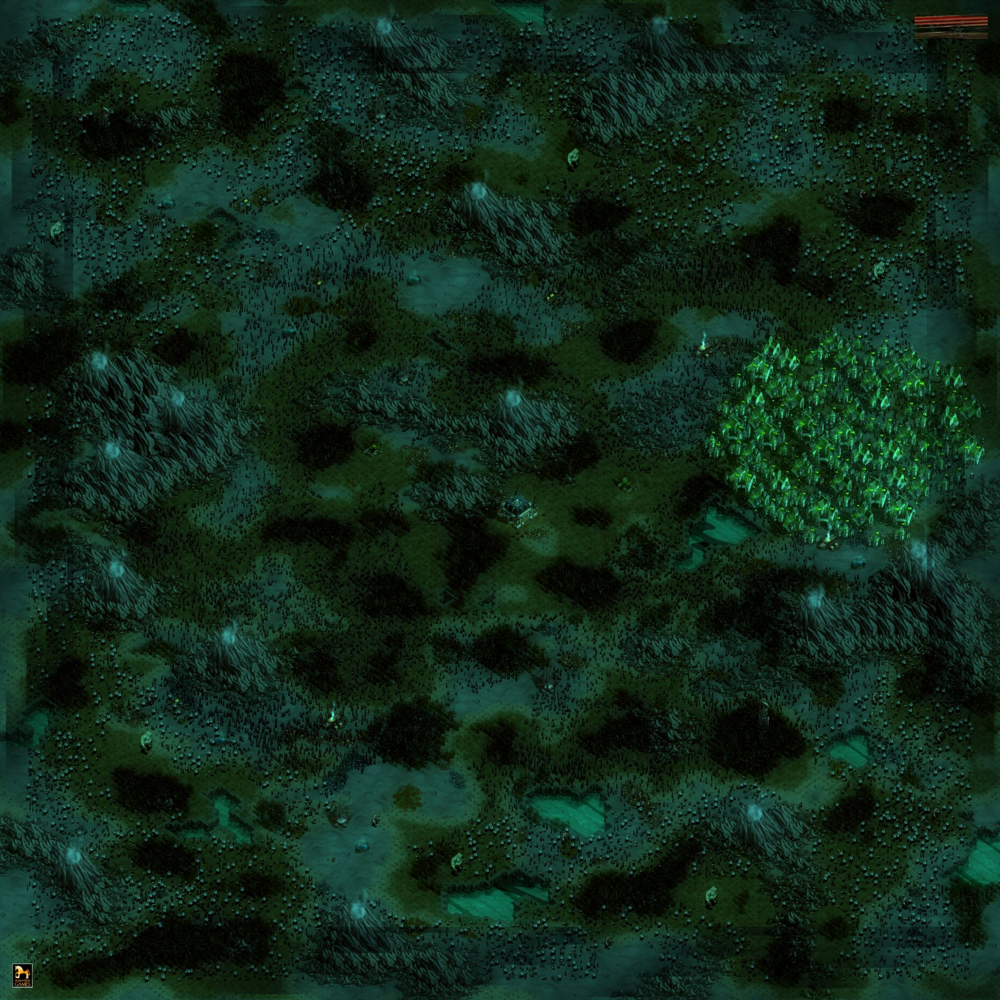
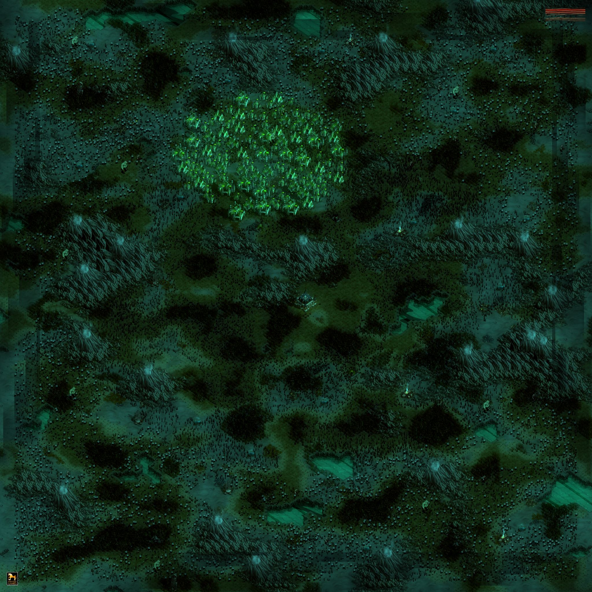
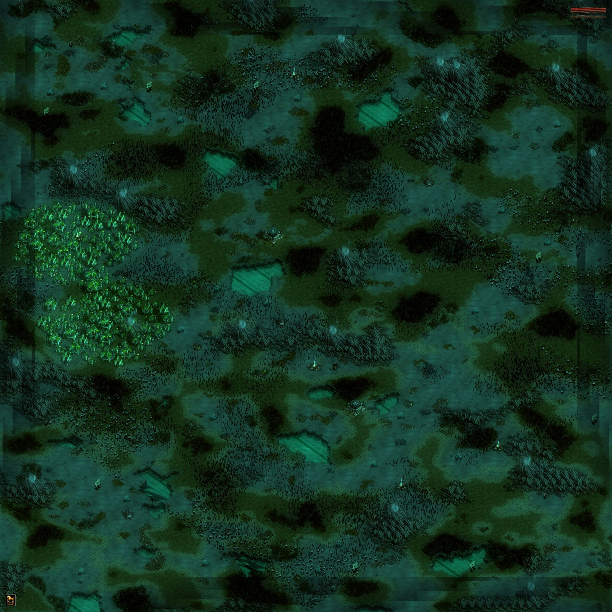
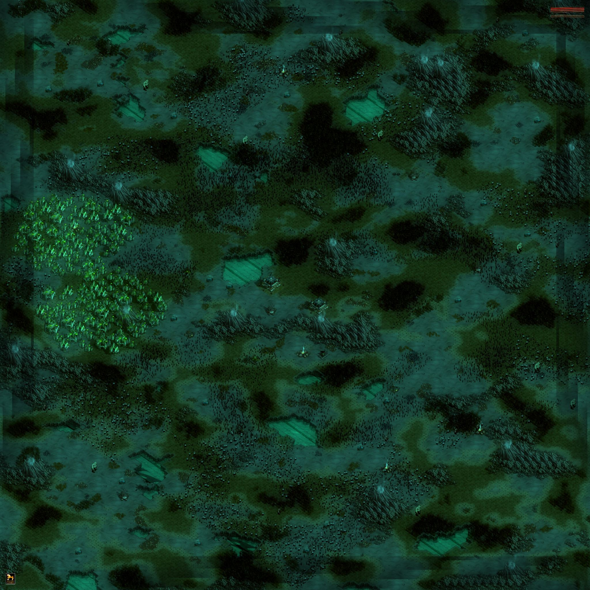
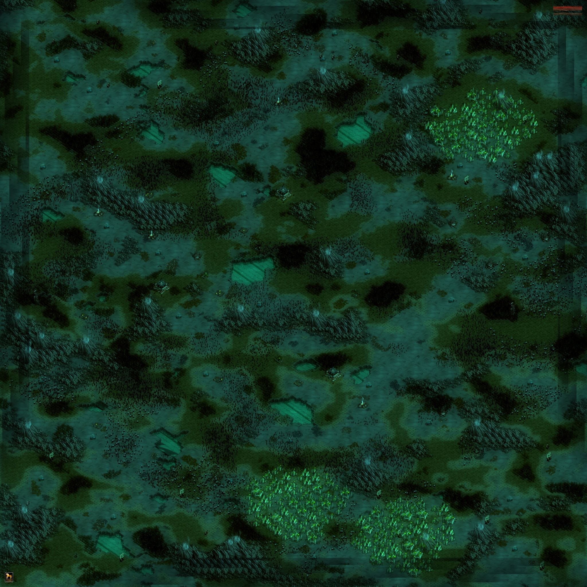
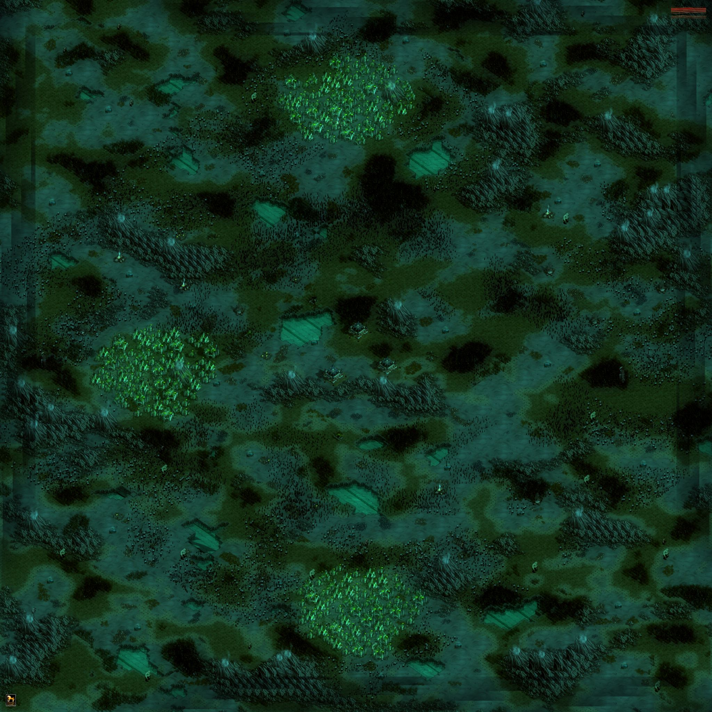

# TABCoopMod — 《亿万僵尸》(They Are Billions) 2~3 人 Steam P2P 合作联机 Mod

`TABCoopMod` 是为《亿万僵尸》（They Are Billions，Steam x64 v1.0.14.29）打造的无服务器合作联机 Mod。无需专用服务器，也**不会修改游戏本体 exe/dll 文件**，支持 **2~3 名玩家**通过 Steam P2P 共同游玩生存模式、战役与自定义地图，并提供**执政官共控**与**独立基地（多阵营）**两种合作玩法。

---

## 两种合作模式

房主可在联机大厅中自由切换玩法模式：

### 1. 执政官共控模式（Archon Mode）
- **同阵营协同，操作互不干扰**：2~3 名玩家共同管理同一个人类基地、共享资源与科技，但每位玩家拥有**完全独立的镜头视角、鼠标框选、1~8 编队与建造操作**（局内断线重同步后也会自动保留各自本地编队）。
- **适合场景**：分工运营与多线操作（一人管基建扩张、一人管部队清图与守线），也完全支持游玩原版战役、自定义地图及既有存档。

### 2. 独立基地模式（Multi-Faction Mode，v0.2.0 新增）
- **各自建城，独立经济与科技**：每位玩家拥有**各自的指挥中心、独立资源账本与科技树**，单位与建筑按玩家归属隔离，并在单位脚底渲染阵营色环、在小地图上按阵营着色区分（P1 蓝 / P2 绿 / P3 橙）。
- **多人专属大图与双出生模式**：
  - 新开生存局自动扩大地图尺寸（2 人 `360×360`，3 人 `416×416`）并保证基地间连通路径；
  - 房主可在大厅切换 **分离出生（Separated）**（各自独立区域发展再会师）或 **聚集出生（Clustered）**（近距离紧邻协同开局）。
- **多基地独立动态刷怪与生态升格**（完全遵循原版动态噪声规则，对每个玩家基地独立生效）：
  - **原版同款软减噪安全圈**：每个基地仅对指挥中心周围约 `6` 格硬清空，并在各生态原版 `MinDistanceForWeakInfected` 半径内分别执行 `-0.5` 软减噪，不同难度与生态的开局压迫感与原版保持一致；
  - **多中心渐进升格与生态倾向**：以各格子到最近基地的距离套用原版 `Medium / Strong / Powerful` 阶位门槛；外圈高阶特感（胖子/毒液/鹰身女妖）按随机种子呈现 **均衡（Balanced）/ 重甲（HeavyArmor）/ 酸蚀（Caustic）/ 猎群（SwarmHunter）** 四种变异倾向之一，并在 `>= 85` 格最外围按每 `30` 名高阶特感凝聚额外**巨人**镇守（原有巨人/变异体与原版一致外推至 `>= 70` / `>= 64` 格）。
- **多路协同尸潮与后期浓缩**：Wave 1~2 从各玩家外侧方向独立刷出，Wave 3 起按 `75% 分流 / 20% 两路合流 / 5% 全合流` 进攻；后期常规波次单路超过 `850` 只、最终波次超过 `1400` 只时，溢出低阶僵尸会自动浓缩为精英特感（最终波次额外折算巨人），兼顾高强度压迫感与联机帧率。
- **奇观众筹与资源贸易（按 `F7` 打开协作面板）**：
  - **奇观众筹**：泰坦之塔等大型功能奇观支持多人两阶段众筹共建（研究 + 建造），`The Spire` 等奇观建成后可为全队提供共享能源支持；
  - **资源互助**：支持玩家间市场转账支援（默认 20% 税率，局内有概率抽到“零税率贸易”专属市长）。
- **两种战败规则（大厅可切换）**：
  - **流亡交接（AllBasesLost）**：某位玩家最后一座指挥中心沦陷后，其剩余单位与建筑将转交存活队友接管继续战斗，全队基地失守才判负；
  - **一损俱损（AnyBaseLost）**：任意一位玩家的指挥中心失守即全队战败。

---

## 联机大厅与游戏内特性

- **主菜单直接开房**：主菜单新增【多人合作模式】入口（快捷键 `K`），支持 Steam 好友邀请直接入房，也支持 `127.0.0.1:27099` 本地双开测试。
- **自动直连加速 + Steam 保底**：进入大厅后自动尝试局域网/虚拟组网/IPv6/UPnP/STUN UDP 直连以降低操作延迟，大厅顶部实时显示当前链路与延迟；网络受限时自动无缝回落到 Steam P2P 通道。
- **版本校验与准备门控**：联机双方 Mod 版本不一致时自动弹出告警提示；所有客机点击准备后房主即可使用原版【新建生存游戏 / 读取存档 / 自定义地图】界面开局，也支持全队重返大厅。
- **战局协同体验**：
  - 小地图实时显示队友的彩色视野框；
  - **`Alt + 左键`** 可在地面与小地图同步发送战术信号标记（Ping）；
  - 跟随玩家在游戏设置中自定义的**原版暂停快捷键**（`Standard` / `WASD` / `Custom`）或点击右上角按钮同步暂停（暂停期间可下达指令，恢复时显示 3 秒顶居中倒计时）；
  - 建造时提供本地幽灵占位框与资源预扣提示，单位下令提供即时语音反馈；
  - **市长同步**：相同游戏阶段抽取同一市长池，任一玩家选定后对端自动关闭弹窗并同步发放奖励（支持赠送单位取出与奖励建筑次数核销），不会重复或漏领；
  - 支持在局内胜负结算后全队同步退出并返回大厅。
- **多人新生存局【联机均衡】预设**：房主可在大厅切换【联机均衡】或【原版】预设，针对多人扩张速度自动调整地图大小、初始兵力与工人数量，并按面积均衡野怪与波次强度。

---

## 两种模式交互式全景对比展示（以 900% 剧毒/酸蚀荒原为例）

为了直观对比多人扩图与刷怪平衡效果，仓库内置了两套**交互式全景对比报告**（下载仓库或本地打开 HTML 可缩放查看全图与各项统计）：

- **执政官共控模式（Archon）全景报告**：[`reports/panorama_comparison.html`](reports/panorama_comparison.html) ｜ 指标数据：[`reports/panorama_metrics.json`](reports/panorama_metrics.json)
- **独立基地模式（Multi-Faction）全景报告**：[`reports/multifaction_m4_panorama_report.html`](reports/multifaction_m4_panorama_report.html) ｜ 指标数据：[`reports/multifaction_m4_panorama_metrics.json`](reports/multifaction_m4_panorama_metrics.json)

### 1. 执政官共控模式 — VO 900% 剧毒荒原（`Seed 202604`，原版 vs 2P / 3P）

| 档位 (`NCells` / 可玩宽) | 初始单位与额外工人 | 游荡僵尸总量 | 感染村镇建筑 | 巨人 / 变异体 |
| :--- | :---: | :---: | :---: | :---: |
| **原版 Vanilla** `256` (`148`) | `4R + 1S` (`+0W`) | `15,652` | `81` | `6 / 12` |
| **执政官 2P** `280` (`164`) | `6R + 1S` (`+2W`) | `22,295` | `95` | `6 / 15` |
| **执政官 3P** `304` (`178`) | `6R + 2S` (`+3W, +1F`) | `25,952` | `115` | `9 / 18` |

| Vanilla (`256`) | Archon 2P (`280`) | Archon 3P (`304`) |
| :---: | :---: | :---: |
|  |  |  |

### 2. 独立基地模式 — VO 900% 酸蚀之地（`Seed 202661`, `Pop 1.5x / 80天`，2P / 3P × 分离 / 聚集出生）

> 地图扩至 `360`（2P）/ `416`（3P），全基地均通过连通性校验、独立应用原版动态噪声安全圈（本种子实测最近僵尸 `28` 格、最近城镇 `40.7~56.4` 格），前期波次从各玩家外侧独立刷出（`W1=E,W` / `E,W,N` / `E,S,N`）。

| 配置 (`NCells` / 可玩宽) | 出生间距 / 最近城镇 | 初始兵力（全队） | 游荡僵尸总量 | 感染村镇建筑 | 巨人 / 变异体 |
| :--- | :---: | :---: | :---: | :---: | :---: |
| **2P 分离出生** `360` (`210`) | `88.1` / `47.6` 格 | `8R + 2S` | `18,105` | `157` | `8 / 12` |
| **2P 聚集出生** `360` (`210`) | `20.4` / `40.7` 格 | `8R + 2S` | `18,759` | `157` | `8 / 12` |
| **3P 分离出生** `416` (`242`) | `74.1` / `56.4` 格 | `12R + 3S` | `22,423` | `237` | `13 / 15` |
| **3P 聚集出生** `416` (`242`) | `18.9` / `41.0` 格 | `12R + 3S` | `22,244` | `237` | `13 / 15` |

| Multi-Faction 2P 分离 (`360`) | Multi-Faction 2P 聚集 (`360`) | Multi-Faction 3P 分离 (`416`) | Multi-Faction 3P 聚集 (`416`) |
| :---: | :---: | :---: | :---: |
|  |  |  |  |

---

## 玩家安装与使用指南

### 前置要求
- Steam 正版《They Are Billions》（**64 位版本 `TheyAreBillions.exe` v1.0.14.29**）
- 一起游玩的**所有玩家必须安装完全相同的 Mod 版本**

### 安装步骤
1. 完全关闭游戏。
2. 在 Steam 中右键《They Are Billions》→ **管理** → **浏览本地文件**，打开游戏根目录。
3. **备份**游戏根目录中原有的 `TheyAreBillions.exe.config`（例如重命名为 `TheyAreBillions.exe.config.bak`）。
4. 下载发行压缩包（如 `TABCoopMod-v0.2.1.zip`），将压缩包内的所有文件**直接解压到游戏根目录**，提示替换 `TheyAreBillions.exe.config` 时选择覆盖。
5. 通过 Steam 正常启动游戏，主菜单出现【多人合作模式】按钮即安装成功。

### 快速开黑流程
1. 主菜单点击【多人合作模式】（或按 `K`）。
2. **房主**：点击【创建房间】，在顶部选择模式（**执政官** / **独立基地**）、出生方式（分离/聚集）与战败规则（流亡交接/一损俱损），通过 Steam 邀请好友。
3. **客机**：接受 Steam 邀请或在房间列表加入后，点击【准备就绪】。
4. 全员准备后，房主点击【选择地图 / 开始游戏】，使用原版界面新开生存局、战役或读档即可同步进入战局。
5. 若使用**独立基地模式**，局内可随时按 **`F7`** 打开奇观众筹与资源贸易面板。

### 卸载步骤
1. 关闭游戏，删除游戏根目录下的 `TABCoopMod.dll`、`TABCoopMod.pdb`、`0Harmony.dll`、`steam_appid.txt`、`TABCoopMod.log`、`TABCoopMod_Logs\` 目录与 `TABCoopMod_使用说明.txt`。
2. 还原之前备份的 `TheyAreBillions.exe.config.bak`（或通过 Steam “验证游戏文件的完整性”恢复原版配置）。

---

## 开发者构建与文档索引

<details>
<summary>展开查看：源码构建命令、目录结构与技术文档</summary>

### 环境要求与构建命令
- Windows x64 + PowerShell + .NET SDK（Mod 目标框架 `net46` / `x64`，MCP 服务端 `net10.0`）+ 本机 Steam 版《They Are Billions》

```powershell
# 1. 首次克隆后，从本机游戏主程序导出编译期只读引用库到 lib/（不会修改游戏文件）
powershell -NoProfile -ExecutionPolicy Bypass -File scripts/extract_sdk.ps1

# 2. 构建 Release 版本 Mod
dotnet build src/TABCoopMod/TABCoopMod.csproj -c Release

# 3. 打包面向玩家的纯解压发行压缩包（输出至 dist/）
powershell -NoProfile -ExecutionPolicy Bypass -File scripts/package_release.ps1

# （可选）开发机部署/卸载到本机游戏目录（部署前请确保游戏已关闭）
powershell -NoProfile -ExecutionPolicy Bypass -File scripts/install_mod.ps1
powershell -NoProfile -ExecutionPolicy Bypass -File scripts/uninstall_mod.ps1
```

### 目录结构
```text
TABCoopMod/
├── README.md                           # 项目简介、玩法特性与玩家使用指南
├── docs/                               # 工程规范、架构设计、协议与验收报告
├── scripts/                            # SDK 提取、构建部署、打包与双开回归测试脚本
├── lib/                                # 本地提取的只读引用程序集（由 extract_sdk.ps1 生成，已 gitignore）
└── src/
    ├── TABCoopMod/                     # Mod 主工程 (.NET Framework 4.6, x64)
    └── TABCoopMod.Mcp/                 # 独立自动化控制/MCP stdio 服务端 (.NET 10)
```

### 技术文档索引
| 文档 | 内容说明 |
| :--- | :--- |
| [`docs/00_DEV_GUIDE.md`](docs/00_DEV_GUIDE.md) | 工程铁律、CLR / HarmonyX 踩坑手册与工具链规范 |
| [`docs/01_PRD_AND_GAMEPLAY.md`](docs/01_PRD_AND_GAMEPLAY.md) | 执政官模式玩法设计、状态划分与协同规则 |
| [`docs/02_ARCHITECTURE_DESIGN.md`](docs/02_ARCHITECTURE_DESIGN.md) | 注入机制、确定性沙盒、指令回放与内存快照流 |
| [`docs/03_REVERSE_ENGINEERING_MAP.md`](docs/03_REVERSE_ENGINEERING_MAP.md) | 逆向符号映射表与原生引擎行为说明 |
| [`docs/04_NETWORK_PROTOCOL.md`](docs/04_NETWORK_PROTOCOL.md) | 传输抽象、`DirectFastPath` UDP 升级、包头协议、`NetCommand` 与 `StateHasher` v3 |
| [`docs/05_DEVELOPMENT_ROADMAP.md`](docs/05_DEVELOPMENT_ROADMAP.md) | 分阶段里程碑与源码交付物清单 |
| [`docs/06_PROJECT_STATUS.md`](docs/06_PROJECT_STATUS.md) | 版本演进总览、当前门禁实测状态与下一步待办 |
| [`docs/07_TESTING_AND_MCP.md`](docs/07_TESTING_AND_MCP.md) | 自动化回放验证、Chaos 故障注入、异构算力测试与控制通道指南 |
| [`docs/08_RTS_SYNC_COMPARISON_AND_FUTURE_OPTIMIZATIONS.md`](docs/08_RTS_SYNC_COMPARISON_AND_FUTURE_OPTIMIZATIONS.md) | 经典 RTS 同步机制对比与后续优化评估 |
| [`docs/09_MULTIPLAYER_BALANCE_DESIGN.md`](docs/09_MULTIPLAYER_BALANCE_DESIGN.md) | 多人执政官生存新局平衡性设计与数值模型 |
| [`docs/10_STEAM_P2P_TEST_ANALYSIS_AND_OPTIMIZATION_PLAN.md`](docs/10_STEAM_P2P_TEST_ANALYSIS_AND_OPTIMIZATION_PLAN.md) | Steam P2P 跨机实测分析与四阶段优化方案 |
| [`docs/11_SYNC_OWNERSHIP_AND_VISUAL_SMOOTHING.md`](docs/11_SYNC_OWNERSHIP_AND_VISUAL_SMOOTHING.md) | 控制权差分对齐与单位移动全场景视觉插值平滑方案 |
| [`docs/12_STEAM_P2P_BUGS_AND_FIXES_20261116.md`](docs/12_STEAM_P2P_BUGS_AND_FIXES_20261116.md) | Steam P2P 实测 Bug 排查与修复记录（`v0.1.2` / `v0.1.3`） |
| [`docs/13_ASYNC_ALIGNMENT_AND_RESYNC_OPTIMIZATION_PLAN.md`](docs/13_ASYNC_ALIGNMENT_AND_RESYNC_OPTIMIZATION_PLAN.md) | 对齐重载频率优化、异步增量修补设计与视觉平滑规划 |
| [`docs/14_MULTI_FACTION_MODE_DESIGN_AND_ROADMAP.md`](docs/14_MULTI_FACTION_MODE_DESIGN_AND_ROADMAP.md) | 独立基地（多阵营）合作模式策划决策、技术架构与路线图 |
| [`docs/15_STEAM_P2P_BUGS_AND_FIX_PLAN_20261120.md`](docs/15_STEAM_P2P_BUGS_AND_FIX_PLAN_20261120.md) | Steam P2P 多阵营实测 Bug 排查与修复方案（`v0.2.1`：编队/A键/DirectFastPath/Proyectile） |
| [`docs/archive/`](docs/archive/SESSION_CHANGELOG_S1_TO_S6.md) | 早期深度根因复盘与会话 1~6 历史演进日志 |

</details>
