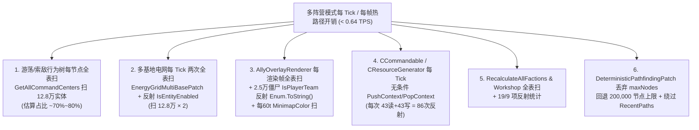
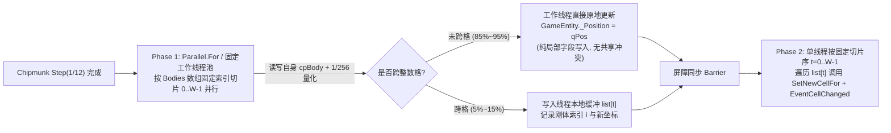

# 多阵营模式性能瓶颈根治、网络协议压缩与确定性多线程优化技术方案

**版本日期**：2026-11-22  
**适用版本**：`TABCoopMod v0.2.5+`（目标游戏：`They Are Billions v1.0.14.29`, `.NET Framework 4.6 x64`）  
**前置参考**：
- [`docs/08_RTS_SYNC_COMPARISON_AND_FUTURE_OPTIMIZATIONS.md`](08_RTS_SYNC_COMPARISON_AND_FUTURE_OPTIMIZATIONS.md)
- [`docs/14_MULTI_FACTION_MODE_DESIGN_AND_ROADMAP.md`](14_MULTI_FACTION_MODE_DESIGN_AND_ROADMAP.md)
- [`docs/16_ZOMBIE_PROMOTION_BTK_AND_DENSITY_OPTIMIZATION.md`](16_ZOMBIE_PROMOTION_BTK_AND_DENSITY_OPTIMIZATION.md)
- [`docs/17_STEAM_P2P_BUGS_AND_PERF_ANALYSIS_20261121.md`](17_STEAM_P2P_BUGS_AND_PERF_ANALYSIS_20261121.md)

---

## 目录

1. [实测日志对比与定量瓶颈分析](#1-实测日志对比与定量瓶颈分析)
2. [多阵营 vs 执政官模式专有交互热路径与 7 项根治方案](#2-多阵营-vs-执政官模式专有交互热路径与-7-项根治方案)
3. [网络交互包二进制结构压缩详细方案](#3-网络交互包二进制结构压缩详细方案)
4. [确定性多线程优化推进可行性与技术方案](#4-确定性多线程优化推进可行性与技术方案)
5. [分阶段实施路线图、风险控制与验收矩阵](#5-分阶段实施路线图风险控制与验收矩阵)

---

## 1. 实测日志对比与定量瓶颈分析

### 1.1 实测样本全景（`logs/0.2.5联机mod测试文件.zip`）

`logs/0.2.5联机mod测试文件.zip` 共收录 **2026-11-22 基于 `v0.2.5` 构建（`Classes OK=105, GameBridge 0 missing, verified=236`）** 的 **14 份主客机实机日志**（主机分辨率 `2560x1440, Unit=2.0`，客机 `1920x1080, Unit=1.5`），涵盖 **5 局执政官模式** 与 **2 局多阵营模式**；其中两组为**同一对进程在返回大厅后原地切换模式**（同硬件、同网络环境下零变量对照）：

| 对局编号 | 主/客机日志标识 | 模式与配置 | 地图 `NCells` / 快照体积 | 实体数（主 / 客）与物理刚体数 | 传输路径与 `directRtt` | `SessionStart -> Tick 1 MATCH` | 推进深度与 `TPS` / `[LatencyStats]` 实测 |
|---|---|---|---|---|---|---|---|
| **A1** | Host `145439_p10232`<br>Client `145428_p9788` | Archon (`players=2`) | `280` (`areaScale=1.20`)<br>`530,837 B` (17 chunks) | `83,273` / `52,725`<br>`16,755` 刚体 | `Direct LanIPv4`<br>`2.5~14.6 ms` | `0.88 s`<br>(`14:58:44.488 -> 45.370`) | 约 `82s` 推进至 `Tick 420~540`；客机 `[Perf]` `tick=299/539` 见下表 |
| **A2** | Host `150425_p3180`<br>Client `150419_p12716` | Archon (`players=2`) | `280`<br>`583,333 B` (18 chunks) | `83,232` / `54,440`<br>`18,809` 刚体 | `Direct LanIPv4`<br>`2.5~6.9 ms` | `0.93 s`<br>(`15:06:37.845 -> 38.777`) | 约 `50s` 至主动重开；客机 `[Perf]` `tick=119` 稳定输出 |
| **A3** | Host `151259_p13392`<br>Client `152226_p248` | Archon (`players=2`) | `280`<br>`554,657 B` (17 chunks) | `78,664` / `52,282`<br>`17,652` 刚体 | `Steam Relay` (NAT 端口跳变未直连)<br>`rtt=113~145 ms` | `1.15 s`（以 Host 为基准） | 约 `77s` 推进至 `Tick 600`；`[Perf]` `tick=119/419` 完整输出 |
| **A4** | Host `153826_p19608` 局1<br>Client `153852_p1060` 局1 | Archon (`players=2`) | `280`<br>`614,285 B` (19 chunks) | `86,831` / `57,334`<br>`20,013` 刚体 | `Direct VirtualLan`<br>`48.2~56.1 ms` | `1.03 s`<br>(`15:42:07.106 -> 08.136`) | 短跑 `21s` 至 `Tick 120+`；客机 `[Perf]` `tick=119` 正常触发 |
| **M1** | Host `153826_p19608` 局2<br>Client `153852_p1060` 局2 | **MultiFaction**<br>`Separated / Balanced` | `360` (`areaScale=1.98`)<br>`699,449 B` (22 chunks) | `125,098` / `80,790`<br>`23,373` 刚体 (`tracked=12`) | `Direct VirtualLan`<br>`49.1~79.1 ms` | **`2.92 s`**<br>(`15:43:52.037 -> 54.954`) | 持续 **55s**：**0 条 `[Perf]`、Tick 1 后 0 条 `[StateChecksum]`（未达 Tick 60/120）**；Host `clientLag=0t`、`cmdAvg=5625.2ms / 5534.1ms`（`delay=2t`） |
| **M2** | Host `154456_p19140` 局1<br>Client `154455_p5936` 局1 | **MultiFaction**<br>`Separated / HeavyArmor` | `360` (`areaScale=1.98`)<br>`744,964 B` (23 chunks) | `128,279` / `81,381`<br>`24,906` 刚体 (`tracked=12`) | `Direct VirtualLan`<br>`48.9~75.5 ms` | **`5.94 s`**<br>(`15:47:46.310 -> 52.246`) | 持续 **94s**：**0 条 `[Perf]`（`< 0.64 TPS`）、Tick 1 后 0 条 `[StateChecksum]`**；Host `clientLag=0t`、`cmdAvg=2823.6ms`（`delay=1t`） |
| **A5** | Host `154456_p19140` 局2<br>Client `154455_p5936` 局2 | Archon (`players=2`) | `280`<br>`587,039 B` (18 chunks) | `83,639` / `54,952`<br>`18,816` 刚体 | `Direct VirtualLan`<br>`48.3~75.5 ms` | **`0.335 s`**<br>(`15:50:30.891 -> 31.226`) | 约 `85.6s` 推进至 **`Tick 1080`（`~12.6 TPS`）**；客机 `[Perf]` `tick=92/572/1052` 全输出，Host 受客机反压 `clientLag=13t~15t` |

> **注**：同时参考先前 `docs/17_STEAM_P2P_BUGS_AND_PERF_ANALYSIS_20261121.md` 中的终极波次高压数据（`log7` 执政官最终波，实体 `10,309 -> 14,692`，`directRtt=5.7~6.1ms`，`logic=154~222ms`，`TPS=4.5~6.5`）。而本次实测的 **M1 / M2 多阵营开局第一天（仅有 `tracked=12` 个玩家归属实体）** 就比执政官终极尸潮还卡，充分证明瓶颈并非简单的地图面积增大。

### 1.2 执政官模式客机 `[Perf]` 分解实测基准

`LogPerfWindow` 每 60 Tick 采样一次；仅当 `DiagAvgTickLogicMs > 45.0` 时输出。以下为本次压缩包中实测的客机典型样本：

| 样本来源（均为 Archon） | `tick` | `frame` | `logic (wait)` | `phys (x/60t)` | `physFor2` | `quant (quantized/total)` | `pullSync (cnt/p)` | `movSync` | `path` | `coopTick` |
|---|---|---|---|---|---|---|---|---|---|---|
| A1 (`145428`) | `299` | `76.2 ms` | `49.3 (57.9)` | `39.5 (x25)` | `6.09 ms` | `10.08 ms (9422/15558)` | `2.80 ms (1078/p)` | `0.50 ms` | `0.12 ms` | `2.01 ms` |
| A1 (`145428`) | `539` | `77.8 ms` | `51.0 (55.3)` | `41.2 (x24)` | `6.17 ms` | `10.87 ms (10786/15558)` | `4.10 ms (1152/p)` | `0.60 ms` | `0.02 ms` | `2.01 ms` |
| A2 (`150419`) | `119` | `76.9 ms` | `50.0 (62.0)` | `42.3 (x25)` | `6.69 ms` | `10.24 ms (8498/17677)` | `2.87 ms (795/p)` | `0.28 ms` | `0.02 ms` | `2.24 ms` |
| A3 (`152226`) | `419` | `85.5 ms` | `53.0 (67.6)` | `50.7 (x24)` | `7.64 ms` | `13.55 ms (10905/16423)` | `3.92 ms (1262/p)` | `0.68 ms` | `3.08 ms` | `2.30 ms` |
| A4 (`153852`) | `119` | `75.5 ms` | `48.3 (60.3)` | `43.3 (x25)` | `6.87 ms` | `10.47 ms (8954/18819)` | `3.37 ms (760/p)` | `0.31 ms` | `0.03 ms` | `2.04 ms` |
| A5 (`154455`) | `92` | `69.3 ms` | `45.1 (56.9)` | `42.5 (x24)` | `6.50 ms` | `10.49 ms (8385/17693)` | `2.74 ms (647/p)` | `0.20 ms` | `0.02 ms` | `1.09 ms` |
| A5 (`154455`) | `1052` | `76.4 ms` | `48.2 (60.4)` | `43.5 (x24)` | `7.34 ms` | `12.23 ms (13071/17693)` | `4.72 ms (1450/p)` | `0.52 ms` | `0.01 ms` | `2.18 ms` |

从上表可直接得出两项关键结论：
1. **执政官模式即使在客机端，物理后处理串行阶段也已成为首要耗时项**：`physFor2 + quant + pullSync` 合计占 **`19.3 ~ 25.1 ms`**（约占 `phys` 总耗时 `40~50 ms` 的 48%~53%，更是 `33.33 ms` Tick 预算的 60%~75%）。客机单帧平均 `~76 ms`（`~13.1 TPS`），稳定触及主机最大提前量上限 `tickLag=12t~17t`（`400~566 ms`），导致客机发送一条指令到执行的往返延时被拖大到 **`1,142 ~ 1,906 ms`**。
2. **反常对比直指多阵营代码路径 Bug**：A5 与 M2 在同一对硬件、同一对进程、`VirtualLan RTT ~50ms` 下先后运行——M2 仅比 A5 多出 `+53%` 总实体（`128,279` vs `83,639`）与 `+32%` 物理刚体（`24,906` vs `18,816`），但结果却是：
   - **Tick 1 耗时暴涨 17.7 倍**：`0.335 s`（A5）-> **`5.94 s`**（M2，`TABCoop_FastSpritePull` 编译时间点推迟至开局后 `5.84 s`，说明第一个 Logic/Physics 步被严重堵塞）；
   - **长时帧率断崖跌至 `< 0.64 TPS`**：M1 跑 55 秒、M2 跑 94 秒**均未能走到 Tick 60**（导致 `[Perf]` 与 `Tick 120 [StateChecksum]` 零输出），单 Tick 均耗时 **`~2,800 ms`**（由 M2 `delay=1t` 下 `cmdAvg = 2823.6 ms`、M1 `delay=2t` 下 `cmdAvg = 5534.1 ~ 5625.2 ms` 与 `cmdAvg ≈ delayTicks × TickDuration` 高度吻合，且主机 `clientLag=0t` / 客机 `tickLag=0t` 证实**主客机双端均被同一份 CPU 逻辑死锁拖垮，与网络带宽无关**）。

---

## 2. 多阵营 vs 执政官模式专有交互热路径与 7 项根治方案

静默全量审计源码（`FactionOwnershipPatches.cs`、`FactionOwnershipTracker.cs`、`EnergyGridMultiBasePatch.cs`、`FactionEconomyAndWonderPatches.cs`、`FactionContextManager.cs`、`AllyOverlayRenderer.cs`、`WonderCrowdfundManager.cs`、`GameBridge.cs`、`LockstepClock.cs`）与反编译原版引擎类（`ZX.Behaviours.ZXBehaviour`、`DXVision.DXGame`、`DXVision.DXWorldGrid`、`ZX.Components.CResourceGenerator`、`ZX.Components.CCommandable`），**确认多阵营模式存在 6 项专有交互热路径灾难，外加 1 项双模式通用寻路内核 Bug（在 360×360 多阵营地图被显著放大）**。



### 2.1 瓶颈一（头号元凶）：僵尸游荡与索敌行为树每节点触发 `GetAllCommandCenters` 12.8 万实体线性全表扫描

#### 代码定位与反编译证据
- **Mod 热路径**：
  - `Patches/FactionOwnershipPatches.cs:430-479`：`Patch_ZXBehaviour_RoamingMultiBaseClamp.Postfix`
  - `Patches/FactionOwnershipPatches.cs:346-428`：`Patch_ZXBehaviour_SetInfectedDestinyMultiBase`、`Patch_ZXBehaviour_TargetCommandCenterMultiBase`
  - `Sync/FactionOwnershipTracker.cs:535`：`PickTargetCommandCenterForZombie`
  - `Core/GameBridge.cs:5688-5724`：`GetAllCommandCenters(bool aliveOnly = true)`
- **原版引擎行为树实证**（反编译 `ZX.Behaviours.ZXBehaviour`）：
  - `Field_ZXBehaviour_PickRoamingCell`（`#=zxLay8zPafKGD`）被挂在所有未惊动游荡僵尸的 AI 行为树循环中：`#=zGJ_CtDb$fABIpO67Jzlh4Yo=` 包含 `#=zbtHfonJRLcmd & DXBehaviour<BData>.WaitSeconds(2, 5)`，即**全图 ~25,000+ 只野生僵尸每 2~5 秒（60~150 Tick）就会重新进入一次游荡选点节点**。
  - 更致命的是**第 1 Tick 初始化风暴**：开局 `Tick 1` 地图上数千至上万只僵尸的行为树同时首次求值或进入 `PickRoamingCell` / 警戒相关节点。
  - 原版 `PickRoamingCell` 只读一次单例属性 `ZXLevelState.#=zuartwoo=().CurrentCommandCenterCell`（$O(1)$）；而 `Patch_ZXBehaviour_RoamingMultiBaseClamp.Postfix` **每次被调用都执行一次 `GameBridge.GetAllCommandCenters(aliveOnly: true)`**，该函数会 `foreach` 线性遍历 `GameBridge.GetEntitiesList(game)` 的 **全部 `128,279` 个 `DXEntity`**（依次反射检查 `IsCommandCenter`、`IsPlayerEntity`、`IsEntityAlive`、`IsBuildingInfected` 并排序）！
- **定量复杂度**：开局稳态每 Tick 约 180~250 次调用 × `128,279` 实体 ≈ **每 Tick 2,300 万~3,200 万次**实体检查与反射/强转；`Tick 1` 集中求值更是达到**上亿次级别**——与日志中 **`Tick 0 -> Tick 1` 卡死 5.94 秒、后续单 Tick `~2.82 秒`** 完全吻合！

#### 根治方案：CC 轻量级 Tick 级与事件级双重缓存 + `EntitiesOfType` O(1) 索引
1. 在 `FactionOwnershipTracker`（或 `GameBridge`）维护连续结构缓存：
   ```csharp
   internal struct CommandCenterSnapshot
   {
       public DXEntity Entity;
       public ulong EntityId;
       public Point Cell;
       public byte OwnerPlayerId;
       public bool IsAlive;
   }
   ```
2. **更新策略**：正常对局仅有 `1~4` 座指挥中心（CC），不需要每调用一次就扫 12.8 万实体。缓存按 **`_ccCacheDirty || _lastCcRefreshTick != currentTick`** 懒更新（或在 `Build` 完成、`HandleCommandCenterDestroyed`、`OnLoadComplete` 时置脏）；刷新时**严禁调用 `GetEntitiesList`**，改用引擎内置字典 `DXGame.Current.EntitiesOfType(GameBridge.TypeCommandCenter)`（集合长度通常仅 1~4 个元素！）。
3. **快速只读查询接口**：提供 `GetCachedAliveCommandCenters(out int count)` 返回预分配只读数组/Span 视图，彻底零 GC 分配；`PickTargetCommandCenterForZombie` 与 `RoamingMultiBaseClamp` 直接复用同一份 `<= 4` 元素的内存数组，将单 Tick `2,500 万` 次扫描压缩为 **最多 4 次结构体对比（耗时 `< 0.005 ms`）**。

---

### 2.2 瓶颈二：多基地电网 `EnergyGridMultiBasePatch` 每 Tick 两次扫描 12.8 万实体与反射装箱

#### 代码定位与反编译证据
- **Mod 热路径**：`Patches/EnergyGridMultiBasePatch.cs:68-81` (`EnergyGridMultiBasePatch.Prefix`) 与 `161-253` (`Patch_CEnergyTransferer_CheckDisconnectedMultiBase.Prefix`)。
- **反编译实证**：原版 `CEnergyTransferer.#=zeJrYi6vVVMO8Q25qqH7ixNY=()` 每 Tick 由 `IDXSystem.System_OnStartUpdate` 触发一次；原版在引擎内调用的是 `DXGame.Current.ComponentsOfType<CEnergyTransferer>()`（只遍历几十到几百个电网塔/发电建筑组件）。
- 而 `Patch_CEnergyTransferer_CheckDisconnectedMultiBase` 为多基地接管连通性后，第 174 行调了一次全表扫 `GetAllCommandCenters`，第 185~210 行又遍历 `GameBridge.GetEntitiesList(game)` 全部 **`128,279`** 个实体，并对每个实体依次调用 `GameBridge.IsEntityEnabled(ent)`（`_pStructEnabled.GetValue(ent)` 反射 + `bool` 装箱）和 `FindComponent(ent, TypeCEnergyTransferer)`；同时 `EnergyGridMultiBasePatch.Prefix`（第 71 行）也遍历一次 `GetEntitiesList` 检查 `HasComponent(TypeCEnergyTransferer)`。

#### 根治方案：`DXGame.EntitiesOfType/ComponentsOfType` 非泛型预索引 + 强类型 `DynamicMethod`
- **关键跨程序集调用约束（铁律 #3）**：通过反编译 `DXVision.DXGame` 确认其同时暴露了泛型与非泛型两个 `public` 重载：
  - `public IEnumerable<DXEntity> EntitiesOfType(Type type)`（查 `_EntitiesPerType.TryGetValue(type, out ...)`）
  - `public IEnumerable<DXComponent> ComponentsOfType(Type type)`（查 `_ComponentsPerType.TryGetValue(type, out ...)`）
  在 CLR 4.6 下禁止传 `internal` 泛型参数，而**直接传入 `System.Type` 参数的非泛型重载**完全合规且无任何 `TypeAccessException`。
- **改造做法**：
  1. 将 `EnergyGridMultiBasePatch.cs` 中全部 3 处全表 `GetEntitiesList` 循环替换为 `DXGame.Current.ComponentsOfType(GameBridge.TypeCEnergyTransferer)`（或 `TypeBuilding`），遍历规模从 **`128,279`** 降至 **几十~几百**（降幅 **99.5%+**）。
  2. 为 `GameBridge.IsEntityEnabled` 编译一次静态 `DynamicMethod`（`Func<object, bool>` 直接读取底层字段/属性），消除每 Tick 十余万次反射调用与 `bool` 装箱分配。
  3. 仅当玩家发生供电建筑建造/摧毁/开关状态变化或 CC 变化时，才允许执行 `CheckDisconnected` 重算 BFS（结合电网脏标记），空闲 Tick 耗时代价降为 `~0 ms`。

---

### 2.3 瓶颈三：`AllyOverlayRenderer.UpdateUnitFactionRings` 每渲染帧全表扫 + 2.5 万僵尸 `Enum.ToString()` 堆分配风暴

#### 代码定位与根因分析
- **Mod 热路径**：
  - `UI/AllyOverlayRenderer.cs:198-287` (`UpdateUnitFactionRings`)
  - `Patches/FactionEconomyAndWonderPatches.cs:802-821` (`Patch_ZXEntity_MinimapColor_MultiFaction`)
  - `Core/GameBridge.cs:2393-2411` (`IsPlayerEntity` / `IsPlayerTeam`)
- **具体双重缺陷**：
  1. `UpdateUnitFactionRings` 在**每次渲染帧**遍历全图 `128,279` 个 `DXEntity`；其内层判断先执行 `GameBridge.HasComponent(entity, GameBridge.TypeCMovable)`（**全图 25,000+ 只僵尸也带有 `CMovable`！**），再对这 25,000+ 只僵尸调用 `GameBridge.IsPlayerEntity(entity)`。
  2. `GameBridge.IsPlayerTeam` 实现为 `string.Equals(prop.GetValue(entity)?.ToString(), "Player", StringComparison.OrdinalIgnoreCase)`。这意味着**每次渲染帧至少触发 25,000 次 `PropertyInfo.GetValue` + `ZXTeam` 枚举装箱 + `Enum.ToString()` 堆字符串分配 + 字符串比较**；在 `ZXEntity.OnUpdate()` 每 60 Tick 刷小地图颜色触发 `Patch_ZXEntity_MinimapColor_MultiFaction` 时同样反复触发。

#### 根治方案
1. **消除 `IsPlayerTeam` 反射与堆分配**：在 `GameBridge` 初始化时（已知 `TypeZXEntity` 与 `Team` 属性/底层字段）验证 `ZXTeam.Player` 枚举整型常量值（缓存 `int _playerTeamValue`），生成 `DynamicMethod` 委托 `Func<object, int>` 直接返回 `(int)entity.Team`，`IsPlayerTeam` 收敛为 `(GetTeamIntFast(entity) == _playerTeamValue)`——**0 反射、0 装箱、0 字符串分配**，性能提升 **50~100 倍**。
2. **反转 `UpdateUnitFactionRings` 遍历方向**：友军阵营圈仅需绘制在“其他玩家的存活可移动单位”上，全图该类单位通常仅几十到数百个，且已全部注册在 `FactionOwnershipTracker` 中。`UpdateUnitFactionRings` 改为直接遍历 `FactionOwnershipTracker.Instance` 的**非本机归属玩家实体 ID 集合**（通过 `DXEntity.GetEntityById` 或预维护的玩家可移动单位表），彻底消除对 `128,279` 实体的渲染帧遍历。

---

### 2.4 瓶颈四：`CCommandable` 与 `CResourceGenerator` 每 Tick 无条件 `PushContext`/`PopContext` 触发 86 次反射拷贝

#### 代码定位与反编译证据
- **Mod 热路径**：
  - `Patches/FactionEconomyAndWonderPatches.cs:70-98` (`Patch_CResourceGenerator_Update_Context`) 与 `218-258` (`Patch_CCommandable_QueueMethods_Context`)
  - `Sync/FactionContextManager.cs:196-254` (`PushContext` / `PopContext` / `FlushActiveOwnerFromLevelState` / `LoadOwnerIntoLevelState`)
  - `Core/GameBridge.cs:6059-6168` (`ReadRawLevelEconomyState` / `WriteRawLevelEconomyState`)
- **反编译引擎行为**：
  1. `CResourceGenerator.#=zzHXxhbjNa0Zf()`（挂于 `Entity.EventOnUpdate`，每 Tick 均会跑所有玩家资源/住房建筑）：绝大多数 Tick 仅仅累加 `Counter += 33.333333333333336`，**只有当 `Counter >= GenerationIntervalMs`（`28000` ms = 840 Ticks，即游戏内 28 秒一次）时**才会真正触发 `building.#=z3rO8Jok=()` 与读写 `ZXLevelState` 资源！（反编译代码中 `IsIAFrameModule(30)` 分支是 `_ = ZXLevelState.#=zuartwoo=().Wood;`，为无任何副作用的丢弃读操作）。
  2. `CCommandable.#=zzHXxhbjNa0Zf()`（挂于所有带指令队列能力的玩家单位与建筑）：内部首行即判断 `if (#=zu9BgZBFyR1Zo) { #=z8dbvOmM=?.#=zThX9FxI=(Entity as ZXEntity); }`，只有当建筑/单位正在训练、建造或研究（`ProgressType == Progressive || UntilFinish`）时 `#=zu9BgZBFyR1Zo` 才为 `true`。
  3. 而当前 Mod 的 Prefix 无论上述标志位真假，**每 Tick 对每一个玩家建筑/单位无条件 `PushContext(owner)`**：更糟糕的是 `PushContext(byte playerId)` **即使在 `_activeLevelStateOwner == playerId` 时也无条件调用一次 `FlushActiveOwnerFromLevelState()`**；一旦 `playerId != _activeLevelStateOwner`，则会触发 1 次 `ReadRawLevelEconomyState`（15 个 `FieldInfo.GetValue` + 28 个 `PropertyInfo.GetValue` = **43 次反射**）+ 1 次 `WriteRawLevelEconomyState`（**43 次反射**）= **单次切上下文 86 次反射**！多阵营中后期两家合计 1,000+ 建筑/单位时，每 Tick 即触发数万次无用反射。

#### 根治方案（三管齐下）
1. **前置快速守卫（Fast Guard，削减 99% 无效 `PushContext`）**：
   - 在 `Patch_CResourceGenerator_Update_Context.Prefix` 中通过 `DynamicMethod` 直接读取组件的 `Counter` 与 `GenerationIntervalMs`：若 `Counter + 33.34 < GenerationIntervalMs`（且非首次启动 Tick），**直接 `return true` 不切换上下文**（840 个 Tick 内跳过 839 个！）。
   - 在 `Patch_CCommandable_QueueMethods_Context.Prefix` 中通过 `DynamicMethod` 直接读取 `#=zu9BgZBFyR1Zo`（进度激活布尔字段）：若为 `false`，直接 `return true` 跳过 `PushContext`。
2. **`PushContext` 懒刷盘（Lazy Flush）与栈深度归并**：
   - 仅当 `_contextDepth == 0` 且 `playerId == _activeLevelStateOwner` 时，**直接递增 `_contextDepth++` 并返回**，完全跳过 `FlushActiveOwnerFromLevelState()`！仅在确实要切换 `owner != _activeLevelStateOwner` 或主动同步/结算前才刷回活跃账本。
3. **`ReadRawLevelEconomyState` / `WriteRawLevelEconomyState` 合并编译为 2 个整包 `DynamicMethod`**：
   - 使用 `System.Reflection.Emit.DynamicMethod` 在初始化阶段生成 `Action<object, RawLevelEconomyState>`（单次委托调用连续读出 43 个字段/属性）和 `Action<object, RawLevelEconomyState>`（连续写回 43 个字段/属性），消除每次 86 次反射与装箱，耗时降至 **`< 1 微秒/次`**。

---

### 2.5 瓶颈五：`FactionContextManager.RecalculateAllFactions` 全表扫与属性反射风暴

#### 代码定位
- `Sync/FactionContextManager.cs:261-496`：扫描全部 `rawEntities`（`128,279` 实体），再对所有玩家建筑调用 `ReadBuildingTotals`（9 次 `PropertyInfo.GetValue`）和 `ReadDefaultParamsStats`（19 次 `PropertyInfo.GetValue`），对所有玩家单位调用 `ReadDefaultParamsStats`（19 次 `PropertyInfo.GetValue`）。

#### 根治方案
1. 使用 `DXGame.Current.EntitiesOfType(TypeBuilding)` 与 `EntitiesOfType(TypeUnit)` 替代扫描全图 `128,279` 实体（过滤掉 10 万+ 地形/树/矿/装饰/静态僵尸）。
2. **`DefaultParams` 类型级缓存**：每类实体（如 `Ranger`, `Tent`, `Sawmill`）的 `DefaultParams` 在对局中高度静态，按 `(Type / ParamsRef)` 构建 `Dictionary<object, DefaultParamsSnapshot>`（若科技加成修改再按 `(ParamsRef, owner)` 键缓存或失效），避免每轮重算反复执行 19 次属性反射。
3. **`ReadBuildingTotals` 编译为单一 `DynamicMethod`**，与第 2.4 节同理消除 9 次反射。

---

### 2.6 瓶颈六：`WonderCrowdfundManager.HasRequiredWorkshopBuilt` 高频全表扫描

#### 代码定位
- `Sync/WonderCrowdfundManager.cs:234-257` & `534-557` (`TickResearchProgress`)，以及 `UI/MultiFactionPanel.cs:360-385` (`RefreshWonderTab`)：
  在奇观研究阶段（`WonderPhase.Researching`），**每 Tick** 在逻辑线程扫一遍全图 `128,279` 实体检查 `WoodWorkshop` / `StoneWorkshop` / `Foundry` 是否启用且未感染；同时 UI 面板每 `120 ms` 对 3 座奇观连续调用 3 次全表扫。

#### 根治方案
- 将 `HasRequiredWorkshopBuilt` 内部遍历改为查询 `DXGame.Current.EntitiesOfType(workshopType)`（全图工坊实体数最多 1~3 个），并对结果做按 Tick / 事件（工坊建造完成、摧毁、感染）失效的布尔缓存，复杂度从 $O(N_{\text{all}})$ 降至 **$O(1)$**。

---

### 2.7 瓶颈七（双模式通用，多阵营双倍尸潮放大）：`DeterministicPathfindingPatch` 丢弃 `maxNodes` 参数并绕过空间复用缓存

#### 代码定位与反编译关键发现
- **Mod 热路径**：`Determinism/LockstepClock.cs:2514-2687` (`DeterministicPathfindingPatch.RunSyncPathfinding`)。
- **引擎反编译实证**（`DXVision.DXWorldGrid`）：
  1. `DXWorldGrid.DefaultSearchLimit = 200000;`
  2. 原版 6 参数方法 `FindPath(int cellSize, Point p1, Point p2, uint mask, bool nearPath = false, int? maxNodes = null)` 反编译体为：
     ```csharp
     public static List<PathFinderNode> FindPath(int cellSize, Point p1, Point p2, uint mask, bool nearPath = false, int? maxNodes = null)
     {
         return FindPath(cellSize, PathFinders[cellSize][0], p1, p2, mask, nearPath);
     }
     ```
     **它直接丢弃了调用方传入的 `maxNodes`！** 转而调用的 6 参数 `PathFinderFast` 重载默认把 `maxNodes` 设为 `null`，进而在内部回退为 **`DefaultSearchLimit = 200,000` 节点**！
  3. 同时，原版 `FindPath(PathFindingRequest request, PathFinderFast pathFinder)` 内部维护着 **`RecentPaths`（近邻起终点与目标格共享缓存）**：在尸潮大军向同一方向移动时，处于同一 `2x2` 区域的大量单位本可直接复用缓存路径，但当前的同步补丁直接调用 6 参数 `FindPath` 绕过了该缓存。
- **影响**：多阵营地图面积增大到 `360×360` 且双基地吸引 N 路分流尸潮，一旦发生寻路堵塞/绕墙/死路，原先有 `maxNodes` 限制（通常数千节点即剪枝失败或退化为 `nearPath`）的僵尸会被迫展开 **高达 200,000 节点** 的全图无效 A* 搜寻！

#### 根治方案
1. **直连 8 参数内部 `FindPath` 重载（保留 `maxNodes`）**：在 `GameBridge` 中通过 `AccessTools.Method` 绑定 `DXWorldGrid` 的 `internal` 8 参数方法：
   `FindPath(int cellSize, PathFinderFast pathFinder, Point p1, Point p2, uint mask, bool nearPath, int? maxNodes, bool useCache)`
   在 `RunSyncPathfinding` 中读取 `PathFinders[cellSize][0]` 并**显式透传调用方的 `maxNodes` 与 `useCache: true`**，立刻将死路搜索剪枝回原版上限。
2. **引入确定性 Tick 内空间聚合路径缓存**：在每 Tick 逻辑步内按 `(cellSize, mask, nearPath, p1.X >> 1, p1.Y >> 1, p2.X, p2.Y)` 对主线寻路结果做轻量哈希缓存（仅在当前 Tick 有效，Tick 结束清空且确保地形掩码未修改后失效），既 100% 确定性不引入跨端过期状态，又能让同簇几十只僵尸共享一次 A* 结果。

---

## 3. 网络交互包二进制结构压缩详细方案

通过对 `Commands/NetCommand.cs`（`WriteTo`/`ReadFrom`）与 `Sync/CoopSessionManager.cs`（`WriteDigestReport`、`TrySendPosDriftSync`、`AllyCursorAndCamera`）逐字节拆解，目前网络协议在固定头部、明文调试串、重复实体 ID 序列化与全精度浮点上存在显著冗余。针对多阵营长局与弱网（如 `A3` 日志中无法直连仅走 `Steam Relay` 的 `113~145 ms` 环境），制定以下 **4 大协议包的无损/可控有损紧凑化改造方案**（通过 `DirectFastPath` / `SteamP2PTransport` 握手版本号协商启用）。

### 3.1 `StateChecksumReport (0x30)`：两级按需上报，从 `765~1,789 B` 降至 `83 B`（压缩率 89%~95%）

| 字段组 | 现状格式（`CoopSessionManager.cs:3143-3191`） | 优化方案（`0x30 Compact` + 按需 `0x35/0x36`） | 字节对比 |
|---|---|---|---|
| 基础标量核对头 | `tick(4) + globalHash(8) + count(4) + pos(8) + life(8) + aggro(8) + econ(8) + proj(8) + rng(8) + extra(51) + idCounter(8)` 等，共 **`135 B`** | 保留核心分类摘要 + `idCounter`，合并布尔与计数位段；新增 `bucketsXorHash(8)` 与 `ownedUnitsHash(8)` 两个 64 位聚合成员校验值 | `135 B` -> **`67 B`**（`tick`+`idCounter`+核心分类 `ulong` 保留） |
| `summary` 明文 ASCII 串 | 每 60 Tick 固定发送长达 `~240 B` 的 ASCII 格式化日志文本 | **彻底删除在线发送**；仅在收到方比对发现不一致时，利用本地结构化标量字段当场 `string.Format` 拼出诊断文本 | `~240 B` -> **`0 B`** |
| `3×16` 分桶 (`pos`/`life`/`behave`) | 每 60 Tick 固定发 `48 × 8B + 6B长度 = 390 B` | 平时**只发 `bucketsXorHash (8 B)`**；仅当某端摘要不匹配触发诊断时，主/客机通过 **`0x35/0x36` 按需拉取** 390 B 分桶定位具体 ID 桶 | `390 B` -> **`8 B`**（常规帧） |
| `ownedUnits` 归属抽样列表 | 最多 64 个单位，每条 `16 B`（`EntityId 8B + Owner/Hash 8B`），多阵营常态约 `64~1024 B` | 平时**只发 `ownedUnitsHash (8 B)`**；仅当 `ownedUnitsHash` 不一致时，随 `0x35/0x36` 拉取明细 | `64~1024 B` -> **`8 B`**（常规帧） |
| **单次合计** | **`765 ~ 1,789 Bytes`**（超 1200B MTU 时触发拆包重传风险） | **常规匹配态恒定 `83 Bytes`（单包极速直达）** | **节省 89% ~ 95%** |

### 3.2 `NetCommand (0x10 / 0x11)`：位掩码裁剪 + 排序差分 Varint，从 `80 + 8N B` 降至 `8~26 B`

- **现状问题**（`NetCommand.cs:63-100`）：无论是只需一个坐标的 `Move`，还是无参数的 `Heartbeat` / `Stop`，`WriteTo` 固定写入全套 `76 B` 标量 + 2 个空字符串长度（`2 B`）+ `4 B` 长度 + `8N B` `ExecutorEntityIds`。而游戏 `DXGuid` 分配的 `EntityId` 数值高达 `4.61 × 10^18`（日志实测 `idCounter=4611623549286425896`），同一次框选编队训练出的多单位 ID 高位相同、差值通常只有 `1 ~ 1,000`。
- **紧凑格式设计**：
  1. **固定迷你头（`4 Bytes`）**：`byte Type (1B) + byte PlayerId (1B) + ushort FieldMask (2B)`。
  2. **Varint 序数**：`TargetTick`（改为相对于最近 60s 基准或 ULEB128 `Varint`，正常 `2~3B`）、`SequenceNumber`（`Varint` `1~3B`）。
  3. **按 `FieldMask` 条件写入载荷**：
     - `Bit 0 (HasTargetPos)`：`ushort` 定点数 `quantX = (ushort)Math.Round(TargetX * 64f)`, `quantY = (ushort)Math.Round(TargetY * 64f)`（精度 `1/64 = 0.015625` 格，覆盖 `0..1023` 地图坐标，共 `4 B` 替代 `8 B float`；若需保留原始 `float` 精确坐标建造吸附则可用 `Bit 8` 控制或对建造保持 `float`）。
     - `Bit 1 (HasTargetEntity)`：`ulong TargetEntityId (8B)`。
     - `Bit 2 (HasBuildingType)`：字符串表索引（1B 常见建筑枚举 ID 映射，未知退回 UTF-8 串）。
     - `Bit 3 (HasIndices/Flags)`：仅含非零 `ModFlags(1B)` / `CommandIndex` / `OptionIndex`。
     - `Bit 4 (HasExtra)`：仅在心跳/奇观捐献/外交等带扩展参数时写入。
  4. **`ExecutorEntityIds` 排序差分 Varint（`Sort-Delta-ULEB128`）**：
     - 注意铁律：由于指令回放顺位可能影响队列/选点，`NetCommand` 发送前先判断数组是否单调递增（若乱序可在 Bit 位附带或统一升序归一化，因为执行器按固定顺序执行反而更利于多端一致）。
     - 写入 `Varint count`；`count > 0` 时首元素写 `ulong baseId (8 B)`，后续 `i = 1..count-1` 仅写入 `ULEB128(ids[i] - ids[i-1])`。对于连续训练的一队 20 名游侠，ID 数组体积从 `160 B` 降至 `8 + 19×1.5 ≈ 36 B`（省 77%）；单条 `Move` 指令总长度从 `88 B` 降至 **`18~24 B`**。

### 3.3 `PosDriftSyncChunk (0x32)`：消除重复 ID、流合并与后台差分压缩（带宽降低 55%~70%）

- **现状审计**（`CoopSessionManager.cs:4127-4249`）：主机每 120 Tick（4 秒）对全图 1.5 万~3 万个动态实体进行全量扫描，随后执行 `DeflateStream(Fastest)`：
  - **致命结构冗余**：主体记录流写了一遍所有实体的 `EntityId(8B) + PosX(4B) + PosY(4B) + Life(4B) = 20B/实体`；紧接着在 `TargetMeta` 扩展流中**对每个实体又重复写了一遍 `EntityId(8B) + TargetEntityId(8B) + MoveX(4B) + MoveY(4B) = 20B/实体`**！按 `17,685` 动态实体测算，仅重复写 8B `EntityId` 就白白填充了 **141 KB 无效未压缩载荷**！
  - 此外，未受伤僵尸（占 95%+）冗余携带 `4B Life`，无攻击/移动目标的静止僵尸（占 85%+）冗余携带 `12B` 全零目标元数据。
- **优化重构方案**：
  1. **单流合并 + 逐实体特征位掩码**：实体列表按 `EntityId` 升序排列后合并为单一实体流：
     - `Varint deltaEntityId`（1~3B 替代 8B，利用有序 `DXEntity.ID` 相邻差）
     - `byte flags`：`Bit0 = FullLife`（若满血省略 `Life`）、`Bit1 = HasTargetEntity`、`Bit2 = HasMoveTarget`、`Bit3 = LifeIsSmallVarint`
     - **定点化坐标（零误差无损）**：因 `LockstepClock` 在每物理步已严格将实体坐标量化至 **`1/256` 格**，地图最大 512 格仅需 `512 × 256 = 131,072 < 2^17`，即每个坐标轴严格只占 **17 bits**（`X + Y` 可打包为 **`5 Bytes`（40 bits：17b X + 17b Y + 6b flags）** 替代原来的 `8B float + 1B flags`，实现 **物理坐标 100% 比特无损还原**！）。
     - 按 `flags` 的 `Bit1 / Bit2` 仅对极少数真正处于追击或移动中的实体写入 `TargetEntityId(8B)` 和 `(MoveX, MoveY)` 定点坐标，不再写第二遍 `EntityId`！
  2. **跨同步周期增量过滤（Delta-Only against Last Confirmed Drift）**：主机记录上一轮 `Tick - 120` 时各实体的量化坐标 `(qX, qY, life, tgt)` 摘要数组；新周期若某远端未惊动僵尸完全静止（状态与位置零变化），直接跳过不发送！仅此一项在中前期即可剔除 **50%~80%** 的静态实体。
  3. **后台线程双缓冲压缩**：主线程 Tick 结束时仅用 `1~2 ms` 将精简 `struct DriftEntry` 数组 `memcpy` 到双缓冲队列，由独立工作线程执行排序、差分位打包与 `DeflateStream` 压缩后投递 `SendBulk`，彻底消除每 4 秒一次的主线程 5~12 ms 卡顿尖峰。

### 3.4 `AllyCursorAndCamera (0x40)` 与 `DirectFastPath` NAT 风暴抑制

1. **`AllyCursorAndCamera (0x40)`（`CoopSessionManager.cs:2016-2036`）**：
   - 现为固定 20Hz (`50 ms`) 发送 `29 B`（`1B pid + 6×4B float + 4B tick`），哪怕鼠标/镜头纹丝不动每秒也要消耗 `20 × (8B头 + 29B) = 740 B/s` 上下行并触发 20 次 UDP 收包处理。
   - **压缩后 `15 Bytes`**：6 个视口坐标（`cursorX/Y, camX/Y, camW/H`）量化为 `ushort` 定点数 `(ushort)Math.Round(v * 32f)`（精度 `0.03` 格，`12 B` 替代 `24 B`），`tick` 取 `ushort`（`2 B`），总载荷从 `29 B` 降至 **`15 B`**；加入变化阈值探测（光标与镜头位移 `< 0.05` 格且已发送静止确认包后，自动降频至 `2 Hz` 保活，静止期间带宽降 **85%**）。
2. **`DirectFastPath` 对称 NAT STUN 端口跳变风暴抑制（实测副产品修复）**：
   - 在 `logs/0.2.5联机mod测试文件.zip` 的 A3 日志（`151259_p13392.log` / `152226_p248.log`）中实测到：当客机处于对称 NAT（运营商级 NAT444 对不同 STUN 目标分配不同外网端口 `11652` vs `53723`）时，双端每 3 秒互相广播一次 4~5 条候选列表，日志在短时间内被数百条 `Registered 5 candidate(s)` 与 `Updated external candidates` 刷屏且始终无法打洞成功。
   - **改进**：为外部候选列表维护哈希快照——仅当候选集 IP/Port **稳定存在连续 2 次一致或真正新增了非对称可达候选时**才通过 Steam 信令通道发送候选更新；若连续 3 轮探测发现同一 STUN 地址映射端口在 2 个以上 STUN 服务器间持续跳变，自动判定为 `SymmetricNAT`，停止每 3 秒的候选广播并将探测重连周期退避至 `30 秒`（同时避免在日志和主线程上产生无谓开销）。

---

## 4. 确定性多线程优化推进可行性与技术方案

结合本轮实测数据（执政官模式下客机每 Tick `~76 ms`，其中物理回写 `physFor2 = 6.1~7.6 ms` + 量化 `quant = 10.1~13.6 ms`；高压尸潮下仅 `quant + physFor2` 即可飙升至 `35~45 ms`，寻路 `path` 峰值可达 `20~45 ms`），深度反编译核验 `DXVision.dll` 与 `TheyAreBillions.exe` 后，给出明确的**架构禁区边界**与 **3 个完全保持逐比特确定性的可落地并行方案**。

### 4.1 架构禁区：为什么绝对不能把 `IsIADeterministic` 设为 `false` 开启原版多核逻辑更新

通过反编译 `DXVision.DXGame.Update` 及相关组件源码，实证原版在 `IsIADeterministic == false` 时会使用 `DXHelper_Task.For` 多线程并发执行 `DXEntity.OnUpdate()`。这在锁步联机下**绝对不可行**，原因有四条不可调和的确定性冲突：
1. **全局伪随机流竞争**：原版实体行为树广泛读取共享的 `DXLevel.Current.Random` 与 `DXBehaviour<BData>.GlobalRandom`（实测日志 `calls/t: rngG=129~159`），多线程乱序抢占随机数序列会令双端状态在 1 Tick 内直接分叉；
2. **全局实体 ID 计数器与生成顺序**：开火抛射物、僵尸生成、尸体/特效产生均会消耗自增 `ID` 并插入全局 `_Entities` 列表，线程调度顺序不可复现；
3. **空间网格链表并发重写**：实体移动调用 `DXEntity.set_Position` 时会在跨格瞬间回调 `DXWorldGrid.SetNewCellFor` 修改全局网格链表桶，`EventCellChanged` 与 `ZXBehaviour` 的 `GetNearestEntityAtCell` 邻近扫描对网格遍历顺序高度敏感；
4. **`ZXLevelState` 全局状态读写冲突**：经济、电量、仇恨热力图（`CellActivity`）会在实体 Update 中交错更新。

因此，**必须坚持 `DXGame.IsIADeterministic = true` 保全逻辑层单线程确定性顺序执行**，将多线程算力精准投放到以下**无副作用、输入只读或状态局部可分片、且支持确定性屏障规约**的重度计算阶段。

---

### 4.2 可行方案 A：物理 Step 2 (`OnNewPositionComputed`) 与 `QuantizePhysicsBodiesPostStep` 合并及分块并行（重点收益项）

#### 可行性核心发现（基于 `DXPhysicWorld` 与 `DXEntity` 反编译源码）
1. 目前链路在每次 12Hz 物理步中串行执行了**两遍全动态刚体循环**（每步遍历 1.6 万~3.5 万刚体）：
   - 第一遍：`DXPhysicWorld.UpdateDefaultTime()` 内的 Loop 2（已被 `DeterministicTaskPatch` 设为单线程）调用每个刚体的 `OnNewPositionComputed()` -> `GameEntity.Position = PositionComputed;`（耗时 `physFor2 = 6.1~7.6 ms`，高压 `15+ ms`）；
   - 第二遍：我们 Postfix 挂载的 `QuantizePhysicsBodiesPostStep` (`LockstepClock.cs:1012-1140`) 再次遍历全部 `Bodies`，通过 Chipmunk Native P/Invoke 读写刚体位置/速度按 `1/256` 量化并再次写回 `GameEntity.Position`（耗时 `quant = 10.1~13.6 ms`，高压 `20~25 ms`）。
2. 反编译 `DXEntity.set_Position(PointF value)` 的真实逻辑：
   ```csharp
   Point point = value.ToPoint();
   bool flag = point != _Cell;
   _Cell = point;
   _Position = value;
   if (CacheWorldPosition && InScene && flag)
   {
       DXWorldGrid.SetNewCellFor(this, value);
       this.EventCellChanged?.Invoke(this, EventArgs.Empty);
   }
   ```
   **极其关键的事实**：
   - 当刚体在一次 12Hz 物理步（`dt = 83.3 ms`）内**没有跨越整数世界格（`1.0 × 1.0`）边界**时（即 `flag == false`），`set_Position` **不会触碰 `DXWorldGrid` 全局网格，也不会触发 `EventCellChanged`**——它**只写该实体自己的私有字段 `_Cell` 和 `_Position`**，各刚体之间 **100% 无内存写入冲突**！
   - 以僵尸基础移速 `1~2 格/秒` 计算，单物理步最大位移仅 `0.08 ~ 0.17 格`，加之全图有大量刚体处于静止/微挤状态，实测**每物理步有 `85% ~ 95%` 的动态刚体不会跨过整数格边界**！真正跨格的刚体仅占 **`5% ~ 15%`**（约 1,000 ~ 2,500 个）！

#### 两阶段确定性无锁并行架构（Two-Phase Merge & Chunked Parallel）



- **实现细节**：
  1. 在 `DXPhysicWorld.UpdateDefaultTime()` 中将原版 Loop 2（由 Mod 接管 `DeterministicTaskPatch` 的 Physics Loop 2）直接与 `QuantizePhysicsBodiesPostStep` **合并为一次遍历**（省去一次 P/Invoke 与全数组遍历开销，以及在 Loop 2 尚未量化时多写入一次未量化中间坐标导致的二次 `SetNewCellFor` 检查）。
  2. 通过 `DynamicMethod` 预编译强类型访问器直接读写 `DXPhysicBody._BodyPtr`、`PositionComputed`、`GameEntity`、`GameEntity._Position`、`GameEntity._Cell`、`CacheWorldPosition`、`InScene`。
  3. **Phase 1（并行量化 + 未跨格同步）**：按确定性静态切片 `[chunkStart .. chunkEnd)` 分配给固定数量 $W$（如 `Math.Min(4, Environment.ProcessorCount)`）的工作线程。每个线程 `t` 内联执行 `cpBodyGetPosition`、`1/256` 定点舍入、`cpBodySetPosition`、以及位置同步判断：未跨整数格则直接写回 `_Position`（并标脏以便渲染插值/Pull）；跨整数格则将 `(int bodyIndex, PointF qPos)` 写入线程私有数组 `threadCrossed[t]`。
  4. **Phase 2（单线程确定性顺序提交跨格更新）**：严格按工作线程号 `t = 0 .. W-1` 依次顺序调用跨格实体的 `GameEntity.Position = qPos`（从而让 `DXWorldGrid.SetNewCellFor` 与 `EventCellChanged` 按 **完全等同于单线程遍历 `i = 0 .. N-1`** 的精确次序执行！）。
- **确定性与性能预期**：
  - 网格桶链表顺序、事件回调顺序与单线程 `physFor2 + quant` **100% 逐比特一致**（前提是确保合并后先量化再一次设置位置与分开两次设位置在跨界判定上一致；在物理步本身已确定且仅在步末统一同步位置，实际上先量化再同步比“先写未量化位置再写量化位置”更干净）。
  - 预计可将实测中 `16.2 ~ 21.2 ms`（终极尸潮期 `35~45 ms`）的物理回写+量化耗时压缩至 **`3.5 ~ 6.0 ms`**（提速 **3.5 ~ 4.5 倍**）。

---

### 4.3 可行方案 B：同 Tick 确定性两阶段批处理并行 A* 寻路（零竞争复用引擎预分配 `PathFinders`）

#### 可行性核心发现（基于 `DXWorldGrid` 反编译源码）
- 反编译 `DXWorldGrid` 可确认，引擎在静态构造/地图初始化时已经为每个网格尺寸 `cellSize` 创建好了 **`PathFinderFast[] PathFinders[cellSize]`（长度为 `_NThreads` 个独立寻路器实例）**！
- 每个 `PathFinderFast` 实例独占自己的开放/关闭优先队列、父节点矩阵与节点状态缓冲区；在寻路计算期间，所有线程共享读取的地图地形碰撞数组 `uint[,] Grids[cellSize]` 是 **100% 只读的**（寻路结果仅返回 `List<PathFinderNode>` 路径点列表，不修改任何全局状态）。

#### Collect -> Parallel Execute -> Deterministic Commit 三段式设计
- **适用阶段**：原版物理与 IA 帧内允许 `CMovable` 发起阻塞式或异步式寻路请求；此外通过 Hook `CMovable` 发起寻路的批处理点（如每 Tick 逻辑步前针对 `PendingRequests` 队列，或针对大军团 `GroupMove` 下发的一批 `K` 个单位同时 `FindPath` 的场景）：
  1. **Collect（收集请求）**：对于一帧内的批量请求（例如 `NetCommand` 回放玩家一次性框选 `60` 个游侠移动，或尸潮生成后一批僵尸同时寻找主城路线），在 `CommandExecutor` / 寻路调度点先按实体 ID 固定序收集全部寻路三元组 `(entityId, cellSize, p1, p2, mask, nearPath, maxNodes)`，不去马上在主线程循环内同步执行。
  2. **Parallel Execute（并行寻路）**：若批次大小 `K >= 4`，按固定索引切片分发给 `W = Math.Min(4, PathFinders[cellSize].Length)` 个工作线程。线程 `t` 独占使用 **`PathFinders[cellSize][t]`** 执行前文 2.7 节修复后的 8 参数 `FindPath(..., maxNodes, useCache: false)`（注意并发计算时若不共享可变 `RecentPaths` 则 `useCache: false`，由主线程在下一阶段统一查写确定性缓存！），把计算结果存入 `results[i]`。
  3. **Deterministic Commit（按确定序写入缓存与单位组件）**：屏障汇合后，主线程严格按 `0 .. K-1` 顺序把 `results[i]` 填回各个 `CMovable` 并写入 Tick 级空间复用缓存。
- **确定性与性能预期**：工作线程既不读写 `RecentPaths`，也不读写游戏实体；每个 `PathFinderFast` 实例独立隔离，输出结果与单线程依次用 `PathFinders[cellSize][0]` 求解完全一致。对玩家多单位 `A` 键编队操作响应和终极波次（原 `path = 20~45 ms`）可带来 **60%~75%** 的寻路时间降幅。

---

### 4.4 可行方案 C：`StateHasher` 并发规约与 `PosDriftSync` 采集压缩后台化

1. **`PosDriftSyncChunk (0x32)` 全面异步后台化**：
   - 主线程仅从 `DXGame.Entities` 线性读取一次轻量 `struct DriftEntitySnapshot { ulong Id; uint PackedXY; int Life; ulong TargetId; uint PackedMoveXY; }`（仅占用 ~24B 值类型数组，避免对象引用的并发 GC/竞态；对于约 2 万个动态实体拷贝仅需 `~1.0 ms`）。
   - 随后立即唤醒后台专职网络打包线程完成：（1）与上一已确认周期做差分过滤；（2）`EntityId` 升序排序与 ULEB128 增量打包；（3）`DeflateStream` 压缩与分片投递 `DirectFastPath` / `SteamP2PTransport`。可将目前每 120 Tick 在主线程抖动出现的 `5~12 ms` 压缩峰值**完全移出主线程**。
2. **`StateHasher` 分片局部计算（中大规模实体备选）**：
   - 结合第 3.1 节的按需诊断上报，目前 `IncrementalEpochHasher`（`StateHasher.cs:165`，通过 `entity.ID % 60` 均摊）每次采样只处理约 `1/60` 实体（仅 `~0.1 ms`），真正耗时的是每帧全表扫描 `GetEntitiesList` 找出 `ID % 60 == frameMod`（实测中需要扫过全部 `128,279` 个实体的其余 `59/60` 空转分支！）。
   - 若将 `IncrementalEpochHasher` 改为在维护玩家/动态实体索引列表的基础上直接按**`EntitiesOfType(TypeUnit)`/`TypeBuilding` 或分片数组切片 `[start..end)`**（每 Tick 只访问固定连续区间索引 `[idx .. idx + count/60)`，不再为了取 `1/60` 而循环判断 12.8 万个静态树/地形实体 `ID % 60`），仅此单核改造即可使 `StateHasher` 耗时从扫 12.8 万实体降至仅扫 ~400 活跃实体，效果优于多线程本身。

---

## 5. 分阶段实施路线图、风险控制与验收矩阵

为保证每一次改动可独立验证确定性且不破坏已稳固的 `v0.2.5` 线上行为，按 **P0 热修复 -> P1 热路径与协议压缩 -> P2 确定性多核并行** 三步推进：

### 5.1 实施阶段表

| 阶段与优先级 | 涵盖改造项 | 涉及主要文件 | 预计工作量 | 预期收益量化 |
|---|---|---|---|---|
| **Phase P0**<br>（立竿见影解决多阵营 `< 0.64 TPS` 开局卡死） | 1. `GetAllCommandCenters` Tick/事件脏标记缓存（`EntitiesOfType` O(1) 刷新）<br>2. `EnergyGridMultiBasePatch` 改用 `ComponentsOfType` + `DynamicMethod IsEntityEnabled`<br>3. `IsPlayerTeam` `DynamicMethod` 整数比对（0 反射/0 分配）+ `UpdateUnitFactionRings` 仅扫非本地玩家实体<br>4. `DeterministicPathfindingPatch` 调用 8 参数 `FindPath` 透传 `maxNodes` 并加 Tick 级空间复用缓存 | `FactionOwnershipTracker.cs`<br>`FactionOwnershipPatches.cs`<br>`EnergyGridMultiBasePatch.cs`<br>`AllyOverlayRenderer.cs`<br>`GameBridge.cs`<br>`LockstepClock.cs` | 0.5 ~ 1 天 | - 多阵营开局 `Tick 0 -> Tick 1` 从 **`2.9~5.9 s`** 降至 **`< 0.5 s`**<br>- 消除 `2,500 万次/Tick` 的无效全表扫描与百万级/秒 `.ToString()` GC 分配<br>- 多阵营稳态从 `< 0.64 TPS` 直接跃升回 **`15~30 TPS`** |
| **Phase P1**<br>（中后期经济重算降本 + 网络协议瘦身） | 1. `CResourceGenerator` / `CCommandable` Fast Guard 前置判定<br>2. `PushContext` 懒刷盘 + `Read/WriteRawLevelEconomyState` 双包 `DynamicMethod`<br>3. `RecalculateAllFactions` 与 `HasRequiredWorkshopBuilt` 改用 `EntitiesOfType` + `DefaultParams` 缓存<br>4. 协议压缩：`StateChecksumReport (83B)`、`NetCommand` 位掩码+Varint、`PosDriftSyncChunk` 流合并+定点差分+后台线程压缩、`AllyCursorAndCamera (15B)` 降频、`DirectFastPath` 对称 NAT 退避 | `FactionEconomyAndWonderPatches.cs`<br>`FactionContextManager.cs`<br>`WonderCrowdfundManager.cs`<br>`NetCommand.cs`<br>`CoopSessionManager.cs`<br>`DirectFastPath.cs` | 1 ~ 1.5 天 | - 每 Tick `PushContext` 调用与反射开销降 **95%+**<br>- `StateChecksum` 单包流量降 **89%~95%**<br>- `NetCommand` 降 **70%~85%**，`PosDriftSyncChunk` 降 **55%~70%** 并移除主线程 Deflate 抖动 |
| **Phase P2**<br>（确定性多核并行压低客机 `phys` 瓶颈） | 1. 物理 Step 2 (`physFor2`) 与 `QuantizePhysicsBodiesPostStep` (`quant`) 合并为 **Phase 1 分块并行量化/未跨格更新 + Phase 2 跨格顺序提交**<br>2. `DXWorldGrid.PathFinders[cellSize][0..W-1]` 同 Tick 两阶段并行 A* 批处理<br>3. `StateHasher` 分片连续区间采样（剔除 12.8 万静态实体空转） | `LockstepClock.cs`<br>`DeterministicTaskPatch.cs`<br>`StateHasher.cs`<br>`GameBridge.cs` | 1.5 ~ 2 天 | - 执政官/多阵营客机 `physFor2 + quant` 从 **`16~21 ms`**（高压 `35~45 ms`）降至 **`3.5~6.0 ms`**<br>- 终极波次/大军团 A 键移动寻路耗时降 **60%~75%**<br>- 显著缩小主客机算力差导致的 `clientLag=15t` 积压延迟 |

### 5.2 核心风险与规避措施

1. **CLR 4.6 跨程序集 `internal` 访问陷阱（铁律 #3）**：
   - 在 `DynamicMethod` 内使用 `ILGenerator` 直接 `Ldfld` 或调用 `DXEntity` / `DXPhysicBody` / `ZXLevelState` 等 `internal` 类型成员时，构造 `new DynamicMethod(name, returnType, paramTypes, typeof(DXEntity).Module, skipVisibility: true)` **必须将 `owner` 锚定到目标 `Module` 或确保参数统一用 `object` / `IntPtr` 后经 `FieldInfo` 解析（已知 `DynamicMethod` 传入 `skipVisibility: true` 可绕过 JIT 访问检查，但方法签名中避免直接暴露非 `public` 类型作为外部委托强类型参数，全部通过 `object` 强转后内部访问，防止委托绑定期抛出 `TypeAccessException`）**。
2. **多进程并行量化中静态阵营建筑/地形刚体识别**：
   - P2 阶段并行切片内必须严格复刻原版 `QuantizePhysicsBodiesPostStep` 对静态/睡眠刚体的过滤条件（仅处理动态刚体），且通过 `BodyPtr` 与 `GameEntity._Position` 访问需处于 `InPhysicsStep` 锁定窗口内（禁止渲染线程同时直接覆写刚体坐标）。
3. **版本兼容与双端协议握手**：
   - 在 `SteamP2PTransport` 与 `LocalTcpLoopbackTransport` 握手 `PacketVersion` 中引入协议特性位（如 `NetProtocolFlags`），保证同版本（`v0.2.6+`）主客机完整启用二进制压缩，不与旧版本包头误解析崩溃。

### 5.3 验收标准与回归测试矩阵

1. **零 Desync 确定性硬门槛（每阶段改动后必跑）**：
   - `powershell -NoProfile -NonInteractive -ExecutionPolicy Bypass -File scripts/run_replay_verify.ps1 -SavePath "..."`：双进程离线回放结果 **`identical`**。
   - `scripts/verify_multifaction_m1.ps1`、`scripts/verify_multifaction_m2_m3.ps1`、`scripts/verify_multifaction_m4.ps1` 全流程运行至终局断言点，全程 **`StateChecksum MATCH`**、无新增 `[WARN]` / `[ERROR]`。
   - 对 P2 并行物理学与并行寻路：额外在同一种子与指令脚本下分别以 `ParallelWorkers=1`（退化单线程对照组）与 `ParallelWorkers=4`（并行组）运行 300 Tick，比对两者的全量逐 Tick `StateChecksum` **100% 一致**。
2. **量化性能验收门限（对照本次 `0.2.5联机mod测试文件.zip` 基线）**：

| 验收指标 | 本轮 `v0.2.5` 实测基线（M1/M2 & A5） | P0+P1 目标门限 | P2 目标门限 |
|---|---|---|---|
| 多阵营 `NCells=360` `SessionStart -> Tick 1 MATCH` | `2.92 s ~ 5.94 s` | **`< 0.5 s`** | **`< 0.35 s`** |
| 多阵营开局 `90s` 内推进 Tick 数与平均 `TPS` | `< 60 ticks` (`< 0.64 TPS`) | **`>= 1,800 ticks` (`>= 20 TPS`)** | **`2,700 ticks` (满速 `30 TPS`)** |
| 客机中低负载 `[Perf]` `physFor2 + quant` | `16.2 ~ 21.2 ms`（1.7万刚体） | `15 ~ 20 ms` | **`<= 5.5 ms`** |
| 120 Tick `PosDriftSync` 压缩包体积与主线程耗时 | ~120 KB（含重复 8B ID），主线程压缩 | **`<= 40 KB`，主线程耗时 `< 1.5 ms`** | **`<= 40 KB`，主线程耗时 `< 1.0 ms`** |
| 常规匹配帧 `StateChecksumReport` 负载体积 | `765 ~ 1,789 B` | **`83 B` 固定单包** | **`83 B` 固定单包** |
