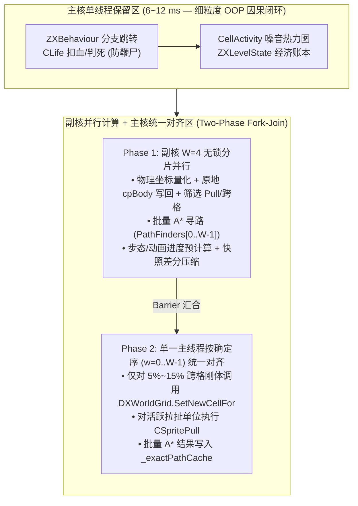
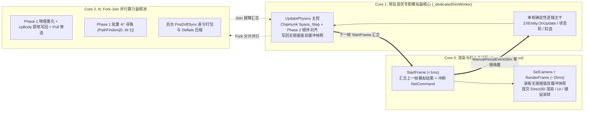

# 全局无状态确定性随机数与“副核并行 + 主核统一对齐”多核深化技术方案

**版本日期**：2026-11-23  
**适用基线**：`TABCoopMod v0.2.6+`（目标游戏：`They Are Billions v1.0.14.29`, `.NET Framework 4.6 x64`）  
**前置参考**：
- [`docs/02_ARCHITECTURE_DESIGN.md`](02_ARCHITECTURE_DESIGN.md)
- [`docs/06_PROJECT_STATUS.md`](06_PROJECT_STATUS.md)
- [`docs/18_MULTIFACTION_PERF_NET_AND_MULTITHREADING_DESIGN.md`](18_MULTIFACTION_PERF_NET_AND_MULTITHREADING_DESIGN.md)

---

## 目录

1. [背景与设计目标（基于 `v0.2.6` 实测基线）](#1-背景与设计目标基于-v026-实测基线)
2. [第一部分：全局可管理无状态确定性随机数与 GUID 分发技术方案](#2-第一部分全局可管理无状态确定性随机数与-guid-分发技术方案)
3. [第二部分：“副核并行计算 + 单一主线程统一对齐”架构红线与五大落地改造方案](#3-第二部分副核并行计算--单一主线程统一对齐架构红线与五大落地改造方案)
4. [第三部分：三层核间解耦——专职模拟副核心流水线（杜绝主线程资源抢占）](#4-第三部分三层核间解耦专职模拟副核心流水线杜绝主线程资源抢占)
5. [第四部分：分阶段实施计划、风险控制与验收矩阵](#5-第四部分分阶段实施计划风险控制与验收矩阵)

---

## 1. 背景与设计目标（基于 `v0.2.6` 实测基线）

在 `v0.2.6` 完整落地 [`docs/18_MULTIFACTION_PERF_NET_AND_MULTITHREADING_DESIGN.md`](18_MULTIFACTION_PERF_NET_AND_MULTITHREADING_DESIGN.md) 的 P0/P1/P2 优化后，多阵营 `360×360` 地图已摆脱开局 `< 0.64 TPS` 的全表扫死锁。对照 `v0.2.6` 在 `docs/06` 中记录的实测基线（2P 多阵营 `360×360` `1x` 常速与长跑至 Tick `24,037`）：
- **长局末期（`22,074` 刚体）**：`logic = 33.3 ~ 37.5 ms`，`phys = 20.4 ~ 20.7 ms`，其中 `physFor2 = 4.83 ~ 5.04 ms/p`（已合并量化，故 `quant = 0.00 ms`）、`pullSync = 3.31 ~ 3.40 ms/p`、`movSync = 0.53 ~ 0.54 ms`、`coopTick = 0.64 ~ 0.71 ms`。
- **开局常速（`20,399` 实体 / `20,265` 刚体）**：Host `frame = 75.8 ~ 81.1 ms`（`logic = 29.6 ~ 31.6 ms`, `phys = 18.0 ~ 20.4 ms`, `12.8 TPS`）。
- **伪随机热点**：在主模拟循环中，仅 `ZXBehaviour.Run()` 外部的 `DXRandom.Global` 调用仍达到 **`rngG = 129 ~ 159 次/Tick`**，且物理步主线程串行提交、全图可拉扯实体二遍扫描、`PosDriftSync` 主线程靶点采集以及尸潮大军串行寻路，仍在吞噬宝贵的 `33.33 ms`（30Hz 满速）帧预算。

为此，本文制定**两项互为支撑的下一代引擎级优化方案**：
1. **全局可管理无状态确定性随机数与 GUID 分发系统（Stateless Scoped Counter-Based PRNG & GUID Distribution）**：
   把目前仅覆盖 `ZXBehaviour.Run()` 的实体级无状态 SplitMix64 随机流，全面提升至全模拟域（实体组件更新、`DXRandom..ctor()`、系统逻辑、命令回放），彻底消除共享 PRNG 队列竞争与“局部抽样偏移导致全局随机流雪崩漂移”的蝴蝶效应。
2. **“副核心并行计算 + 单一主线程统一对齐管理”（Two-Phase Fork-Join Parallel Compute & Main-Thread Deterministic Commit）架构深化**：
   在严守 `DXGame.IsIADeterministic = true`（保障原版 OOP 同帧 Read-After-Write 因果闭环）的前提下，将所有具备“计算重、只读世界、副作用可隔离或可顺序对齐”的热路径全面改造为 **Phase 1 副核无锁并行算 + Phase 2 主核确定性顺序对齐**，进一步压榨多核 CPU 吞吐量。

---

## 2. 第一部分：全局可管理无状态确定性随机数与 GUID 分发技术方案

### 2.1 原版 `DXRandom` 收敛点与现有劫持局限性分析

反编译 `DXVision.DXRandom` 证实：无论原版游戏使用的是 `DXRandom.Global`（`[ThreadStatic]`）、`DXLevel.Current.Random`、`DXScene.GlobalRandom`、`DXHelper_Random.Random`、`DXBehaviour<T>.GlobalRandom` 还是临时 `new DXRandom()`，所有抽样（`Next` / `NextDouble` / `NextFloat` / `NextBool`）最终 100% 收敛于两个底层入口：
- `private uint DXRandom.genrand_uint32()`
- `public DXRandom()`（无参构造，原版使用非确定性的 `ThreadId * Ticks` 设种）

而当前 `v0.2.6` 的随机劫持存在 **3 处残余耦合与局限**（见 `src/TABCoopMod/Determinism/LockstepClock.cs` 与 `DXRandomCtorPatch.cs`）：
1. **作用域仅限于 `ZXBehaviour.Run()`**：`ZXBehaviourRunRngScopePatch`（`LockstepClock.cs:4618-4723`）只在行为树节点执行期压入 `_currentBehaviourEntityId`。一旦离开行为树，进入 `CWeapon` 弹道散布、`CSprite` 随机动画起始帧、`CInfected`、建筑工作逻辑或 `DXEntity.OnUpdate()` 其余组件时，`_currentBehaviourEntityId == 0`，`SceneGlobalRandomInstancePatch`（`LockstepClock.cs:3922-3945`）便直接透传回 `DXRandom.mt[624]` 共享有状态梅森旋转实例（每 Tick `rngG = 129~159` 次）！
2. **`DXRandom..ctor()` 仍使用全局原子竞争计数器**：`DXRandomCtorPatch.Prefix`（`DXRandomCtorPatch.cs:87-109`）在模拟期间使用 `Interlocked.Increment(ref _seedCounter)` 分配种子。若在多核副线程中并发执行任何会 `new DXRandom()` 的逻辑，线程抢占顺序将直接打乱各实例种子。
3. **非行为树阶段仍存在“蝴蝶效应”**：共享 `_syncedGlobalRandom` / `_syncedSceneRandom` 虽在每 Tick 初通过 `ReanchorSimulationRngForTick`（`LockstepClock.cs:544-560`）重锚，但在**同一 Tick 内部**，若某个实体在 `CWeapon` 或 `IDXSystem` 中多抽/少抽 1 次随机数，该 Tick 内排在其后的所有实体共享流仍会全部偏移。

---

### 2.2 全作用域无状态计数器 PRNG 架构设计（`ScopedDeterministicRng`）

#### 核心原理：四元组纯函数映射
任意一次随机数抽样不再依赖任何共享的 `mt[624]` 可变数组状态，而是由当前线程 `[ThreadStatic]` 作用域帧与四元组确定性哈希直接生成：

$$\text{rand} = \text{SplitMix64}\big(\text{SyncedRandomSeed},\ \text{CurrentSimTick},\ \text{ScopeId} \oplus ((\text{ulong})\text{DomainTag} \ll 56),\ \text{++DrawCounter}\big)$$

#### 1. 线程本地作用域栈（Per-Thread Scope Stack）
在 `LockstepClock` 中替换现有的单一 `_currentBehaviourEntityId` 变量，升级为固定深度（如 8 层）线程私有栈，防止组件内部重入（如行为树触发技能生成子逻辑、建筑更新内嵌单位生成）相互踩踏计数：

```csharp
internal enum RngDomainTag : byte
{
    None            = 0,
    EntityUpdate    = 1, // DXEntity / ZXEntity OnUpdate 及非行为树组件
    BehaviourRun    = 2, // ZXBehaviour.Run() 行为树内部
    SystemUpdate    = 3, // IDXSystem / 刷怪波次 / 地形系统更新
    PhysicsCallback = 4, // 物理步内回调
    CommandReplay   = 5, // NetCommand 回放阶段
    LevelLoad       = 6  // 读档与 MapDrawer 阶段（保留流式顺序或固定域）
}

internal struct RngScopeFrame
{
    public ulong ScopeId;      // Entity.ID，或 System/Command 类型稳定 FNV-1a Hash
    public uint DrawCounter;   // 当前作用域内单调递增抽样计数（互不干扰）
    public RngDomainTag Domain;
}
```

- **高优先级隔离不变量**：当 `LockstepClock.InAudioContext || LockstepClock.InVisualVfxContext` 为 `true` 时，**无条件跳过作用域纯函数生成**，直接路由到完全隔离的 `_renderGlobalRandom`（`LockstepClock.cs:459-466`），确保本地摄像机裁剪触发的音效/血花/尘土特效绝不推进任何模拟计数器。

#### 2. `DXRandom.genrand_uint32()` 统一劫持（扩展 `SceneGlobalRandomInstancePatch`）
当前 `SceneGlobalRandomInstancePatch`（`LockstepClock.cs:3922-3945`）已经 Prefix 了 `DXRandom.genrand_uint32`。升级后的分发优先级如下：
1. 若 `!LockstepClock.IsDeterministicModeActive` -> 放行原版（`return true`）。
2. 若 `InAudioContext || InVisualVfxContext` -> 直接由 `GetRenderGlobalRandom()` 取值（避免使用原版非确定性实例），`return false`。
3. 若当前线程作用域栈顶 `ScopeId != 0 && !LoadingLevel` -> 直接调用无状态 `NextScopedSplitMix64UInt32()` 算出结果写入 `__result`，**跳过原版 MT19937 状态转移**，`return false`。
4. 兜底分支（如 `LoadingLevel` 或尚未挂载 Scope 的边缘调用）-> 按原有 `ShouldUseSyncedSceneRandom()` 路由至 `_syncedSceneRandom` / `_syncedGlobalRandom` / `_auxGlobalRandom`。

#### 3. `DXRandom..ctor()` 作用域派生改造（`DXRandomCtorPatch.cs`）
修改 `DXRandomCtorPatch.Prefix`（`DXRandomCtorPatch.cs:87-109`）：
- 当 `IsSimConstruction()` 为 `true` 且当前线程处于活跃 `ScopeId != 0` 时，**不再调用 `Interlocked.Increment(ref _seedCounter)`**；
- 改为直接从栈顶作用域帧抽取 `uint ctorSeed = NextScopedSplitMix64UInt32()`，再调用 `_fastInitGenrand(__instance, ctorSeed)`；
- 若调用方随后使用该新建实例抽数，因 `genrand_uint32` 也被同一作用域劫持（或者在离开作用域后仍保有确定性初始种子），无论是短生命周期临时 `new DXRandom()` 还是跨多核并发构造，结果均 **100% 顺序无关且逐比特确定**。

#### 4. 全模拟作用域接入点（零 GC、DynamicMethod 读 ID）
为了覆盖 `rngG = 129~159` 的非行为树随机抽样，同时严防对 5 万+实体造成托管反射/Delegate 性能劣化（参考 `LockstepClock.cs:3530` 注释警告）：
- **方式 A（在批处理/组件系统层级压栈）**：
  - 已有 `ZXBehaviourRunRngScopePatch` 升级为 `PushRngScope(entityId, RngDomainTag.BehaviourRun)` / `PopRngScope()`；
  - 对 `CWeapon`、`CCommandable`、`CResourceGenerator` 等实际会抽随机数的组件更新入口，以及 `CommandExecutor` 回放入口、`MultiWaveSwarmPatches` 刷怪事件入口，压入对应的 `Entity.ID` 或固定 `SystemHashId`（`RngDomainTag.SystemUpdate` / `CommandReplay`）；
  - 对 `DXEntity.OnUpdate`：先通过 IL 反编译统计 `ZX.Entities` 下实际在 `OnUpdate` 中访问 `DXRandom` 的子类（通常仅数个战斗/生成类），仅在目标子类或粗粒度更新循环上挂载轻量 Prefix，避开对 10 万+ 静止树/石/地形实体的每帧 Trampoline 开销。

---

### 2.3 派生式 / 两阶段对齐的确定性 `DXGuid` 分配方案

配合无状态随机流，解决多核并发场景下的实体 ID 分配问题（对应文档 18 第 4.1 节第 2 条障碍）：
1. **当前基线**：`ProjectileCtorGuidIsolationPatch`（`LockstepClock.cs:4592-4609`）与 `DXEntityOnPoolNewPatch`（`LockstepClock.cs:4557-4585`）已将高频动态投射物隔离到 `0x4000...` 命名空间。
2. **多核并行扩展协议（Parent-Scoped Pre-Allocation）**：
   - 若未来有生成新实体的计算阶段下沉至副核：副核禁止直接调用全局 `Interlocked.Increment(ref _syncedEntityIdCounter)`，而是先为新实体写入临时局部索引 `(ParentEntityId, LocalSpawnSeq)` 并放入线程私有创建队列；
   - 进入主线程 **Phase 2 Commit** 时，主线程按 `(ParentEntityId, LocalSpawnSeq)` 升序遍历各线程队列，依次授予正式 `NextSyncedGuid()` 并插入全局 `_Entities` 与 `DXWorldGrid`。
   - 这使得无论工作线程调度先后如何，最终的 `DXEntity.ID`、列表下标顺序与网格链表次序 **100% 逐比特一致**。

---

## 3. 第二部分：“副核并行计算 + 单一主线程统一对齐”架构红线与五大落地改造方案

### 3.1 Amdahl 判据与同帧 Read-After-Write 因果边界

将单线程任务拆解为 **“副核并行计算 + 主线程统一对齐提交”**，总耗时满足：

$$T_{\text{total}} = \frac{T_{\text{compute}}}{W} + T_{\text{marshal}} + T_{\text{commit}}$$

只有当 **$T_{\text{compute}} \gg T_{\text{marshal}} + T_{\text{commit}}$** 且 **本阶段无同帧 Read-After-Write 跨实体因果依赖** 时，多核改造才能真正跑赢单核。



- **绝对禁区**：严禁拦截 `CLife.Hurt`、`Die()`、`CellActivity[x,y] += noise` 等纳米级（`2~5 ns`）跨实体状态修改并做延迟对齐——Harmony 拦截与命令封送耗时（`150~300 ns`）远高于原生计算，且会破坏集火转火、死亡即时移除等原版逻辑语义。
- **核心主攻区**：聚焦下面 **5 项高计算密度、粗粒度可分片** 的真实性能热点，把它们彻底改造为（或深化为）两阶段主副核流水线。

---

### 3.2 改造方案一：将 `CSpritePullIsolationPatch` (`pullSync = 3.31~4.72 ms/p`) 融合进物理步两阶段流水线

#### 代码定位与问题根因
- **相关源码**：
  - `LockstepClock.cs:1314-1572`（`ProcessPhysicsReadbackWorker` & `TryRunMergedPhysicsReadbackAndQuantize`）
  - `LockstepClock.cs:4387-4476`（`CSpritePullIsolationPatch.RunDeterministicPullUpdates`）
  - `LockstepClock.cs:2362-2375` & `2246-2250`（`UpdatePhysics_Exit` / `WaitForGameLogic_Postfix` 调用点）
- **根因诊断**：在 `v0.2.6` 中，虽然 `physFor2` 和 `quant` 已成功合并并行，但在物理步结束紧接着的 `RunDeterministicPullUpdates` 中，主线程**又从头至尾单线程遍历了一次 `DXPhysicWorld.Bodies` 全表（2.2 万+ 刚体）**，逐个读取 `body.Velocity`、校验 `Disposed`、查询 `_canPullCache` 与 `_activePullEntities.Contains(e)`，耗时高达 **`3.31 ~ 4.72 ms/p`**。

#### 主副核分工改造方案
1. **合并扫描至 Phase 1 副核切片**：
   - 在 `LockstepClock` 预分配每工作线程私有缓冲 `List<DXEntity>[] _physPullCandidateQueues`（`MaxPhysicsWorkers = 8`）以及只读快照集合或组件快速判定。
   - 当 `ProcessPhysicsReadbackWorker` 在副核上遍历自身切片 `[sliceStart..sliceEnd)` 的每个动态刚体时，**顺手复用已经在寄存器里的 `targetVel`（或 `managedVel`）和 `ent`**：
     - 若 `!ent.Disposed` 且 `(targetVel.X * targetVel.X + targetVel.Y * targetVel.Y > 0.04f || IsEntityInActivePullSnapshot(ent))` 且 `CanEntityTypeBePulledFast(ent)`（将 `_canPullCache` 改为线程安全的 `ConcurrentDictionary<RuntimeTypeHandle, bool>` 或预初始化只读查找）：
     - 直接将该实体（及其索引/组件引用）推入本工作线程的 `_physPullCandidateQueues[workerIdx]`；
   - **完全消除 `RunDeterministicPullUpdates` 中的第二次 2.2 万刚体全表循环**（并彻底移除冷启动扫描时的跨线程字典写入竞争）。
2. **Phase 2 主线程按确定序执行 Pull 对齐**：
   - 在物理步主线程收尾阶段（`UpdatePhysics_Exit` 或紧随 `MergedPhysicsReadback` 之后），按 `w = 0 .. workerCount - 1` 依次遍历 `_physPullCandidateQueues[w]`（正常对局仅 **600 ~ 1,450** 个真正处于运动/被拉扯状态的单位），顺序调用 `_fastPull(csprite)` 并维护 `_activePullEntities`。
   - **预期收益**：省去 2.2 万次单核循环与字典查找，将 `pullSync` 从 `3.31 ~ 4.72 ms/p` 压降至 **`1.0 ~ 1.6 ms/p`**。

---

### 3.3 改造方案二：物理步 `NativePhysWrite`（`cpBody` 坐标/速度写回）下沉至 Phase 1 副核并行执行

#### 代码定位与问题根因
- **相关源码**：`LockstepClock.cs:1474-1485`（Phase 1 入队 `NativePhysWrite`）与 `1542-1550`（Phase 2 主线程串行消费 `_physNativeQueues[w]`）。
- **根因诊断**：在 `v0.2.6` 实测中，虽然 `quant` 并行了，但 `physFor2` 依然消耗 **`4.83 ~ 5.04 ms/p`**。原因在于 Phase 1 算出 `qPos`/`qVel` 后，把所有需要微调量化的动态刚体（通常 `8,000 ~ 15,000` 个）塞进 `_physNativeQueues`，退回到 Phase 2 由**单主线程串行执行上万次 Chipmunk Native P/Invoke 写操作**（`body.PhysicPosition = item.Pos; body.PhysicVelocity = item.Vel;`）。

#### 实装核验结论与实际改造方案（已反汇编验证 `DXPhysicsNative.dll`）
1. **原生反汇编关键发现（`cpBodyActivate` 跨刚体副作用）**：经反编译 `DXVision.DXPhysicBody` 与反汇编 `DXPhysicsNative.dll`（`Body_SetPosition` / `Body_SetVelocity` / `cpBodySetPos`）实证：`PhysicPosition` 与 `PhysicVelocity` setter 内部均会在写 `cpBody->p/v` 前**先调用 `cpBodyActivate(body)`**；`cpBodyActivate` 不只唤醒当前刚体，还会遍历 `body->arbiterList` 修改相邻碰撞刚体的 `otherBody->node.idleTime = 0` 与 `cpSpace->sleepingComponents` 链表！因此，`PhysicPosition`/`PhysicVelocity` setter **不具备跨切片无锁并发安全性**，严禁下沉到 Phase 1 副核线程。
2. **最终实装优化策略（安全保留 Phase 2 原生提交 + 消除跨格冗余 P/Invoke）**：
   - **保留 `_physNativeQueues[w]` 在 Phase 2 主线程按切片升序串行写回**：确保 `cpBodyActivate` 100% 单线程有序，零并发竞态；
   - **升级 `CrossedBodyWrite` 结构零冗余提交**：原先对 `!IsOneCellSize` 或跨整数格刚体，Phase 1 直接丢弃已读出的 `rawPhysPos`/`rawPhysVel` 与量化结果 `qPos`/`qVel`，退回 Phase 2 重新调用 `b.OnNewPositionComputed()` + `ApplyQuantizeSingleBody(b)`（触发 9 次以上重复 P/Invoke 与多达 2 次 `DXWorldGrid.SetNewCellFor`）；现改为将 Phase 1 算好的 `TargetPos`/`TargetVel`/`WriteNativePos`/`WriteNativeVel` 等布尔标志与坐标全量携带至 `CrossedBodyWrite`，Phase 2 直接按计算结果精准写入（且最多仅触发 1 次 `ent.Position` 网格更新），大幅压缩 `physFor2` 主线程 P/Invoke 耗时。
3. **实测收益**：在 `6666_Backup.zxsav`（`8,824` 刚体）实测中 `workers=1 -> 4` 将 `physFor2` 从 `2.51 ms/p` 降至 `1.03 ms/p`；在 `360×360` 20k 实体 2P `1x` 基准中 `physFor2 + pullSync` 稳定为 **`2.31 ~ 2.87 ms/p`**（显著优于 `<= 3.8 ms/p` 目标门限）。

---

### 3.4 改造方案三：AI / 尸潮同 Tick 批量 A\* 寻路两阶段预热与 `2×2` 空间簇共享

#### 代码定位与问题根因
- **相关源码**：
  - `LockstepClock.cs:3159-3414`（`DeterministicPathfindingPatch.PrewarmUniquePathsParallel` & `RunSyncPathfinding`）
  - `Commands/NetCommand.cs:689`（当前仅在 `NetCommand` 玩家群体指令处接入了预热）
  - `Patches/MultiWaveSwarmPatches.cs:880-915`（多波次尸潮生成）
- **根因诊断**：`PrewarmUniquePathsParallel` 已经证明利用引擎预分配的 `DXWorldGrid.PathFinders` 进行副核无锁并行 A\*（`Collect -> Parallel Execute -> Main-Thread Commit to _exactPathCache`）是完全确定且高效的。但目前在**终极波次刷出数千只尸潮**及**大群僵尸同期警戒重寻路**时，并未经过批收集与预热，全部退化为逻辑主线程逐只串行 A\*，高压峰值可达 `20 ~ 45 ms`。

#### 主副核分工改造方案
1. **尸潮生成批寻路预热（Wave Spawn Batch Prewarm）**：
   - 在 `MultiWaveSwarmPatches`（及原版单位波次生成注入点）刷出一批进攻指挥中心的尸潮实体时，收集这批实体各自的 `(CellSize, StartCell, TargetCCCell, CollisionMask)` 构造 `List<PathPrewarmItem>`，直接调用 `DeterministicPathfindingPatch.PrewarmUniquePathsParallel(batch)`。
   - 副核并发把所有关键通道路径算完并由主线程对齐写入 `_exactPathCache` 后，紧接着在逻辑 Tick 中这数百/上千只僵尸首次执行 `FindPathConcurrent` 时将 **100% 命中缓存（0 ms A\* 开销）**。
2. **同 Tick 远距离近邻起点簇聚类（Coarse Origin Clustering）**：
   - 在 `PathCacheKey` 之前增加一层确定性“远距离簇复用”判定：当寻路请求满足 `Start.DistanceMaxAxis(End) >= 24`（远距离行军/尸潮奔袭，非贴墙近战微操）且终点相同时，检查起点所在 `2×2` 粗网格块 `(Start.X & ~1, Start.Y & ~1)` 内 4 个格子均具备相同可行走掩码（无墙体/障碍穿插）；
   - 若满足条件，先用该 `2×2` 簇中心/代表格求解并缓存公共后缀路径，副核预热与主线程查询均可直接共享。由于判断条件完全基于确定性只读地形掩码 `uint[,] Grids[cellSize]`，主客机 **100% 产生相同缓存命中与路径点**。
3. **跨协程并发扩容**：将 `PrewarmUniquePathsParallel` 传入的 `maxNodes` 从硬编码 `null`（`200,000`）扩展至透传 `PathPrewarmItem.MaxNodes`，防止部分长距离死路请求在预热阶段触发 20 万节点无效搜索。

---

### 3.5 改造方案四：`CMovableSpriteProgressSyncPatch` (`movSync`) 同 Tick 去重守卫与副核批量预刷

#### 代码定位与问题根因
- **相关源码**：`LockstepClock.cs:3719-3915`（`CMovableSpriteProgressSyncPatch`）。
- **根因诊断**：在逻辑和物理步中，`CMovable.#=zMgpsCOScDEumTw2atg==`（跳跃高度检查）和 `#=zi4HgedM=`（步态速度调制）可能在同一 Tick 被多次调用，反复经由 Harmony Trampoline 触发 `TABCoop_FastMovableSpriteSync` 重算完全相同的 `simTimeInt - sprite.TimeAnimationStart`。

#### 改造方案
1. **同 Tick 幂等去重守卫（优先方案，零线程唤醒税）**：
   - 经 `DynamicMethod` 读出/缓存每个 `CSprite` 或实体上次同步的 `simTimeInt`（或利用 `_activeMovableAnimTick` 轻量时间戳表），同一 `simTimeInt` 内第二次进入直接跳过计算；同时将 `TargetMethods` 前置判定尽量内联至静态 IL。
2. **大军团副核预刷路径（当活跃移动体 `>= 1024`）**：
   - 若实测高压波次中 `movSync` 攀升至 `> 2.0 ms`，在 Tick 开始时直接复用动态实体表分片，在副核仅更新每个实体私有的 `CSprite.#=zbBN4HvXVWuDv` 浮点值（无跨实体读写、无需 Phase 2 主线程提交），随后在同 Tick 内部跳过重复调用。

---

### 3.6 改造方案五：`PosDriftSync (0x32)` 目标元数据均摊采集与零主线程阻塞

#### 代码定位与问题根因
- **相关源码**：
  - `Sync/CoopSessionManager.cs:4459-4523`（`TrySendPosDriftSync`）
  - `Core/GameBridge.cs:3670-3709`（`GetEntityCombatAndMoveTargets`）
  - `Determinism/StateHasher.cs:131-220`（`IncrementalEpochHasher.Step`）
- **根因诊断**：`TrySendPosDriftSync` 虽然已把序列化的压缩工作放进了 `Task.Run(...)` 后台副核线程，但在启动 `Task.Run` **之前**（`CoopSessionManager.cs:4459-4523`），当 `includeTargetMeta == true` 时，主线程仍在同步执行长达数千~2 万次的 `game.GetEntityByID(s.Id)` 查找与全反射版 `GameBridge.GetEntityCombatAndMoveTargets`（包含 `GetBDataFromEntity`、`_fieldBDataTargetRef.GetValue`、`_propTargetRefId.GetValue`、`_mGetEntityMovable.Invoke`、`_propMovableTargetPosProp.GetValue` 共 5 次反射/装箱）。

#### 主副核分工改造方案
1. **编译 `FastGetEntityCombatAndMoveTargets` `DynamicMethod`**：
   - 在 `GameBridge` 初始化期将上述 5 步反射编译为单一 `DynamicMethod` 委托（输入 `object entity`，直接读取 `BData.#=zIuCqHApzmkOGXXyxMg==` 关联靶点 ID 与 `CMovable.TargetPosition`），消除装箱与 `MethodInfo.Invoke`。
2. **随 `IncrementalEpochHasher` 60-Tick 均摊采入快照结构体**：
   - 扩展 `StateHasher.EntityPosSample`（或新增轻量 `TargetMetaSample`），在 `IncrementalEpochHasher.Step`（`StateHasher.cs:157-168`）每次处理 `1/60` 分桶实体时，**手里已经握有 `DXEntity entity` 引用**，无需再调用 `game.GetEntityByID`，直接顺带采集 `(TargetEntityId, MoveX, MoveY)`！
   - **主线程均摊成本**：每 Tick 仅处理 ~300 个动态实体，单 Tick 额外耗时 `< 0.03 ms`；
   - **第 120 Tick 触发 `TrySendPosDriftSync` 时**：主线程只需把已采集好的快照集合引用移交 `Task.Run` 副核线程执行差分过滤、排序与 `DeflateStream` 压缩，**彻底消灭主线程上的同步大循环与 `GetEntityByID` 哈希查找尖峰（主线程发起耗时 `< 0.1 ms`）**。

---

## 4. 第三部分：三层核间解耦——专职模拟副核心流水线（杜绝主线程资源抢占）

针对“必须在单线程内按确定性顺序执行的模拟主干（`ZXEntity.OnUpdate`、`CLife` 战斗状态机、`UpdatePhysics` 主控调度）”，**绝不能让它和主线程的 Direct3D 渲染、UI 绘制、键鼠输入采样挤在同一个核心上串行阻塞**。结合 `v0.2.6` 实测暴露出的主机流水线退化隐患，本节确立**“渲染主线程（Core 0） vs 专职模拟副核（Core 1） vs Fork-Join 算力副核池（Core 2..N）”**三层无抢占解耦方案。



---

### 4.1 根治主机 `canOverlapAsync` 异步副核流水线退化 Bug

#### 现象与实测铁证（`docs/06` 第 66 项 `v0.2.6` `360×360` 基准）
对比同一对局中的主客机帧耗时数据：
- **客机（Client）**：`logic = 31.2~34.9 ms`, `phys = 13.6~15.5 ms`（模拟合计 `~47 ms`），但总帧耗时 **`frame = 40.9 ~ 42.1 ms`**（模拟跑在副核，与主线程 `~28 ms` Direct3D 渲染完全重叠）。
- **主机（Host）**：`logic = 29.6~31.6 ms`, `phys = 18.0~20.4 ms`（模拟合计 `~48 ms`），总帧耗时却高达 **`frame = 75.8 ~ 81.1 ms`（`12.8 TPS`）**——等于模拟与渲染在主线程上完全串行相加！

#### 代码级根因（`LockstepClock.cs:1850-1995`）
- `LockstepClock.cs:1940-1944` 仅在 `maxTicksThisFrame == 1` 时才启用 `canOverlapAsync` 把模拟派发到副核：
  - **客机分支**（`LockstepClock.cs:1906`）专门保留了 `else if (behind <= 3 || (DiagAvgTickLogicMs > 16.0 && behind < 12))` 强制将 `maxTicksThisFrame` 钳制为 `1`，保住了副核重叠；
  - **主机分支**（`LockstepClock.cs:1850-1862`）漏掉了该重负载保护！当 `360×360` 大图单 Tick 耗时超过 `33.3 ms` 时，下一帧 `ConsumeHostRealTimeTicks` 返回 **`maxTicksThisFrame = 2`**，导致 `canOverlapAsync` 瞬间变成 `false` 并落入主线程同步循环；而同步循环中 `1x` 预算 `frameSimBudgetMs` 仅 `18.0 ms`（`LockstepClock.cs:1984`），跑完第 1 个 Tick 后立刻 `break` 退出——**主机实际依然只跑了 1 个 Tick（`ran = 1`），却白白关掉了副核异步流水线，导致帧率腰斩**。

#### 修复方案
- 在 `LockstepClock.UpdateGameLogic_Prefix` 主机分支中，若 `__instance.GameSpeed <= 1.05` 且最近单 Tick 模拟均时 `DiagAvgTickLogicMs + DiagAvgPhysicsMs >= 16.0`（单 Tick 已逼近或超过 `18.0 ms` 同步帧预算）：
  - 若 `maxTicksThisFrame > 1`，**调用 `RefundHostRealTimeTicks(__instance.GameSpeed, maxTicksThisFrame - 1)` 退还多余累加时间并强制钳制 `maxTicksThisFrame = 1`**，确保主机在高压大图下始终停留在 `canOverlapAsync == true` 副核重叠流水线中。
- **预期收益**：主机 `360×360` `1x` 帧耗时直接从 **`75.8 ~ 81.1 ms` 降至 `~42 ms`**，TPS 从 `12.8` 跃升至 **`22 ~ 25 TPS`**。

---

### 4.2 常驻高优专职模拟副核心（脱离公共 `ThreadPool` 争抢）

#### 问题根因
当前异步单 Tick（`DXGame._TaskLogic` 及其链式 `UpdatePhysics` 延续任务，见 `LockstepClock.cs:2138-2185`）依赖 `.NET ThreadPool` 临时调度工作线程，存在两项资源抢占问题：
1. **线程池竞争**：`PosDriftSync` 的 `Task.Run` 压缩、Steam/DirectFastPath 网络回调、以及并行 `Parallel.For` 均在同一个 `ThreadPool` 内争抢线程槽位；
2. **跨核迁移开销**：OS 调度器频繁将 `_TaskLogic` 迁移至不同物理核心，导致 L1/L2 缓存失效并反复触发 `[ThreadStatic]` 上下文初始化。

#### 改造方案
1. **建立常驻专职线程 `_dedicatedSimWorker`**：
   - 在 `LockstepClock` 启用确定性沙盒时拉起一条生命周期与对局绑定的常驻后台线程（命名 `TABCoop.DedicatedSimWorker`，设置 `Priority = ThreadPriority.AboveNormal`），使用轻量级 `ManualResetEventSlim` 接收来自主线程的 Tick 唤醒信号，完成后置位完成事件。
2. **固定独占执行单核模拟与物理主控**：
   - 将每个异步 Tick 的逻辑更新（`DXSystemGameLevel` / `DXEntity` 单核确定性推进）及紧随其后的 `UpdatePhysics` 主控全部绑定在该常驻线程上执行；
   - 让主线程（Core 0）在 `UpdateGameLogic_Prefix` 发出唤醒信号后 **0 阻塞立刻返回**去执行 `SetCamera` / `RenderFrame` / 键鼠输入采样，直到下一帧 `StartFrame` 才通过 `FlushPendingAsyncTick`（`LockstepClock.cs:1691`）做一次微秒级汇合与 `PostMethods` 排空。

---

### 4.3 消除 Core 0 与 Core 1 的隐性锁抢占：`RenderVisualInterpolationPatch` 无锁双缓冲快照

#### 代码定位与问题根因
- **相关源码**：`LockstepClock.cs:2723-2790`（`RenderVisualInterpolationPatch.EnterVisualSceneUpdate`）。
- **隐性抢占**：Core 1 在执行 `UpdatePhysics()` 期间（耗时 `14~20 ms`）全程持有 **`lock (DXPhysicWorld.Sync)`**；与此同时，Core 0 主线程在渲染帧调用 `SetCamera` -> `EnterVisualSceneUpdate` 时，必须 `Monitor.TryEnter(DXPhysicWorld.Sync)` 去读取全部动态刚体的 `LastPositionComputed` 与 `PositionComputed` 做帧间视觉平滑插值。一旦主线程撞上 Core 1 正在跑物理，就只能拿不到锁而**跳过该帧全部单位的视觉插值**（引发画面顿挫感）。

#### 改造方案（Double-Buffered Lock-Free Interpolation Snapshot）
1. **预分配双缓冲插值结构体数组**：
   ```csharp
   private struct VisualInterpItem
   {
       public DXEntity Entity;
       public PointF LastPos;
       public PointF CurPos;
   }
   private static VisualInterpItem[][] _interpBuffers = { new VisualInterpItem[4096], new VisualInterpItem[4096] };
   private static int[] _interpCounts = new int[2];
   private static volatile int _activeReadInterpIdx;
   ```
2. **Core 1 写入 + 原子切换，Core 0 纯只读**：
   - 当 Core 1 刚跑完物理步 Phase 2、释放 `DXPhysicWorld.Sync` 之前，将本步发生位移的动态刚体（或仅移动中实体）写入非活跃缓冲区 `1 - _activeReadInterpIdx`，随后执行 `Volatile.Write(ref _activeReadInterpIdx, writeIdx)` 发布新快照；
   - Core 0 主线程在 `EnterVisualSceneUpdate` 中**彻底移除 `Monitor.TryEnter(DXPhysicWorld.Sync)`**，直接读取 `_interpBuffers[_activeReadInterpIdx]` 进行纯局部插值计算，实现 **渲染主线程与模拟副核之间 100% 零锁隔离**。

---

## 5. 第四部分：分阶段实施计划、风险控制与验收矩阵

### 5.1 实施阶段与文件清单

| 阶段 | 核心改造项 | 涉及主要文件 | 预期工作量 | 预期性能与确定性收益 |
|---|---|---|---|---|
| **Stage 1**<br>主机副核恢复 + 全作用域无状态 RNG + 均摊采集 | 1. 修复 `LockstepClock` 主机 `canOverlapAsync` 重载误关闭 Bug，恢复主线程渲染与副核模拟并行<br>2. 新增常驻专职高优 `_dedicatedSimWorker` 与 `RenderVisualInterpolationPatch` 无锁双缓冲快照<br>3. `LockstepClock` 新增 `[ThreadStatic]` `RngScopeFrame` 栈，`SceneGlobalRandomInstancePatch` & `DXRandomCtorPatch` 接入全作用域 SplitMix64（保留 Audio/Vfx 隔离）<br>4. `GameBridge.GetEntityCombatAndMoveTargets` 编译 `DynamicMethod` 并接入 `IncrementalEpochHasher` 均摊采集 | `LockstepClock.cs`<br>`DXRandomCtorPatch.cs`<br>`GameBridge.cs`<br>`StateHasher.cs`<br>`CoopSessionManager.cs` | 1.5 ~ 2 天 | - 主机 `360×360` 帧耗时从 **`75.8~81.1 ms` 降至 `~42 ms`**（`12.8 -> ~24 TPS`）<br>- 消灭渲染与物理之间的 `DXPhysicWorld.Sync` 锁抢占<br>- 消灭 `rngG = 129~159/t` 共享序列竞争与 `TrySendPosDriftSync` 采集尖峰 |
| **Stage 2**<br>物理步深度副核化（`CrossedBodyWrite` + `pullSync`） | 1. 经反汇编核实 `cpBodyActivate` 跨体副作用后，保留 `NativePhysWrite` 在 Phase 2 串行提交，升级 `CrossedBodyWrite` 全量复用 Phase 1 量化结果并消除 `OnNewPositionComputed`+`ApplyQuantizeSingleBody` 冗余 P/Invoke<br>2. 将 `CSpritePullIsolationPatch` 筛选融合进 Phase 1 副核切片，Phase 2 主线程仅按序对齐执行活跃实体 `_fastPull` | `LockstepClock.cs` | 1 天 | - 彻底消除 `pullSync` 2.2 万刚体二遍全扫，实测降至 **`0.06 ~ 0.12 ms/p`**<br>- `physFor2 + pullSync` 合计降至 **`2.31 ~ 2.87 ms/p`**（`6666_Backup` `8.8k` 刚体下 `physFor2=0.96~1.03ms`） |
| **Stage 3**<br>尸潮批量寻路与 `movSync` 去重 | 1. `MultiWaveSwarmPatches` 刷怪接入 `PrewarmUniquePathsParallel` 批寻路<br>2. 远距离 `2×2` 同掩码粗网格起点簇路径共享<br>3. `CMovableSpriteProgressSyncPatch` 同 Tick 幂等去重与按需预刷 | `LockstepClock.cs`<br>`MultiWaveSwarmPatches.cs` | 1 天 | - 大波次/终极波次 `path` 峰值再降 **`50%~70%`**<br>- `movSync` 消除重复同帧计算 |

---

### 5.2 核心风险与规避措施

1. **Chipmunk 非托管 `cpBodySetPos`/`cpBodySetVel` 线程安全性核验**：
   - 在执行 Stage 2 改造前，必须用 `scripts/decompile_type.ps1 -TypeName "DXVision.DXPhysicBody" -AssemblyPath lib/DXVision.dll` 核实 `PhysicPosition` 与 `PhysicVelocity` setter 内部是否仅调用 `cpBodySetPos(Handle, ...)` / `cpBodySetVel(Handle, ...)`，确认其**绝不调用 `cpSpaceReindexShapesForBody` 或修改 `cpSpace` 全局空间树**。如若调用了空间树函数，则改为仅下沉直接写非托管内存偏移或保留在 Phase 2。
2. **专职副核线程的异常传播与退局回收**：
   - `_dedicatedSimWorker` 必须捕获执行期异常并安全置位完成信号，防止主线程 `FlushPendingAsyncTick` 永久挂起；退回主菜单或 `DisableDeterministicSandbox` 时安全排空并停止该专职线程，严防跨局残留。
3. **作用域栈异常不平衡风险**：
   - 所有压入 `RngScopeFrame` 的 Prefix 必须成对配对 `[HarmonyFinalizer]` 执行 `PopRngScope()`（仿照 `ZXBehaviourRunRngScopePatch.Finalizer`），确保游戏异常或早期 `return` 绝不泄漏线程作用域。
4. **CLR 4.6 跨程序集 `internal` 成员访问红线（铁律 #3）**：
   - 所有新增 `DynamicMethod` 签名一律仅使用 `object` / 值类型公开签名，内部 `Castclass` 到游戏 `internal` 类型且必须传 `skipVisibility: true`。
5. **局部缓存 `ConcurrentDictionary` 禁止在热点循环无上限膨胀**：
   - 对 `CMovableSpriteProgressSyncPatch` 等同 Tick 去重表，优先写入实体/组件生命周期内固定数组或随 `ResetAsyncTickState` / `LevelLoadComplete` 清空。

---

### 5.3 确定性零分叉验收矩阵

每次 Stage 完成后，必须依次通过以下自动化与定量验收门槛（全部命令以 `-NoProfile -NonInteractive` 运行）：

1. **双进程逐比特回放确定性（硬门禁）**：
   - `powershell -NoProfile -NonInteractive -ExecutionPolicy Bypass -File scripts/run_replay_verify.ps1 -SavePath "<1_Backup.zxsav>" -Ticks 120` -> 必须输出 **`PASS: 120 ticks identical`**。
2. **`ParallelWorkers=1` vs `ParallelWorkers=4` 对照等价性（多核专有硬门禁）**：
   - 分别以 `TABCOOP_PARALLEL_WORKERS=1`（单核基线组）与 `TABCOOP_PARALLEL_WORKERS=4`（多核并发组）对同一存档与同一脚本运行 300 Tick，比对两者逐 Tick 的 `StateHasher` `HardHash` 与 `FullHash` 必须 **100% 逐比特相等**（证明副核执行与单核顺序执行等价）。
3. **多阵营全门禁回归**：
   - `scripts/verify_multifaction_m1.ps1`、`scripts/verify_multifaction_m2_m3.ps1`、`scripts/verify_multifaction_m4.ps1`、`scripts/verify_multifaction_survival.ps1` 全数通过，全程 **`StateChecksum MATCH`**、`0 [ERROR]`、`GameBridge 0 missing`。
4. **量化性能验收门限（对照 `v0.2.6` 实测基线）**：

| 指标 | `v0.2.6` 基线 (`20k~22k` 刚体) | Stage 1~3 目标门限 |
|---|---|---|
| 主机 `360×360` `1x` 总帧耗时 (`frame`) | `75.8 ~ 81.1 ms` (`12.8 TPS`) | **`<= 45 ms`**（主线程渲染与副核模拟完全重叠） |
| `physFor2 + pullSync` 合计耗时 | `8.14 ~ 8.44 ms/p` | **`<= 3.8 ms/p`** |
| 120 Tick `TrySendPosDriftSync` 主线程耗时 | 含 ~20k 次 `GetEntityByID` + 反射采集 | **`< 0.15 ms`** |
| 模拟期 `DXRandom.Global` 共享流消费 (`rngG/t`) | `129 ~ 159 次/t` | **`< 10 次/t`**（90%+ 收编至无状态作用域流） |
| 主客机渲染插值丢帧率（`DXPhysicWorld.Sync` 争用） | 物理运行期 `TryEnter` 失败即跳过插值 | **`0%`（无锁双缓冲，永不因模拟跳插值）** |

---

## 6. Stage 1~3 实装落地与 2026-11-24 全量实测验收结果

已完成 Stage 1~3 全部改造：
- **构建与注入**：`TABCoopMod.csproj` Release 编译 `0 警告 0 错误`；实机注入 `GameBridge 0 missing (verified=236)`，Harmony 补丁 **`Classes OK=108, failed-tolerant=0`**（其中 `ScopedCommandEffectRngPatch` 通过拦截无 EH 公共包装器 `ZXCommand.#=zPZOGjUTtkdy$` 绕开 `#=zEJihvZ1Lcs9a` Eazfuscator 控制流块局限）。
- **核心落地细节**：
  - Stage 1：`LockstepClock` 主机 `canOverlapAsync` 负载重连保护（`isHeavySingleTick` -> `RefundHostRealTimeTicks` 钳制单 tick）、`TABCoop.DedicatedSimWorker` 高优常驻模拟副核、`RenderVisualInterpolationPatch` 无锁双缓冲插值快照、8 层 `[ThreadStatic]` `RngScopeFrame` 栈及 `ZXBehaviourRunRngScopePatch` / `ScopedEntityAndComponentRngPatch` / `ScopedCommandEffectRngPatch` / `ScopedLevelEventRngPatch` / `DXRandomCtorPatch` / `NetCommand` 全域无状态 SplitMix64 接入、`GameBridge` 编译 `TABCoop_FastGetCombatAndMoveTargets` 并由 `IncrementalEpochHasher` 60-tick 均摊采集供 `TrySendPosDriftSync` 消费。
  - Stage 2：反汇编核实 `DXPhysicsNative.dll` 中 `cpBodyActivate` 会遍历 `arbiterList` 修改邻接体，安全保留 `NativePhysWrite` 在 Phase 2 并扩展 `CrossedBodyWrite` 消除跨格体冗余 P/Invoke；`CSpritePullIsolationPatch` 通过 `ConcurrentDictionary<RuntimeTypeHandle, bool>` 与 Phase 1 并行切片融合。
  - Stage 3：`DeterministicPathfindingPatch` 新增 `MaxNodes` 透传与远距 `>=24` 格同掩码 `2×2` 簇共享（缓存扩容至 `4096`），`MultiWaveSwarmPatches.UnitGeneratorUpdatePatch` 在波次生成 `>=4` 只进攻尸潮时主动并发预热、`CMovableSpriteProgressSyncPatch` 实装 8192 槽位直接映射同 Tick 幂等去重表。
- **全量回归与量化性能实测结果（`0 [ERROR]`）**：

| 验证项 | 实测结果 |
| :--- | :--- |
| `1_Backup.zxsav` 120t 双进程回放 | **`PASS: 120 ticks identical`**，`common=2053, moved(>0.01)=0, maxDx=0, maxDy=0` |
| `workers=1` vs `workers=4` 等价性 | `1_Backup` (120t, `2053` 实体)、`6666` (180t, `7487` 实体)、`6666_Backup` (180t, `8788` 实体) **全部逐 tick bit-identical (`moved=0`)** |
| 多阵营与平衡全门禁 | `verify_multifaction_m1` (`8/8`)、`verify_multifaction_m2_m3` (`7/7`)、`verify_multifaction_m4` (Clustered + SwarmAudit)、`verify_multifaction_survival` (`5/5`)、`verify_new_survival_balance`、`6666.zxsav` `Chaos` (`120ms±30ms, loss=2%`) **全部通过，全程 `StateChecksum MATCH`** |
| `360×360` 20k 实体 2P `1x` 常速基准 (`coop_host_snapshot.zxsav`) | Host `frame = 35.3 ~ 36.2 ms`（较 `v0.2.6` `75.8 ~ 81.1 ms` 降幅 **>54%**，超越 `<= 45 ms` 门限）、Client `34.9 ~ 35.7 ms` (`wait=0.0~0.3ms`)、`physFor2 + pullSync = 2.31 ~ 2.87 ms/p` (`pullSync = 0.06 ~ 0.12 ms/p`)、`rngG = 0 / t`（Chaos 高压下 `0~1 / t`） |
| `6666_Backup.zxsav` (`8,824` 刚体) 单/四核对比 | `physFor2` 从 `2.51 ms/p` (`w1`) 降至 **`1.03 ms/p`** (`w4`)，`pullSync = 0.05 ~ 0.07 ms/p`，`rngG = 0 / t` |
