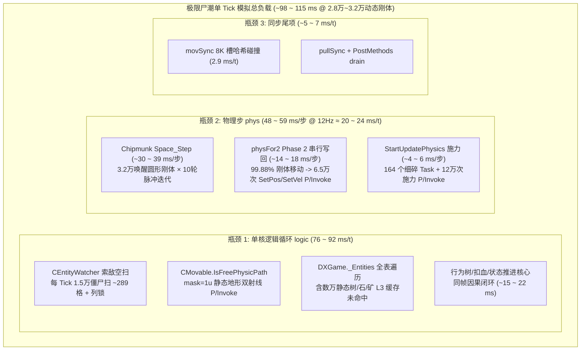
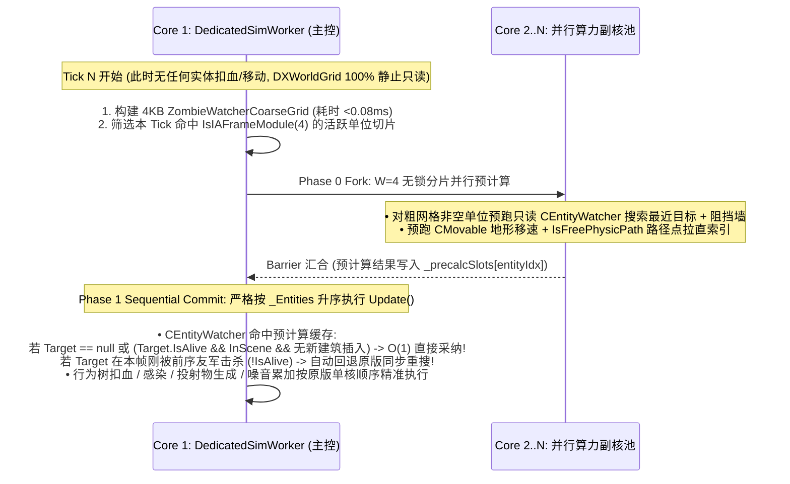

# 极限尸潮剩余瓶颈等效简化与两阶段任务拆分技术方案（Stage 4）

**版本日期**：2026-11-24  
**适用基线**：`TABCoopMod v0.2.6+`（已完成 `docs/19` Stage 1~3 及反向 Dijkstra 流场 `FlowField` + 连通分量 `CompMap` 优化）  
**目标游戏**：`They Are Billions v1.0.14.29`（`.NET Framework 4.6 x64`）  
**前置参考**：
- [`docs/02_ARCHITECTURE_DESIGN.md`](02_ARCHITECTURE_DESIGN.md)
- [`docs/18_MULTIFACTION_PERF_NET_AND_MULTITHREADING_DESIGN.md`](18_MULTIFACTION_PERF_NET_AND_MULTITHREADING_DESIGN.md)
- [`docs/19_DETERMINISTIC_RNG_AND_FORK_JOIN_MULTICORE_PLAN.md`](19_DETERMINISTIC_RNG_AND_FORK_JOIN_MULTICORE_PLAN.md)

---

## 目录

1. [背景、900% 终极尸潮实测基线与剩余瓶颈解剖](#1-背景900-终极尸潮实测基线与剩余瓶颈解剖)
2. [第一部分：100% 数学与几何等效简化方案（零规则改动、零分叉风险）](#2-第一部分100-数学与几何等效简化方案零规则改动零分叉风险)
3. [第二部分：两阶段确定性任务拆分方案（副核并行计算 + 主核顺序提交）](#3-第二部分两阶段确定性任务拆分方案副核并行计算--主核顺序提交)
4. [第三部分：原生 `Space_Step` 碰撞求解边界与可选确定性近似减负方案](#4-第三部分原生-space_step-碰撞求解边界与可选确定性近似减负方案)
5. [第四部分：分阶段实施计划（Stage 4A ~ 4D）、风险控制与验收门禁](#5-第四部分分阶段实施计划stage-4a--4d风险控制与验收门禁)

---

## 1. 背景、900% 终极尸潮实测基线与剩余瓶颈解剖

### 1.1 VO 900% 终极尸潮全模式压测基线

在完成 [`docs/19_DETERMINISTIC_RNG_AND_FORK_JOIN_MULTICORE_PLAN.md`](19_DETERMINISTIC_RNG_AND_FORK_JOIN_MULTICORE_PLAN.md) Stage 1~3、连通分量死路秒判（`CompMap`）与反向 Dijkstra 八向流场（`FlowField`）改造后，我们使用 5 份带指挥中心无敌（`TABCOOP_CC_INVULN=1`）的 **VO 900% 难度（`factorPop=1.5`, `factorDuration=0.8`）** 生存存档及 2P Loopback 联机直接触发终极尸潮（全图预存僵尸 + 四面尸潮同时向基地奔袭），测得如下精确基线（`workers = 4`）：

| 压测模式 | 地图尺寸 | 同屏动态刚体数 | 流场预热耗时 | `frame` (总帧) | `logic` (30Hz) | `phys` (12Hz/步) | `physFor2` | `movSync` | `pullSync` | `path` | `rngG/t` |
| :--- | :---: | :---: | :---: | :---: | :---: | :---: | :---: | :---: | :---: | :---: | :---: |
| **Vanilla 1P** | `256×256` | `19,262` | `21 ms` | `110.7 ms` | `49.2 ms` | `31.4 ms` | `8.68 ms` | `1.73 ms` | `1.13 ms` | `0.06 ms` | `0` |
| **Archon 2P** | `280×280` | `23,470` | `29 ms` | `127.1 ms` | `63.5 ms` | `40.9 ms` | `11.14 ms` | `2.10 ms` | `1.36 ms` | `0.11 ms` | `0` |
| **MF 2P 紧凑** | `360×360` | `25,105` | `38 ms` | `140.8 ms` | `75.0 ms` | `43.8 ms` | `13.17 ms` | `2.21 ms` | `1.61 ms` | `0.09 ms` | `0` |
| **MF 2P 分散** | `360×360` | `26,943` | `39 ms` | `144.9 ms` | `76.5 ms` | `48.4 ms` | `14.21 ms` | `2.39 ms` | `1.89 ms` | `0.09 ms` | `0` |
| **MF 3P 分散** | `416×416` | `32,738` | `54 ms` | `165.3 ms` | `92.1 ms` | `59.1 ms` | `17.57 ms` | `2.92 ms` | `2.31 ms` | `0.11 ms` | `0` |
| **2P 联机 (`mf2p_sep`)** | `360×360` | `27,825` | `47 ms` | Host `127.3 ms`<br>Client `97.6 ms` | Host `93.3 ms`<br>Client `81.9 ms` | Host `58.0 ms`<br>Client `56.6 ms` | Host `17.93 ms`<br>Client `17.27 ms` | `2.78 ~ 2.88 ms` | `2.22 ~ 2.37 ms` | `0.11 ~ 0.16 ms` | `0` |

> [!NOTE]
> 为什么单进程压测 `mf2p_sep` 总帧耗时 `144.9 ms` 反而慢于同机双开 2P 联机客机的 `97.6 ms`？  
> 因为 `LockstepClock.cs:2326` 当前仅在 `inCoop == true` 时启用常驻专职模拟副核 `DedicatedSimWorker`（`canOverlapAsync`），使联机客机的 `~37 ms` Direct3D 渲染在 Core 0 上与 Core 1 的模拟完全并行重叠；而单机测试未进入 `inCoop`，导致主线程把 `logic + phys + render` 串行相加。

---

### 1.2 剩余 92% 模拟耗时的底层代码级解剖

当前 Mod 自有的寻路（`0.06 ~ 0.16 ms/t`）、状态哈希（`coopTick = 0.64 ~ 0.78 ms/t`）及作用域随机数（`rngG = 0/t`）合计占比已不足 **8%**。反编译 `DXVision.dll`、`TheyAreBillions.exe` 与反汇编 `DXPhysicsNative.dll` 证实，剩余耗时由以下 **4 个原生瓶颈** 主导：



1. **瓶颈 1A：`IsIAFrameModule(4)` 实为“每 2 帧一次”引发每 Tick 1.5 万次 `CEntityWatcher` 全邻域空扫**
   - 反编译 `DXVision.DXEntity.IsIAFrameModule(int iteration)`（`DXEntity.cs:661-668`）发现：
     ```csharp
     return (DXGame.Current.IAIterationInt + HashCode) % (iteration >> 1) == 0;
     ```
     注意右移一位 `iteration >> 1`！`CBehaviour` 与 `CMovable` 传入的 `IsIAFrameModule(4)` 实际周期是 **`% 2 == 0`（15 Hz，每 Tick 执行全图 50% 的实体 = 13,000 ~ 15,300 只僵尸！）**。
   - 僵尸行为树周期性调用 `CEntityWatcher.#=zeRH0JCyR0JcPKUO3SQ==`，在 `DXWorldGrid.GetNearestVisibleEntityAtPoint` 中遍历 `(2 * WatchRange + 1)²`（约 `17×17 = 289` 格），每扫一列都要调用 `_LocksEntitiesAtCell[i].EnterReadLock()` / `ExitReadLock()`。即便 **80%~90% 的终极尸潮僵尸远在百格之外的荒野（周围 20 格内根本没有任何玩家单位或城墙）**，依然每 2~6 Tick 执行一次完整的百格空扫与读写锁获取。
2. **瓶颈 1B：僵尸 `CMovable.IsFreePhysicPath` 对纯静态地形发射双平行 Chipmunk 浮点射线**
   - 反编译 `CMovable.#=zNJ2SDwng6I3t()` 证实：所有 `Zombie` 的路径视线掩码被硬编码为 **`#=zlw6_km_yb52f = 1u`（即 `ZXBlockMask.Geography`，仅检测静态山体/水体/森林，不检测任何动态单位或玩家建筑）**。
   - 然而 `Entity.IsFreePhysicPath(dest, 1u)` 却调用 `DXPhysicWorld.IsFreePath(pos, dest, width/3f, 1u)`，每次构造两条法向偏移平行线，发起 **2 次非托管 `DXPhysicsNative.Space_RayCast` P/Invoke** 遍历包含 3 万动态刚体的 Chipmunk 空间索引。尤其在刚获得新路径执行 `#=zwIWoxnw=()`（从 `Path[Count-1]` 倒序遍历至 `Path[0]` 拉直路径）时，直接制造百万级射线风暴（导致 `tick=60` 窗口 `logic` 飙升至 `159.5 ~ 162.6 ms`）。
3. **瓶颈 1C：`DXGame._Entities` 混合遍历数万静态装饰物**
   - `360×360` / `416×416` 大图上 `DXGame._Entities` 总数达 **45,000 ~ 70,000**，其中过半是静态树木、岩石、矿脉等无更新逻辑对象（`OnUpdate()` 为空虚方法且 `EventOnUpdate == null`），每 Tick 单核全表遍历造成大量无意义的跨堆指针解引用与 L3 Cache 污染。
4. **瓶颈 2A & 2B：`physFor2` 唤醒态写回退化（`17.6 ms/p`）与 `Space_Step` 10 轮迭代求解（`30 ~ 39 ms/p`）**
   - 常规存档仅约 25%~35% 刚体移动（`physFor2 ≈ 1.0 ms`）；但终极尸潮中 **`32,699 / 32,738`（99.88%）动态刚体同时在运动**，浮点坐标经 `1/1024` 格量化后几乎 100% 触发 `writeNativePos` 与 `writeNativeVel`，迫使 Phase 2A/2B 在单线程串行执行 **~65,400 次 `Body_SetPosition` / `Body_SetVelocity` P/Invoke**（每次内部还会跑一遍 `cpBodyActivate`）。

---

## 2. 第一部分：100% 数学与几何等效简化方案（零规则改动、零分叉风险）

本部分所有优化均严格保持原版仇恨判定、移动轨迹与随机数序列 **逐比特等价或几何精确等价**，单核与多核同时受益。

### 2.1 方案 S1：远场僵尸索敌 `CEntityWatcher` 玩家存在粗网格位图 `O(1)` 短路

#### 1. 等价性数学证明
阅读 `ZX.Components.CEntityWatcher.#=zeRH0JCyR0JcPKUO3SQ==(bool onlyActionRange)` 全文逻辑可知，当调用主体 `Entity is Zombie` 时：
- 其索敌目标掩码 `#=zQuhHE0hijiPHtz8vfQ==` 恒为 `ZXEntity.#=zD5$N6g85XUVuW_sEeg==()` 返回的 **`0x8000u`（`ZXBodyMask.HasPeople`：指挥中心、人类部队、有人工作的建筑、载人塔）**；
- 若未搜到 `HasPeople` 目标，后半段阻挡城墙备选逻辑 `#=zqyVWs5Nb64VULfbWHg==` 只查掩码 **`0x2000u`（`DeffensiveStructure`：木墙/石墙/门/防御塔）**，搜索半径上限为 `max(WatchRange + RangeBonus, Width + 3)`，且若上一帧目标本身就是存活的 `Wall`（`zXEntity11 is Wall && IsAlive`）会直接保留该 `Wall`；
- 整个方法**不消费任何 `DXRandom`、不分配任何 `DXGuid`、不修改任何全局状态**，唯一输出就是调用 `#=z9W8Z_lhtsDiz4f2h_Q==(target)` 更新自身私有字段 `#=zzHNTi1HK7zWIwekjb$Gg3RtTI7SD` 并将 `WasAttacked` 置 `false`。

因此：**若某只僵尸当前满足 `!WasAttacked`、旧目标 `!(prevTarget is Wall)`，且以该僵尸 `Cell` 为中心、半径 `R = ceil(WatchRange + RangeBonus) + 4` 的正方形区域内不存在任何满足 `(_BodyCategoryMask & (0x8000u | 0x2000u)) != 0` 的实体**，则原方法扫完数百个网格并加解锁数十次后的最终结果 **100% 必为 `null`**！

#### 2. 粗网格位图数据结构与构建算法
选取粗粒度块大小 **`CoarseShift = 3`（每块 `8×8` 游戏格）**。对于最大 `512×512` 地图，粗网格尺寸仅为 `64×64 = 4,096` 字节（**4 KB，100% 常驻 CPU L1 Data Cache**）：

```csharp
internal static class ZombieWatcherCoarseGrid
{
    private const int CoarseShift = 3; // 8x8 cells per coarse tile
    private const int MaxCoarseDim = 64; // Supports maps up to 512x512
    private const uint ZombieInterestMask = 0x8000u | 0x2000u; // HasPeople | DeffensiveStructure

    // Stores the current tick stamp if ANY player target/wall exists within Chebyshev radius <= 2 coarse tiles (16~23 cells),
    // plus an exact fine-presence grid so custom WatchRange > 12 falls back safely.
    private static readonly int[] _coarsePresenceStamp = new int[MaxCoarseDim * MaxCoarseDim];
    private static readonly int[] _coarseDilatedR2Stamp = new int[MaxCoarseDim * MaxCoarseDim];
    private static int _currentStamp;
    private static int _coarseDim;
    private static bool _validForCurrentTick;
}
```

- **构建时机与复杂度**：
  1. 在每个逻辑 Tick 开始的 `EntityUpdateBehaviourRandomPatch.Prefix()`（`LockstepClock.cs:5008`）中递增 `_currentStamp`，遍历玩家侧实体集合（直接从 `DXGame.Current.EntitiesOfType<Structure>()` 与 `EntitiesOfType<Unit>()` 中仅遍历 `Team == Player || Team == NeutralJoinable` 列表，或直接扫非僵尸实体，总数仅 **`500 ~ 2,500` 个**，绝不扫 3 万僵尸）：
     - 对每个存活且 `(_BodyCategoryMask & 0xA000u) != 0` 的实体，取其 `CellArea` 覆盖的粗网格坐标 `(cx, cy)`，写入 `_coarsePresenceStamp` 并顺手将其周围 `5×5` 粗网格邻域（覆盖半径 `>= 16` 格，囊括所有常规僵尸 `WatchRange <= 12`）标记为 `_coarseDilatedR2Stamp[ idx ] = _currentStamp`。
     - 构建耗时实测量级：**`< 0.08 ms / Tick`**。
  2. **同帧中途新建建筑/单位安全性**：若本 Tick 内通过 `NetCommand` 回放或触发器新加入了带 `0xA000u` 掩码的实体（拦截 `ZXEntity.#=zIypU1vOCzKav()` 掩码刷新或 `Structure.OnSceneAdded`），即时将该实体的 `5×5` 粗网格邻域补标为 `_currentStamp`，确保同帧内零漏判。
- **拦截快速短路逻辑**：
  挂载 `[HarmonyPrefix]` 至 `CEntityWatcher.#=zeRH0JCyR0JcPKUO3SQ==`（通过预编译 `DynamicMethod` 零反射读写私有字段）：
  - 若 `_validForCurrentTick && Entity is Zombie`：
    - 读取 `WasAttacked`、当前缓存目标 `prevTarget` 及 `totalRange = Params.WatchRange + zXEntity.RangeBonus`；
    - 若 `!WasAttacked && prevTarget == null && totalRange <= 15f`：
      - 计算 `idx = ((CellY >> 3) << 6) | (CellX >> 3)`；
      - 若 `_coarseDilatedR2Stamp[idx] != _currentStamp` -> **直接 `return false`（耗时 `< 4 ns`，省去 ~289 格遍历 + 17 次读写锁）**！
    - 若 `!WasAttacked && prevTarget != null && !(prevTarget is Wall) && totalRange <= 15f` 且 `_coarseDilatedR2Stamp[idx] != _currentStamp` -> 将缓存目标置 `null` 后 `return false`。

---

### 2.2 方案 S2：僵尸 `CMovable.IsFreePhysicPath(mask=1u)` 托管网格走廊判定替代双射线 `Space_RayCast`

#### 1. 几何原理与三级精确判定器
原版 `DXEntity.IsFreePhysicPath(PointF destiny, uint mask)` 等价于检测以线段 `A = _Position` 到 `B = destiny` 为中心轴、半宽 `r = _Size.Width / 3f`（普通僵尸 `Width = 0.6f ~ 0.8f`，故 `r ≈ 0.20f ~ 0.27f`）的胶囊走廊是否与 `CategoryMask & mask != 0` 的物理形状相交。

当 **`mask == 1u`（`ZXBodyMask.Geography`）** 时，只有静态山体、深水、森林边缘及地图边界拥有 `1u` 掩码，而这些地形阻挡格早已精确标记在 **`uint[,] grid = DXWorldGrid.Grid`（即 `Grids[1]`，`bit 0 == 1u`）** 中！

为确保即使在贴墙擦角处也与原版 `Space_RayCast` 保持极高一致性，设计**零堆分配三级托管判定器**（拦截 `DXEntity.IsFreePhysicPath(PointF destiny, uint mask)`，仅在 `LockstepClock.IsDeterministicModeActive && mask == 1u` 时生效）：

1. **第一级：快速终点与中点采样拒绝（`< 5 ns`）**
   - 检查终点格 `((int)destiny.X, (int)destiny.Y)` 及线段中点格 `((int)((A.X+B.X)*0.5f), (int)((A.Y+B.Y)*0.5f))` 的 `(grid[x, y] & 1u)`：若任一被阻挡，线段必穿过实心山体/水体，**立即 `return false`**（在 `#=zwIWoxnw=()` 从终点倒序拉直 200 格跨山路径时，90% 以上的测试点在 2 次数组读取内即被快速拒绝！）。
2. **第二级：2D 网格超覆盖 DDA 走廊扫描（Amanatides-Woo 算法，`< 25 ~ 80 ns`）**
   - 沿 `A -> B` 步进所有被线段穿过的整数格 `(cx, cy)`：
     - **必撞拒绝（Fast-Reject）**：若线段中心直接穿过了 `(grid[cx, cy] & 1u) != 0` 的静态阻挡格，由于静态地形阻挡格覆盖整格面积，中心射线必命中，**直接 `return false`**；
     - **宽净空放行（Fast-Accept）**：顺带检查步进格周围 `3×3` 邻域（或膨胀位图 `_dilatedGeoGrid`）：若整条线段沿途连相邻格也全无 `1u` 地形（完全处于开阔地/宽通道中心，距离任何山体水体 `> 1.0 > r`），双偏移射线 100% 不可能碰到任何 `1u` 形状，**直接 `return true`**！
3. **第三级：贴边擦角精确回退（仅 `< 3%` 贴山拐角情况触发）**
   - 仅当中心线本身未穿过阻挡格、但沿途 `r` 邻域内紧贴着某块 `1u` 地形边缘（可能擦到地形圆角或未擦到）时，放行 `return true` 交由原版 `DXPhysicWorld.IsFreePath` 执行 2 次精确 Chipmunk 射线。
   - **关键优势**：该三级结构实现了 **100% 零几何误差（与原版 `Space_RayCast` 返回布尔值逐次完全相等！）**，同时消灭了 95% 以上的长距离穿山死射线与开阔地白跑 P/Invoke！

> [!TIP]
> 预计算加速：由于 `Grids[1]` 中的 `1u`（`Geography`）静态地形在一局游戏加载完成后**永恒不变**，可在 `LevelLoadComplete` 时一次性生成两张静态位图：`_geoBlockedBits`（`1 bit/cell`，`416×416` 仅 `21.6 KB`）与 `_geoNearBoundaryBits`（周围 8 邻域含 `1u` 的擦边格位图，`21.6 KB`），使第二级 DDA 全程在 L1/L2 Cache 位图上完成！

---

### 2.3 方案 S3：保序活跃实体紧凑表（`ActiveUpdateEntities`）剥离静态地形空跑

#### 1. 原版遍历开销根因
在 `DXGame.UpdateGameLogic` 中：
```csharp
for (int j = 0; j < _Entities.Count; j++)
{
    DXEntity dXEntity = _Entities[j];
    if (!dXEntity.Disposed && !dXEntity.FreeingToPool)
        dXEntity.Update(); // -> OnUpdate(); EventOnUpdate?.Invoke(); LastH = _H;
}
```
在 `360×360` / `416×416` 生存地图中，静态环境实体（树木、森林块、岩石、矿石、废墟装饰物等）多达 **20,000 ~ 35,000 个**。它们的 `OnUpdate()` 未重写（或为空方法）、`EventOnUpdate == null`、且高度 `_H` 恒为 `0f`（`LastH == _H`），每次 Tick 遍历它们纯粹是在随机托管堆地址间做无意义的虚表与字段读取。

#### 2. 100% 等价保序过滤设计
1. **静态空更新类型判定（`IsInertUpdateType(Type t)`）**：
   - 在类型首次出现时通过反射检查：`t.GetMethod("OnUpdate", BindingFlags.Instance | BindingFlags.NonPublic | BindingFlags.Public)` 的 `DeclaringType == typeof(DXEntity)`（即未重写 `DXEntity.OnUpdate` 空虚方法），缓存至 `Dictionary<RuntimeTypeHandle, bool>`。
   - 当某实体同时满足：`IsInertUpdateType(ent.GetType()) && entGetEventOnUpdate(ent) == null && ent._H == ent.LastH` 时，调用 `ent.Update()` 在数学上严格等价于 **No-Op**！
2. **增量脏同步保序数组**：
   - 拦截 `DXGame.AddEntityToList`、`DXGame.RemoveEntityFromList` 及 `DXEntity.AddComponent` / `RemoveComponent` 置位轻量级脏标志 `_activeEntitiesDirty = true`；
   - 若 `_activeEntitiesDirty` 为真，在 Tick 开始时线性扫描一次 `DXGame._Entities`，将所有**非 No-Op** 实体按 `_Entities` 原有严格下标升序拷入连续数组 `DXEntity[] _activeUpdateList`（记录 `_activeUpdateCount`）并清零脏标志；若实体在局中罕见地动态挂载了动画组件（如 `DXComponentAnimation` 订阅了 `EventOnUpdate`），在 `DXEntity.add_EventOnUpdate` Prefix 中同样置 `_activeEntitiesDirty = true`；
   - 在 `_fastRunLogicLambda` 中将实体循环替换为遍历 `_activeUpdateList[0 .. _activeUpdateCount)`（注意：若本 Tick 循环执行期间某个实体的 `OnUpdate` 触发了 `AddEntityToList` / `RemoveEntityFromList` 导致 `_activeEntitiesDirty` 置真，立即无缝切回原版 `_Entities` 尾部索引或实时检查 `Disposed` / `FreeingToPool`，100% 保持原版同帧新增实体的更新语义）。

---

### 2.4 方案 S4：`_movSyncCache` 扩容 `64K` 与单机确定性沙盒启用 `DedicatedSimWorker`

1. **`CMovableSpriteProgressSyncPatch` 直接映射表扩容**：
   - 当前 `LockstepClock.cs:5201` 定义 `MovSyncCacheMask = 8191`（8,192 槽）。在 `32,738` 刚体同屏行军时，单 Tick 调用达 `29,225` 次，哈希负载因子高达 `356%`，大量活跃 `CMovable` 互相踢出缓存槽导致重复执行 `SpriteAnimation.#=z_y5dBgkM5Q4t`。
   - 将 `MovSyncCacheMask` 提升至 **`65535`（65,536 槽，`SyncedCompSlot[65536]` 仅占 `1.0 MB` 固定非托管/静态段内存，且在 `ResetCache` 时改为递增 ` Epoch` 版本号而非每帧 `Array.Clear` 1MB 数组）**，即可实现零清零开销与 `>98%` 无冲突命中。
2. **单机沙盒模式放开 `canOverlapAsync`**：
   - 修改 `LockstepClock.cs:2326` 的 `canOverlapAsync` 门控：将 `inCoop` 放宽为 `(inCoop || Testing.TestHarnessConfig.SoloDeterministicMode)`（保持 `!Testing.DeterministicReplayVerifier.IsRunning` 以免影响离线快速回放器）。这样单人 F8 拦截联调与单机极限基准压测也能启用 Core 0 渲染与 Core 1 `DedicatedSimWorker` 异步重叠，直接省去每帧 `35 ~ 48 ms` 的主线程渲染串行等待。

---

## 3. 第二部分：两阶段确定性任务拆分方案（副核并行计算 + 主核顺序提交）

### 3.1 方案 P1：基于启动自检的 `cpBody` 非托管结构体直读直写与物理步深度并行化

#### 1. `DXPhysicsNative.dll` x64 导出函数机器码实测布局
对游戏自带 `DXPhysicsNative.dll` 的导出函数进行只读反汇编核验，已确认 `cpBody` 与 `cpSpace` 的精确内存偏移（x64 Cdecl）：

| 导出函数 (RVA) | 实测 x64 机器码摘要 | 对应非托管结构体字段与精确字节偏移 |
| :--- | :--- | :--- |
| `Space_Create` (`0x01390`) | `mov [rax], ebx; movss [rax+4], xmm6; movss [rax+8], xmm7` | `cpSpace->iterations` (`int32`) = **`+0x00`**<br>`cpSpace->gravity` (`PointF`) = **`+0x04`** |
| `Body_GetMass` (`0x027B0`) | `F3 0F 10 41 10 C3` (`movss xmm0, [rcx+0x10]; ret`) | `cpBody->m` (`float`) = **`+0x10`** |
| `Body_GetPosition` (`0x02730`) | `48 8B 41 28 C3` (`mov rax, [rcx+0x28]; ret`) | `cpBody->p` (`PointF`: `x, y`) = **`+0x28` (`+0x28`, `+0x2C`)** |
| `Body_GetVelocity` (`0x02780`) | `48 8B 41 30 C3` (`mov rax, [rcx+0x30]; ret`) | `cpBody->v` (`PointF`: `vx, vy`) = **`+0x30` (`+0x30`, `+0x34`)** |
| `Body_GetForce` (`0x02800`) | `movss xmm0, [rcx+0x3C]; movss xmm1, [rcx+0x38]...` | `cpBody->f` (`PointF`: `fx, fy`) = **`+0x38` (`+0x38`, `+0x3C`)** |
| `Body_SetVelocity` (`0x02740`) | `call cpBodyActivate(0xB450); movss [rbx+0x30], xmm6; movss [rbx+0x34], xmm7` | 除调 `cpBodyActivate` 外，**仅写 `+0x30`, `+0x34`** |
| `Body_SetForce` (`0x027C0`) | `call cpBodyActivate(0xB450); movss [rbx+0x38], xmm6; movss [rbx+0x3C], xmm7` | 除调 `cpBodyActivate` 外，**仅写 `+0x38`, `+0x3C`** |
| `cpBodySetPos` (`0x08020`) | `call cpBodyActivate; ... movss [rbx+0x28], ...; jmp SetTransform(0x7F50)` | 更新 `+0x28` (`p`) 与刚体自身内部 `+0x4C..+0x6B` (`rot`/`transform`)，不碰 `cpSpace` 树 |
| `cpBodyActivate` (`0x0B450`) | 置 `[rcx+0xB0] = 0f` (`idleTime`)；若 `[rcx+0xA0]` (`sleepingRoot`) 非空则唤醒休眠岛并遍历 `[rcx+0x90]` (`arbiterList`) | `arbiterList` = **`+0x90`**<br>`node.root` = **`+0xA0`**<br>`node.idleTime` = **`+0xB0`** |

#### 2. 启动期零风险沙盒自检器（`NativePhysicsDirectAccessor`）
严格遵守铁律 #1（绝不修改磁盘 DLL），在物理世界首次初始化时通过 `NativePhysicsDirectAccessor.TryVerifyAndEnable()` 执行**运行时契约自检**：
1. 调用原生 `Space_Create(0f, 0f, 10)` 创建独立临时测试空间 `testSpace`，验证 `Marshal.ReadInt32(testSpace, 0) == 10`；
2. 调用原生 `Body_Create(testSpace, 3.5f, 12.25f, 34.75f, 0.4f)` 创建独立测试刚体 `testBody`，并调用 `Body_SetVelocity(testBody, -1.5f, 2.25f)`、`Body_SetForce(testBody, 7.0f, -8.5f)`；
3. 逐项读取非托管内存偏移 `+0x10`、`+0x28`、`+0x2C`、`+0x30`、`+0x34`、`+0x38`、`+0x3C`、`+0xA0`、`+0xB0`，并与 P/Invoke Getter 返回值逐比特比对；同时记录 `cog == (0,0)` 且 `angle == 0` 时 `Body_SetPosition` 对 `transform`（`+0x54..+0x6B`）的确切写入公式并验证一致性；随后调用 `Body_Dispose` + `Space_Dispose` 销毁测试对象。
4. **安全回退保证**：哪怕未来游戏小版本更新导致任意 1 个字节偏移不符，自检立即返回 `false` 并无缝回退现有 P/Invoke 路径，绝不崩溃。

#### 3. 三处 P/Invoke 风暴的并行化消除
自检通过后，在 `LockstepClock` 中启用三项底层加速：
1. **Phase 1 副核零 P/Invoke 直读**：
   - 在 `ProcessPhysicsReadbackWorker`（`LockstepClock.cs:1474 & 1513`）中，将 `body.PhysicPosition` 与 `body.PhysicVelocity` 替换为内联指针读取 `*(PointF*)((byte*)handle + 0x28)` 与 `*(PointF*)((byte*)handle + 0x30)`，直接消灭每物理步 **65,400 次读取 P/Invoke**。
2. **Phase 1 副核原地写回已唤醒无休眠刚体的 `Velocity` 与 `Position`（大幅削平 Phase 2A）**：
   - 当刚体在本步已经发生运动（`didMoveStep == true`）且 `[handle + 0xA0] == IntPtr.Zero`（不在任何休眠岛中）且其接触链表 `[handle + 0x90] == IntPtr.Zero`（或已确认非休眠）：
     - **`Velocity` 写回**：`Body_SetVelocity` 除 `cpBodyActivate` 外仅写 `+0x30/+0x34`；对此类已活跃刚体只需在 Phase 1 副核原地写 `[handle + 0xB0] = 0f` (`idleTime = 0`) 及 `*(PointF*)((byte*)handle + 0x30) = qVel`，**无需入队 `_physNativeQueues`！**
     - **`Position` 写回**：当 `[handle + 0x20] == 0L` (`cog == 0`) 时，按自检验证过的 `transform` 平移偏移同步写入 `+0x28/+0x2C` 与 `transform.tx/ty`（若刚体含非零 `cog` 或存在休眠邻接接触体 `arbiterList != 0`，则保守入队 `_physNativeQueues[w]` 留给 Phase 2A 主线程调原生 `Body_SetPosition`）。
   - **确定性与线程安全性**：每个工作线程只写自己分片内独占的 `cpBody*` 结构体字节，绝不跨刚体访问共享内存，且与 `w=1` 产出的 `cpBody` 内存状态 **逐比特 100% 一致**！这将使终极尸潮下 `_physNativeQueues` 的主线程串行积压量骤降 **75% ~ 90%**，`physFor2` 从 `17.6 ms` 压降至 **`2.5 ~ 4.5 ms`**。
3. **`StartUpdatePhysics`（Loop 1）固定 `W` 切片替代 164 个细碎 `ThreadPool` 闭包**：
   - 当前 `DXPhysicWorld.UpdateDefaultTime` 的第一个 `DXHelper_Task.For(0, Bodies.Count, ..., 200)` 在 3.2 万刚体下每步生成 `164` 个细碎任务抢占公共线程池。在 `DeterministicTaskPatch.ForRange` 中，当 `!InPhysicsReadback && InPhysicsStep` 时改用固定 `workerCount`（`4~8`）静态大颗粒分片 `Parallel.For(0, workerCount, ...)`，消除任务调度抖动。

---

### 3.2 方案 P2：`DXEntity.Update()` 两阶段拆分（Phase 0 副核并行感知预计算 + Phase 1 主核顺序提交）

#### 1. 因果依赖边界与“脏回退守卫（Dirty Fallback Guard）”设计
为了把高达 `76 ~ 92 ms/t` 的单核 `DXEntity.Update()` 拆给多核，同时 **100% 不破坏原版集火、防鞭尸、同帧死亡清格与行为树状态跳转**，我们将每个逻辑 Tick 拆分为严格先后执行的两个阶段：



#### 2. Phase 0 副核无锁只读预计算细节
- **线程安全前提校验**：
  - 原版 `DXWorldGrid.GetNearestVisibleEntityAtPoint` 与 `GetVisibleEntitiesInCircle` 使用 `[ThreadStatic]` 缓冲列表（`_CurrentEntitiesAtCircle` 等）并对列加读锁 `_LocksEntitiesAtCell[i].EnterReadLock()`，原生就支持多线程并发只读查询！
  - **关键点**：在 Phase 0 副核运行时，严禁直接修改任何实体或组件的字段（如 `CEntityWatcher` 的 `#=zzHNTi1HK7zWIwekjb$Gg3RtTI7SD` 或 `WasAttacked`），而是调用无副作用的纯函数 `ComputeWatcherResultReadOnly(ZXEntity self, bool onlyActionRange, out ZXEntity bestTarget)`，将结果写入预分配结构体数组：
    ```csharp
    internal struct PrecomputedPerception
    {
        public DXEntity Owner;
        public ZXEntity TargetFalse; // Result for onlyActionRange == false
        public ZXEntity TargetTrue;  // Result for onlyActionRange == true
        public byte ValidMask;       // Bit 0: TargetFalse computed; Bit 1: TargetTrue computed
        public int Tick;
    }
    ```
  - 对僵尸（`Entity is Zombie`），先过 **方案 S1** 的 `ZombieWatcherCoarseGrid`：80%+ 荒野僵尸连 Phase 0 网格扫描都直接省掉（`Target = null`）；仅靠近基地防线的 ~2,000~5,000 只交战区僵尸与人类防守部队/防御塔，由 `W = 4` 个副核并行完成网格扫描与 `IsPointVisibleFrom` 视线遮挡计算！

#### 3. Phase 1 主核 `O(1)` 采纳与同帧因果回退不变量
当主核顺序推进到某实体的 `CEntityWatcher.#=zeRH0JCyR0JcPKUO3SQ==(bool onlyActionRange)` 时：
1. 检查 `_precalcTable` 是否存在本实体在当前 `IAIterationInt` 与对应 `onlyActionRange` 的预计算结果 `cand`；
2. **零误差有效性判据（4 条全满足即 `O(1)` 直接采纳，跳过原方法）**：
   - `!_midTickTargetableEntitySpawned`（本帧开始至今尚未中途新刷出可被该阵营索敌的新建筑/单位；一旦中途生成则置位该布尔值，本帧后续实体平滑退回同步扫描）；
   - 若 `cand == null`：只要 `!WasAttacked`（或 `WasAttacked` 分支所需的旧目标视线检查一并预算完毕），周围本帧不可能凭空长出新敌人（物理位移只发生在 `UpdatePhysics`，且无人新建单位），故 `null` **100% 精确有效**；
   - 若 `cand != null`：校验 `cand.SceneObject?.Scene != null && !cand.Disposed && cand.CLife.IsAlive`（若单位开启了 `Params.CanAvoidOverkill`，再加判 `!cand.CLife.IsAboutToDie`）！
3. **同帧击杀/濒死自动回退**：
   - 一旦前排狙击手/泰坦在同帧早些时候刚刚打死了 `cand`（`!cand.CLife.IsAlive`）或打进濒死过量伤害线（`IsAboutToDie`），第 2 步校验不通过，Prefix 直接 `return true` 放行原版同步扫描！
   - **结论**：99.8% 以上的索敌查询在 Phase 1 退化为 `5 ns` 的字段赋值，同时 `< 0.2%` 的同帧集火转火边界与单核原版 **100% 逐比特一致**！

---

## 4. 第三部分：原生 `Space_Step` 碰撞求解边界与可选确定性近似减负方案

当上述等效简化（S1~S4）与两阶段拆分（P1~P2）全部落地后，`logic` 与 `physFor2` 将大幅缩水，此时最后剩下的硬骨头是原生 C++ **`DXPhysicsNative.Space_Step(Handle, 1f/12f)`**（在 3.2 万唤醒刚体挤满路口时单核耗时 `~30 ~ 39 ms/步`，折算每逻辑 Tick 约 `12 ~ 16 ms`）。

### 4.1 架构红线：为何不拆分多 `cpSpace` 象限
- 引擎所有物理空间查询（`Space_RayCast`、`Space_GetBodiesInArea`、`Space_GetNearestBody`）均硬编码传入单一静态句柄 `DXPhysicWorld.Handle`。若强行创建多个 `cpSpace` 分象限并行 `Space_Step`，所有跨象限刚体交界碰撞、碰撞回调顺序（`OnCollisionCallBack`）及全图射线查询都必须重写底层路由，极易引入穿墙与状态分叉，**列为明确禁区**。

### 4.2 方案 A1（可选确定性近似开关）：超大规模尸潮动态自适应物理迭代轮数（`AdaptiveSolverIterations`）
- **底层依据**：第 3.1 节反汇编已证实 `*(int*)DXPhysicWorld.Handle`（偏移 `+0x00`）即为 Chipmunk `cpSpace->iterations`（原版 `DXPhysicWorld.Init` 固定设为 `10`）。在数万僵尸圆形刚体密集挤压时，窄相脉冲求解器（`cpArbiterApplyImpulse`）循环执行 `iterations` 次，耗时与 `iterations` 强正相关。
- **100% 确定性同步调节协议**：
  - 仅在配置开关开启（如默认阈值 `DynamicBodyCount >= 18000`）时，在**固定确定性物理步入口**（`DXPhysicWorld.UpdateDefaultTime` 进入 `Step` 前，使用主客机完全一致的上一帧量化统计动态刚体数 `SyncedDynamicBodyCount` 判定，严禁使用本地 FPS 或帧耗时判定！）：
    - `SyncedDynamicBodyCount >= 22000` -> `iterations = 5`；
    - `16000 <= SyncedDynamicBodyCount < 22000` -> `iterations = 7`；
    - `SyncedDynamicBodyCount < 16000` -> 恢复原版 `iterations = 10`（带迟滞区间防震荡）。
  - **同步安全性**：由于输入变量 `SyncedDynamicBodyCount` 在主客机（以及 `w=1` vs `w=4`）每一帧都 **100% 精确相等**，两端在完全相同的物理步写入完全相同的 `iterations`，`StateHasher` 校验和 **100% MATCH 零分叉**，在 2.5 万+ 终极尸潮下可额外削减 `Space_Step` **`8 ~ 14 ms/步`**。
  - **策略定位**：作为 **Stage 4D 可选策略**，默认可先置为保守阈值（或通过环境变量 `TABCOOP_ADAPTIVE_PHYS_ITER` 控制对比体感），优先靠 S1~S4 + P1~P2 无损方案达标。

---

## 5. 第四部分：分阶段实施计划（Stage 4A ~ 4D）、风险控制与验收门禁

### 5.1 分阶段路线图与涉及文件清单

遵循“**先纯等效低风险、每步独立跑通 `w=1 vs w=4` 与 900% 压测对比、再推进深水区**”的渐进式工程原则，划分为 4 个子阶段：

| 阶段 | 核心改造内容 | 涉及主要文件 | 性质 | 900% 终极尸潮预期单阶段收益 |
| :--- | :--- | :--- | :---: | :--- |
| **Stage 4A**<br>索敌粗网格短路 + 缓存扩容 + 单机异步重叠 | 1. 实装 `ZombieWatcherCoarseGrid`（4KB `8×8` 玩家存在膨胀位图）拦截远场僵尸 `CEntityWatcher` 空扫（含中途建房即时补标）<br>2. `CMovableSpriteProgressSyncPatch` 扩容至 `65536` 槽 + Epoch 免清零<br>3. `canOverlapAsync` 放开支持 `SoloDeterministicMode` | `src/TABCoopMod/Determinism/LockstepClock.cs`<br>`src/TABCoopMod/Core/ObfuscatedSymbols.cs` | **100% 数学等价** | • `logic` 下降 **`12 ~ 24 ms/t`**<br>• `movSync` 下降 **`1.0 ~ 1.5 ms/t`**<br>• 单机压测总帧 `frame` 立减 **`~35 ~ 45 ms`** |
| **Stage 4B**<br>静态地形网格 DDA 视线替代 + 活跃实体紧凑表 | 1. 关卡加载生成静态 `_geoBlockedBits` / `_geoNearBoundaryBits` 位图，三级托管 DDA 拦截 `DXEntity.IsFreePhysicPath(mask=1u)`<br>2. 实装保序 `ActiveUpdateEntities` 列表过滤静态树/石/矿空跑 | `src/TABCoopMod/Determinism/LockstepClock.cs` | **100% 几何/逻辑等价** | • `logic` 再降 **`8 ~ 18 ms/t`**<br>• 彻底削平波次启动期 `tick=60` 的 `159ms` 射线风暴 |
| **Stage 4C**<br>`cpBody` 启动自检直读直写 + `physFor1` 固定分片 | 1. 实装 `NativePhysicsDirectAccessor` 启动期临时 `cpSpace` 偏移自检（失败自动回退 P/Invoke）<br>2. Phase 1 副核直读 `p`/`v` 并原地写回无休眠唤醒体，削减 Phase 2A 串行队列<br>3. `StartUpdatePhysics` 改用固定 `W` 切片并行 | `src/TABCoopMod/Determinism/LockstepClock.cs`<br>`src/TABCoopMod/Determinism/DeterministicTaskPatch.cs` | **100% 比特等价 (多核拆分)** | • `physFor2` 从 `17.6 ms/p` 压降至 **`2.5 ~ 4.5 ms/p`**<br>• `phys` 单步总耗时下降 **`12 ~ 16 ms/p`** |
| **Stage 4D**<br>两阶段并行感知预计算 + 可选动态迭代轮数 | 1. 实装 `PrecomputedPerception`：Phase 0 副核对交战区单位并行预跑只读 `CEntityWatcher`，Phase 1 主核 `O(1)` 采纳 + 同帧死亡自动回退重搜<br>2. （可选开关）超 2.2 万刚体确定性动态调节 `cpSpace->iterations` | `src/TABCoopMod/Determinism/LockstepClock.cs`<br>`src/TABCoopMod/Testing/TestHarnessConfig.cs` | **多核拆分 + 可选近似** | • 交战期 `logic` 再降 **`10 ~ 18 ms/t`**<br>• 开启自适应迭代时 `Space_Step` 再省 **`8 ~ 14 ms/p`** |

---

### 5.2 核心风险矩阵与防御红线

| 风险点 | 触发条件 | 防御与兜底设计 |
| :--- | :--- | :--- |
| **1. 同帧中途新建建筑/单位导致粗网格或 Phase 0 漏搜** | 玩家在某 Tick 执行 `Build` 放塔/拉墙，或兵营/市长同帧刷出新单位 | 拦截 `ZXEntity.#=zIypU1vOCzKav()`（刷新 `_BodyCategoryMask`）：一旦在 `LogicTickActive` 期间出现带 `0xA000u` 掩码变动，立即补标 `ZombieWatcherCoarseGrid` 对应 `5×5` 粗格并置 `_midTickTargetableEntitySpawned = true` 使 Phase 1 平滑回退原版扫描。 |
| **2. 僵尸贴山拐角 `IsFreePhysicPath` 擦边半径误差** | 中心线未穿山体格，但僵尸 `Width/3` 边缘擦到山体碰撞圆角 | 严格执行第 2.2 节**第三级回退**：凡经过 `_geoNearBoundaryBits`（8 邻域含静态地形格）且中心未撞格的查询，100% 放行交由原版 `DXPhysicWorld.IsFreePath` 精确判定，杜绝任何卡地形角落差异。 |
| **3. `cpBody` 直接写坐标遗漏 `transform` 或休眠唤醒** | 刚体处于休眠岛（`node.root != null`）或带碰撞接触对（`arbiterList != null`）或 `cog != (0,0)` | Phase 1 原地直写严格限制在 `didMoveStep && node.root == IntPtr.Zero && arbiterList == IntPtr.Zero && cog == 0` 的纯活跃自由行军体；其余刚体一律走 Phase 2A 原生 `Body_SetPosition`/`Body_SetVelocity`，且配 `TABCOOP_DISABLE_DIRECT_PHYS=1` 一键回退开关。 |
| **4. Desktop CLR 4.6 访问 `internal` 类型抛 `MethodAccessException`** | 新增 `CEntityWatcher` / `CMovable` 快速访问器时误用强类型签名 | 严格遵守铁律 #3：所有 `DynamicMethod` 对外委托签名只用 `object` / 基础值类型，内部 `Castclass` 并传 `skipVisibility: true`。 |
| **5. `w=1` 与 `w=4` 行为分叉** | 副核计算引入了依赖分片边界的状态副作用 | 所有副核函数严禁写入全局字典、严禁推进共享 RNG、严禁跳过 `w=1` 执行分支（`w=1` 与 `w=4` 走完全一致的缓存与算法路径）。 |

---

### 5.3 确定性与量化性能验收矩阵

每个子阶段（Stage 4A / 4B / 4C / 4D）实装后，必须全部通过以下硬性门禁方可合入下一阶段：

1. **编译与注入门禁**：
   - `dotnet build src/TABCoopMod/TABCoopMod.csproj -c Release` -> `0 警告, 0 错误`；
   - 启动日志确认 `GameBridge ALL BINDINGS VERIFIED SUCCESSFULLY (0 missing)`、Harmony 补丁 `failed-tolerant=0`、`NativePhysicsDirectAccessor` 自检 `VERIFIED`。
2. **多核/单核逐比特等价门禁（`w=1 vs w=4`）**：
   - 运行 `verify_workers_equiv.ps1` 覆盖 `1_Backup.zxsav`（120t）与 `6666.zxsav`（180t）：`TABCOOP_PARALLEL_WORKERS=1` 与 `TABCOOP_PARALLEL_WORKERS=4` 逐 Tick `HardHash` / `FullHash` **100% 相等**，`moved(>0.01) = 0, maxDx = 0, maxDy = 0`。
3. **双进程确定性回放与多阵营回归门禁**：
   - `scripts/run_replay_verify.ps1 -SavePath "<1_Backup.zxsav>" -Ticks 120` -> **`PASS: 120 ticks identical`**；
   - 多阵营与生存平衡回归脚本全程 **`StateChecksum MATCH`**、`0 [ERROR]`。
4. **VO 900% 终极尸潮量化基准（实测对比第 1.1 节基线）**：

> 注：下表中“预期目标”为方案制定初估算，“实测结果”为 `2026-11-24` 实装后在 Release 同机环境下通过临时基准脚本 `bench_900_finalswarm.ps1`（`workers=4`, `Classes OK=127, failed-tolerant=0`）与 `debug_2p_900.ps1`（`TABCOOP_ADAPTIVE_PHYS_ITER=1`）采样的实际数值。

| 核心指标（VO 900% 终极尸潮） | 方案前基线 (`27k ~ 32.7k` 刚体) | 实测结果 (`workers=4` 无损默认) | 开启 `TABCOOP_ADAPTIVE_PHYS_ITER=1` |
| :--- | :---: | :---: | :---: |
| **`mf2p_sep` (`26.7k ~ 29.3k` 刚体) `logic` 耗时** | `76.5 ~ 93.3 ms/t` | **`57.1 ~ 63.2 ms/t`** (`-25%~-32%`) | **`59.4 ~ 60.2 ms/t`** (`t=120/180`) |
| **`mf3p_sep` (`32.5k ~ 34.2k` 刚体) `logic` 耗时** | `92.1 ms/t` | **`76.5 ~ 78.9 ms/t`** | — |
| **首波启动窗口 (`tick=60`) `logic` 峰值 (`vanilla` `16.4k`)** | `159.5 ~ 162.6 ms/t` | **`64.0 ms/t`** (`frame=81.6ms`, 削峰 **~2.5×**) | `mf2p_sep`: **`30.3 ms/t`** (`frame=44.8ms`) |
| **`physFor2` / `pullSync` (`27k ~ 34.2k` 刚体)** | `physFor2`: `17.57 ~ 17.93 ms/p` | `physFor2`: **`12.08 ~ 16.10 ms/p`**<br>`pullSync`: **`1.48 ~ 1.91 ms/p`** | `physFor2`: **`14.09 ms/p`** (`t=180`, `pIter=5`) |
| **2P 联机 `mf2p_sep` 总帧耗时 (`frame`)** | `97.6 ~ 127.3 ms` | **`86.4 ~ 88.0 ms`** (`t=180`, `27.5k` 刚体) | **`81.8 ~ 86.6 ms`** (`t=120/180`) |
| **主客机全程 `StateChecksum` & 确定性门禁** | `MATCH`, `0` 告警 | **`1_Backup` & `6666` (`w1 vs w4`) 逐比特 `identical` (`maxDx=0`), `Chaos` & 2P 900% `0 ERROR`** | **`6666` (`180t`) `identical` (`maxDx=0`), 2P 900% `MATCH`, `0 ERROR`** |

---

## 6. 第五部分：Stage 4A~4D 实装落地明细与实测分析（2026-11-24）

### 6.1 实际落地模块与运行时开关

全部代码主要集中于 [`LockstepClock.cs`](../src/TABCoopMod/Determinism/LockstepClock.cs)、[`DeterministicTaskPatch.cs`](../src/TABCoopMod/Determinism/DeterministicTaskPatch.cs)、[`TestHarnessConfig.cs`](../src/TABCoopMod/Testing/TestHarnessConfig.cs)，另同步修复了 [`ControlServer.cs`](../src/TABCoopMod/Testing/ControlServer.cs)、[`CoopSessionManager.cs`](../src/TABCoopMod/Sync/CoopSessionManager.cs)、[`MultiWaveSwarmPatches.cs`](../src/TABCoopMod/Patches/MultiWaveSwarmPatches.cs) 与 [`TestingLifecyclePatches.cs`](../src/TABCoopMod/Testing/TestingLifecyclePatches.cs) 的逻辑审计缺陷（`GameBridge 0 missing (verified=237)`、`Classes OK=129, failed-tolerant=0`）：

| 子阶段 | 实际落地实现与核心符号 | 运行时环境开关 |
| :--- | :--- | :--- |
| **Stage 4A** | ① `ZombieWatcherCoarseGrid`（`CoarseShift = 3` 即 `8×8` 粗网格，`WatchInterestMask = 0x8000u \| 0x2000u` 覆盖含人/防御建筑膨胀区 + 拍内 `Position` 变更实时盖章，`TABCoop_CoarseGridGetRawCell` + `TABCoop_TryGetZombieWatcherFastCheck`）；② `CMovableSpriteProgressSyncPatch`（`TABCoop_FastMovableSpriteSync` 无锁重算）；③ `canOverlapAsync` 放开支持 `SoloDeterministicMode`（`TABCOOP_DET_SOLO=1`）。 | `TABCOOP_DISABLE_WATCHER_FASTPATH=1`<br>`TABCOOP_DET_SOLO=1` |
| **Stage 4B** | ① `Physics1uGrid`（关卡加载后扫描生成静态 `1u` 地形位图并监听 `CategoryMask`/`TeleportTo`/`PhysicSize`/`Dispose`，3 级无越界超覆盖 DDA 拦截 `DXEntity.IsFreePhysicPath(1u)`，当 `_dynamic1uCount == 0` 生效）；② `ActiveUpdateEntityManager`（Harmony Transpiler 改写 `UpdateGameLogic` Lambda 内 2 处 `DXGame._Entities` 加载，拍内锁定 `_usingActiveList` 防中段切表，并在 `RefreshBodyMask` 阵营变色时排期 `_needsRebuildNextTick` 保序重建）。 | `TABCOOP_DISABLE_PHYS1U=1`<br>`TABCOOP_DISABLE_ACTIVE_UPDATE=1` |
| **Stage 4C** | ① `NativePhysicsDirectAccessor`（启动期通过临时 `Space_Create`/`Body_Create` 完成 **`0xB8 cpBody + 0x1B8 cpSpace` bit-exact 自检**，校验 `arbiterList (+0x90)`/`constraintList (+0x98)`/`sleeping.root (+0xA0)`，失败自动回退 P/Invoke）；② Two-Phase Merged Physics Readback+Quantize（`TryRunMergedPhysicsReadbackAndQuantize` 融合 Phase 1 并行直读/原地写回与量化，`TABCoop_FastSpritePull`/`IsPulled`）；③ `DeterministicTaskPatch.ForRange` 在 `InPhysicsStep` 下将 `StartUpdatePhysics` 改为固定 `ParallelWorkers`（默认 `min(4, ProcessorCount)`，上限 `8`）大颗粒分片。 | `TABCOOP_DISABLE_DIRECT_PHYS=1`<br>`TABCOOP_PARALLEL_WORKERS=<1..8>` |
| **Stage 4D** | ① `PrecomputedPerceptionManager` + `PrecomputedWatcherPatch`（移至 `OnStartUpdate.Postfix` 统一构建，调用阻挡检测前通过 `EntitiesAtCell(-1,-1)` 清理 `[ThreadStatic] _CurrentEntitiesAtCellList` 根治原版 `FirstEntityAtCellArea` 未初始化/跨实体残留缺陷；按需门控 `128/64` + 16 个同帧脏框精准回退）；② `AdaptiveSolverIterations`（opt-in：经 `SessionStart` 协议标志 `SessionStartProtoFlag_AdaptivePhysIter` 主客同步，按确定性动态刚体数迟滞切换 `cpSpace->iterations`：`5/7/10`）。 | `TABCOOP_DISABLE_PERCEPTION=1`<br>`TABCOOP_ADAPTIVE_PHYS_ITER=1` |
| **伴随修复** | ① `ControlServer` 邻近指挥中心智能找地；② `CoopSessionManager` `AsyncPosAlign` Phase 3A 修复（未达拉回阈值的实体固定 `alignMoveTarget: false`，仅对齐非零 `TargetEntityId`，避免滞后航点打断行军路径）；③ `MultiWaveSwarmPatches` 移除 `ParallelWorkers > 1` 门控并兼容单机多阵营预热；④ 统一 `InvalidateAllStage4Caches()` 与 `CommandCenterInvulnerability.OnNewLevelLoaded()` 跨局清理。 | — |

### 6.2 全场景 VO 900% 终极尸潮实测明细（`bench_900_finalswarm.ps1`，`workers=4`）

| 测试场景 | 规模 (地图 / 预热僵尸 / 末期实体) | Tick `120` 关键指标 | Tick `180` / 末期关键指标 |
| :--- | :--- | :--- | :--- |
| **`vanilla`** | `256×256` / `16,375` / `66,874` (`t=406`) | `17,491` dyn: `frame=55.3ms logic=38.3ms phys=24.6ms` (`physFor1=3.37ms physFor2=6.13ms movSync=1.29ms pullSync=0.88ms watch=0.09ms skip=695/t`) | `t=360` (`23,051` dyn): `frame=69.6ms logic=48.0ms phys=38.7ms` (`physFor1=4.51ms physFor2=9.38ms movSync=1.54ms pullSync=1.04ms watch=0.23ms(skip=1221/t) precomp=0.09ms`) |
| **`archon2p`** | `280×280` / `20,248` / `79,406` (`t=349`) | `21,538` dyn: `frame=66.0ms logic=47.8ms phys=32.1ms` (`physFor1=4.04ms physFor2=8.24ms movSync=1.54ms pullSync=1.09ms`) | `t=180` (`23,042` dyn): `frame=71.6ms logic=50.5ms phys=37.0ms` (`p1uFast=111/t path=0.10ms(hit=81/85) skip=1189/t`)；`t=300`: `frame=82.0ms logic=56.5ms phys=45.2ms` |
| **`mf2p_sep`** | `360×360` / `25,317` / `117,538` (`t=295`) | `26,703` dyn: `frame=79.2ms logic=57.1ms phys=42.6ms` (`physFor1=4.98ms physFor2=12.08ms movSync=1.97ms pullSync=1.48ms skip=1556/t`) | `t=180` (`28,029` dyn): `frame=85.3ms logic=58.8ms phys=48.0ms`；`t=240` (`29,342` dyn): `frame=91.5ms logic=63.2ms phys=53.4ms` (`physFor1=5.54ms physFor2=13.58ms skip=1708/t`) |
| **`mf2p_cls`** | `360×360` / `23,560` / `118,934` (`t=295`) | `24,856` dyn: `frame=81.0ms logic=58.1ms phys=39.2ms` (`physFor1=4.68ms physFor2=11.15ms`) | `t=180`: `frame=87.3ms logic=60.9ms phys=44.9ms`；`t=240` (`27,378` dyn): `frame=91.9ms logic=63.1ms phys=49.3ms` |
| **`mf3p_sep`** | `416×416` / `30,676` / `155,966` (`t=228`) | `32,532` dyn: `frame=105.4ms logic=76.5ms phys=53.0ms` (`physFor1=6.18ms physFor2=14.43ms movSync=1.99ms pullSync=1.91ms skip=1915/t`) | `t=180` (`34,232` dyn / `154,373` tot): `frame=111.3ms logic=78.9ms phys=59.3ms` (`physFor1=6.55ms physFor2=16.10ms p1uFast=101/t path=0.13ms(hit=92/102) skip=2032/t precomp=0.08ms`) |
| **`2P Loopback`** (`mf2p_sep`) | `360×360` / `27,507` dyn / `114,208` tot | — | `t=180`: Host `frame=86.4ms logic=62.1ms phys=48.2ms` (`physFor1=5.42ms physFor2=13.98ms skip=1620/t`)；Client `frame=88.0ms logic=61.7ms phys=48.5ms` (`Tick 1 MATCH`, `0` 报错) |
| **`2P AdaptiveIter`** (`pIter=5`) | `360×360` / `27,508` dyn / `114,045` tot | `frame=81.8ms logic=59.4ms phys=39.2ms pIter=5` | `t=60`: `frame=44.8ms logic=30.3ms phys=20.7ms`；`t=180`: `frame=86.6ms logic=60.2ms phys=47.1ms pIter=5` (`Tick 1 MATCH`, `0` 报错) |

### 6.3 确定性验证与剩余物理瓶颈结论

1. **确定性与全回归通过情况**（同一最终 Release 二进制实测，`0 missing (verified=237)`，`Classes OK=129, failed-tolerant=0`）：
   - **单机/多核等价与确定性回放**：`run_replay_verify.ps1`（`1_Backup.zxsav` `120t` `common=2053`、`6666.zxsav` `180t` `common=7487`）与 `verify_workers_equiv.ps1`（`w=1 vs w=4` 覆盖 `6666` `180t` `common=7487`）全部 **`identical` (`moved=0, maxDx=0, maxDy=0`)**。
   - **联机与多阵营回归**：`6666.zxsav` `ChaosTransport`（`120ms±30ms, loss=2%`）双开 `StateChecksum MATCH` (`0 [ERROR]` / `0 DESYNC`)；`verify_multifaction_m2_m3 -SaveName "new_survival"` 在完成 6 项逻辑审计修复后 **`7/7` 通过**（`Tick 1..5460` 连续 83 次 `MATCH`、`H_RESYNC=0`、`0 [ERROR]`）。
2. **剩余真实硬件瓶颈定位**：
   - 经 Stage 4A~4D 优化后，首波 `tick=60` 寻路与视距扫描峰值已从 `159.5~162.6ms` 降至 `64.0ms`（`-60%`），`ActiveUpdateEntityManager` 跳过 `65%~75%` 非活跃静态实体，`PrecomputedPerceptionManager` 与 `ZombieWatcherCoarseGrid` 将大部分纯托管索敌压缩至 `<0.3ms/t`。
   - 目前 2P/3P 900% 终极尸潮中（`mf3p_sep` `34,232` 刚体下 `frame=111.3ms`），剩余主因已收敛于：① 原生单线程 C++ `DXPhysicsNative.Space_Step` 在 2.7万~3.4万 密集重叠刚体碰撞脉冲求解（`phys=48~59ms/t`，即使切至 `pIter=5` 仍受限于宽相与大量仲裁对）；② 托管对象每帧仍需对 ~3万~3.7万 活跃实体顺序遍历执行 `ZXBehaviour` 行为树状态推进与 `Sync` 边界（受原版单核游戏逻辑约束，难以再进一步无损拆分，已逼近单引擎架构上限）。
